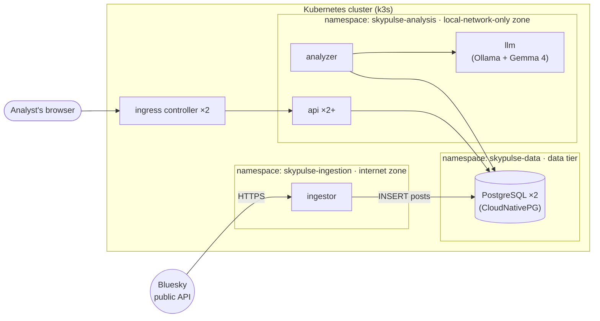

# k3s cluster: LLM sentiment analysis

**SkyPulse** lets analysts subscribe to Bluesky handles and hashtags and see an LLM-generated sentiment summary for each: how many posts it covers and when it was last updated. It runs entirely on-premises on a k3s cluster, with a local Gemma 4 model.

- **The problem:** [`PROBLEM.md`](PROBLEM.md): functional requirements, a security boundary between the internet and the analysts' network, high availability and continuous updates.
- **The solution:** [`skypulse/`](skypulse/): the code, images, Kubernetes manifests and Makefile. Build and run instructions are in [`skypulse/README.md`](skypulse/README.md), and the key decisions are in [`skypulse/DESIGN.md`](skypulse/DESIGN.md).

## Architecture



## Quick start

```bash
cd skypulse
make build     # install deps, run tests, build the images
make start     # create a 3-node cluster, deploy everything
# open http://localhost:8090
make verify    # prove the security boundary and HA setup
```

## How each requirement is met

| Requirement from the [brief](PROBLEM.md) | How it's solved |
|---|---|
| Subscribe/unsubscribe, sentiment summary, item count, last updated | FastAPI web app + ingestor + LLM analyzer, all Python/uv |
| Small local LLM | Ollama with Gemma 4 E2B baked into an image (no runtime downloads) |
| **Security**: ingestion may use the internet; analysis only the local network | Ingestion and analysis namespaces that only meet at a separate data namespace, default-deny NetworkPolicies, a least-privilege DB role per zone, restricted Pod Security |
| **High availability** | 2+ API replicas across nodes, PDBs, probes, 2-instance PostgreSQL with automatic failover, HA ingress |
| **Continuous updates** | Immutable image tags, rolling updates with `maxUnavailable: 0`, Kustomize overlays, GitOps-ready |
| Observability (beyond the brief) | Prometheus + Grafana dashboard fed by the database and the ingress controller, no app code |

## Documentation

| Document | What it is |
|---|---|
| [`PROBLEM.md`](PROBLEM.md) | The brief: functional, security and deployment requirements |
| [`skypulse/README.md`](skypulse/README.md) | Build, run, verify and troubleshoot |
| [`skypulse/DESIGN.md`](skypulse/DESIGN.md) | Key decisions, alternatives considered, open items |
| [`final_summary.md`](final_summary.md) | The whole solution in one read, namespace by namespace |
| [`project_explanation/`](project_explanation/) | Deep dive: build, platform, delivery, security boundary, runtime and code flow, with diagrams and an interactive map |

## Prerequisites

- A computer with **16 GB RAM** (8 GB works with the small model option) and about 25 GB of free disk space.
- Windows 10/11 (with WSL2), macOS or Linux. The tools (Docker, `kubectl`, k3d, uv, make) are listed in [`skypulse/README.md`](skypulse/README.md#prerequisites), and its setup script installs whatever is missing.

Diagrams in the Markdown files use [Mermaid](https://mermaid.js.org/), which GitHub renders natively.
