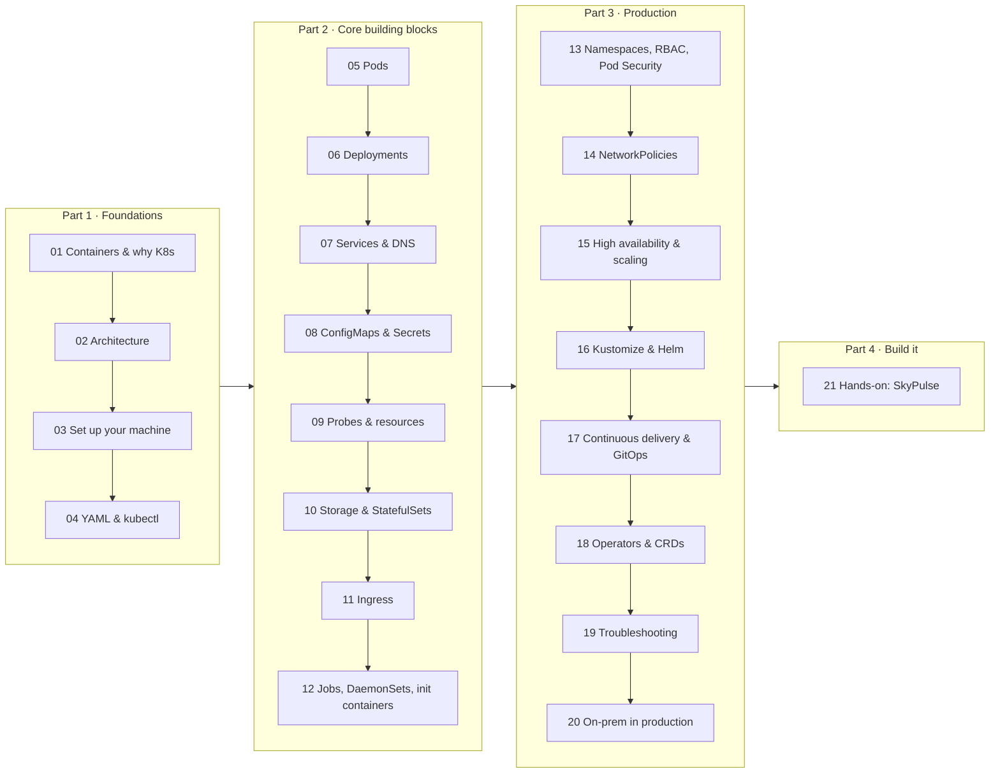

# Kubernetes: From Zero to Production


A hands-on guide that takes you from "what is a container?" to running a secure, highly available, continuously deployed system on your own Kubernetes cluster.

It has two halves that reinforce each other:

1. **The guide** ([`guide/`](guide/)): 20 short chapters, beginner to expert. Each chapter explains one idea, shows the YAML, and ends with something to try.
2. **The project** ([`skypulse/`](skypulse/)): a complete, working system that solves an on-premises feed analysis problem (see [`PROBLEM.md`](PROBLEM.md)). It uses almost every concept in the guide. [Chapter 21](guide/21-project-skypulse.md) walks you through building it step by step.

> **How to read this.** If you're new, go in order. Every chapter assumes only the ones before it. If you already know the basics, skim Part 1 and jump to whatever you need. Throughout, the 🔗 **In the project** boxes point to the exact file in `skypulse/` where a concept is used for real.

---

## The learning path



## Table of contents

| # | Chapter | Level | You will learn |
|---|---------|-------|----------------|
| 01 | [Containers and why Kubernetes exists](guide/01-containers-and-why-kubernetes.md) | 🟢 Beginner | Images, containers, the problems an orchestrator solves |
| 02 | [Kubernetes architecture](guide/02-architecture.md) | 🟢 Beginner | Control plane, nodes, the reconciliation loop |
| 03 | [Set up your machine and your first cluster](guide/03-setup-your-machine.md) | 🟢 Beginner | WSL2, Docker, kubectl, k3d, kind; create a 3-node cluster |
| 04 | [YAML and kubectl: talking to the cluster](guide/04-yaml-and-kubectl.md) | 🟢 Beginner | Anatomy of a manifest, labels, `apply`, `explain`, `describe` |
| 05 | [Pods](guide/05-pods.md) | 🟢 Beginner | The smallest deployable unit, multi-container pods |
| 06 | [Deployments and rolling updates](guide/06-deployments-and-rolling-updates.md) | 🟢 Beginner | ReplicaSets, scaling, zero-downtime updates, rollback |
| 07 | [Services and DNS](guide/07-services-and-dns.md) | 🟡 Intermediate | Stable networking, ClusterIP/NodePort/LoadBalancer, service discovery |
| 08 | [ConfigMaps and Secrets](guide/08-configmaps-and-secrets.md) | 🟡 Intermediate | Configuration and credentials without rebuilding images |
| 09 | [Health probes and resources](guide/09-health-probes-and-resources.md) | 🟡 Intermediate | Liveness/readiness/startup, requests/limits, QoS |
| 10 | [Storage and StatefulSets](guide/10-storage-and-statefulsets.md) | 🟡 Intermediate | Volumes, PV/PVC, StorageClasses, stateful apps |
| 11 | [Ingress](guide/11-ingress.md) | 🟡 Intermediate | HTTP routing into the cluster, TLS, ingress controllers |
| 12 | [Jobs, CronJobs, DaemonSets, init containers](guide/12-jobs-daemonsets-initcontainers.md) | 🟡 Intermediate | Batch work and node-level agents |
| 13 | [Namespaces, RBAC and Pod Security](guide/13-namespaces-rbac-security.md) | 🟠 Advanced | Multi-tenancy, permissions, hardened pods |
| 14 | [NetworkPolicies](guide/14-network-policies.md) | 🟠 Advanced | Firewalls between pods, zero-trust networking |
| 15 | [High availability and scaling](guide/15-high-availability-and-scaling.md) | 🟠 Advanced | Spreading, PodDisruptionBudgets, autoscaling, failure drills |
| 16 | [Packaging: Kustomize and Helm](guide/16-packaging-kustomize-helm.md) | 🟠 Advanced | One base, many environments; charts |
| 17 | [Continuous delivery and GitOps](guide/17-continuous-delivery-gitops.md) | 🟠 Advanced | Image tagging, pipelines, Argo CD, rollbacks |
| 18 | [Operators and Custom Resources](guide/18-operators-and-crds.md) | 🔴 Expert | Extending Kubernetes; running databases with an operator |
| 19 | [Troubleshooting](guide/19-troubleshooting.md) | 🔴 Expert | A systematic debugging method plus real war stories |
| 20 | [On-premises Kubernetes in production](guide/20-on-prem-production.md) | 🔴 Expert | Bare-metal clusters, load balancers, registries, air-gaps, backups, upgrades |
| 21 | [**Hands-on project: SkyPulse**](guide/21-project-skypulse.md) | 🛠️ Project | Build, deploy, secure, break and update a real system |
| ★ | [Cheat sheet](guide/cheatsheet.md) | Reference | Every command you'll keep coming back to |

## The project at a glance

**SkyPulse** lets analysts subscribe to Bluesky handles and hashtags and see an LLM-generated sentiment summary for each: how many posts it covers and when it was last updated. It runs entirely on-premises with a local Gemma 4 model.


```bash
cd skypulse
make build     # install deps, run tests, build the images
make start     # create a 3-node cluster, deploy everything
# open http://localhost:8090
make verify    # prove the security boundary and HA setup
```

What's in it, and where the guide covers it:

| Requirement from the [brief](PROBLEM.md) | How it's solved | Chapters |
|---|---|---|
| Subscribe/unsubscribe, sentiment summary, item count, last updated | FastAPI web app + ingestor + LLM analyzer, all Python/uv | 05–09, 12 |
| Small local LLM | Ollama with Gemma 4 E2B baked into an image (no runtime downloads) | 08, 21 |
| **Security**: ingestion may use the internet; analysis only the local network | Ingestion and analysis namespaces that only meet at a separate data namespace, default-deny NetworkPolicies, a least-privilege DB role per zone, restricted Pod Security | 13, 14 |
| **High availability** | 2+ API replicas across nodes, PDBs, probes, 2-instance PostgreSQL with automatic failover, HA ingress | 09, 15, 18 |
| **Continuous updates** | Immutable image tags, rolling updates with `maxUnavailable: 0`, Kustomize overlays, GitOps-ready | 06, 16, 17 |
| Observability (beyond the brief) | Prometheus + Grafana dashboard fed by the database and the ingress controller, no app code | 09, 18, 20 |

## More documentation

| Document | What it is |
|---|---|
| [`PROBLEM.md`](PROBLEM.md) | The brief: functional, security and deployment requirements |
| [`skypulse/DESIGN.md`](skypulse/DESIGN.md) | Key decisions, alternatives considered, open items |
| [`final_summary.md`](final_summary.md) | The whole project in one read, namespace by namespace |
| [`project_explanation/`](project_explanation/) | Deep dive: build, platform, delivery, security boundary, runtime and code flow, with diagrams and an interactive map |
| [`kubernetes_operations_handbook.md`](kubernetes_operations_handbook.md) | Operating Kubernetes on-prem: common errors, debugging, networking, air-gaps, incidents, flashcards |
| [`Kubernetes_YAML_Practical_Guide.md`](Kubernetes_YAML_Practical_Guide.md) | A practical guide to writing Kubernetes YAML |

## Prerequisites

- A computer with **16 GB RAM** (8 GB works with the small model option) and about 25 GB of free disk space.
- Windows 10/11 (with WSL2), macOS or Linux. [Chapter 03](guide/03-setup-your-machine.md) installs everything else.
- Basic command-line comfort. No prior Kubernetes or Docker knowledge needed.

## Viewing this guide

The chapters are plain Markdown with [Mermaid](https://mermaid.js.org/) diagrams. They render on GitHub/GitLab. In VS Code, install the *Markdown Preview Mermaid Support* extension and press `Ctrl+Shift+V`. A few images come from the official Kubernetes documentation (kubernetes.io, CC BY 4.0) and load from the internet.

## Further reading

- Official docs: <https://kubernetes.io/docs/home/> (the [Concepts](https://kubernetes.io/docs/concepts/) section is excellent)
- Interactive tutorial: <https://kubernetes.io/docs/tutorials/kubernetes-basics/>
- *Kubernetes the Hard Way* (build a cluster by hand): <https://github.com/kelseyhightower/kubernetes-the-hard-way>
- *Production Kubernetes* (O'Reilly) and *Kubernetes Patterns* (O'Reilly), for after this guide
