# SkyPulse, the final summary

One read, start to finish: what each namespace is for, the rules it follows, and what every component in it does. Each chapter has a simple diagram; where a detailed poster exists, it's linked underneath (all in [`project_explanation/diagrams/`](project_explanation/diagrams/README.md)).

---

## Contents

1. [The one idea](#1-the-one-idea)
2. [The map](#2-the-map)
3. [Rules every SkyPulse namespace follows](#3-rules-every-skypulse-namespace-follows)
4. [Getting in: from your browser to a pod](#4-getting-in-from-your-browser-to-a-pod)
5. [`kube-system`: the platform underneath](#5-kube-system-the-platform-underneath)
6. [`cnpg-system`: the database operator](#6-cnpg-system-the-database-operator)
7. [`skypulse-analysis`: api, analyzer, LLM](#7-skypulse-analysis-api-analyzer-llm)
8. [`skypulse-ingestion`: the only way out](#8-skypulse-ingestion-the-only-way-out)
9. [`skypulse-data`: where the zones meet](#9-skypulse-data-where-the-zones-meet)
10. [`skypulse-monitoring`: watching without touching](#10-skypulse-monitoring-watching-without-touching)
11. [The journey, end to end](#11-the-journey-end-to-end)
12. [When things break](#12-when-things-break)
13. [Build, deploy, deliver](#13-build-deploy-deliver)
14. [Honest limits](#14-honest-limits)
15. [Twelve lines to remember](#15-twelve-lines-to-remember)

---

## 1. The one idea

SkyPulse lets analysts subscribe to Bluesky `@handles` and `#hashtags` and see an LLM-written sentiment summary for each one. Everything runs on-premises on k3s, with a local model.

The whole design follows from one decision: **the components never call each other. They meet only in PostgreSQL.**

- The **api** writes subscriptions and reads summaries.
- The **ingestor** reads subscriptions and writes posts.
- The **analyzer** reads posts, asks the LLM, and writes sentiment and summaries.

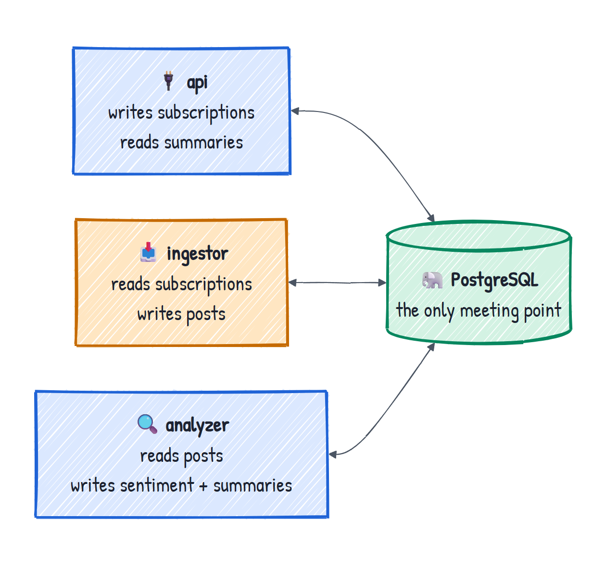

Each one works on its own schedule. Because of that, any of them can be down, slow or being upgraded, and the others keep going. Analysts always see the last known summaries. It also makes the security boundary simple: the zone that talks to the internet (ingestion) and the zone that runs the model (analysis) have no network path to each other at all.

---

## 2. The map

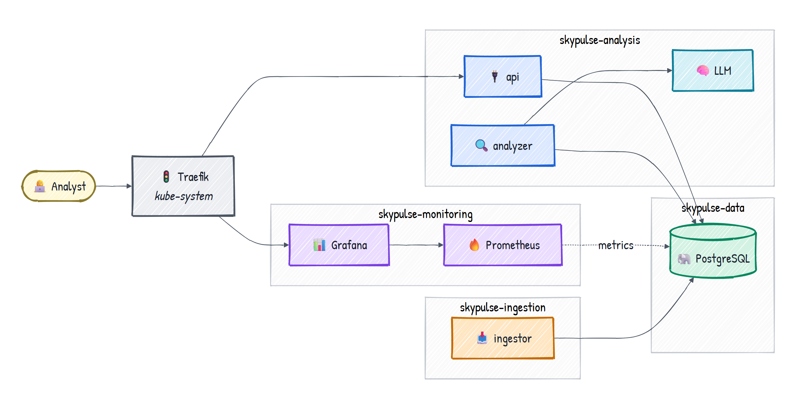

*Detailed poster: [Runtime topology, with every allowed connection](project_explanation/diagrams/04-runtime-topology.png)*

Six namespaces matter:

| Namespace | Owner | Purpose | Internet |
|---|---|---|---|
| `kube-system` | k3s | ingress, DNS, storage, load balancer, metrics | — |
| `cnpg-system` | upstream CNPG | the PostgreSQL operator | — |
| `skypulse-analysis` | SkyPulse | api, analyzer, LLM | **none** |
| `skypulse-ingestion` | SkyPulse | ingestor | **HTTPS to public IPs only** |
| `skypulse-data` | SkyPulse | PostgreSQL, migrate Job | none |
| `skypulse-monitoring` | SkyPulse | Prometheus, Grafana | none |

---

## 3. Rules every SkyPulse namespace follows

The four `skypulse-*` namespaces share a set of rules. The later chapters only describe what each zone adds on top.

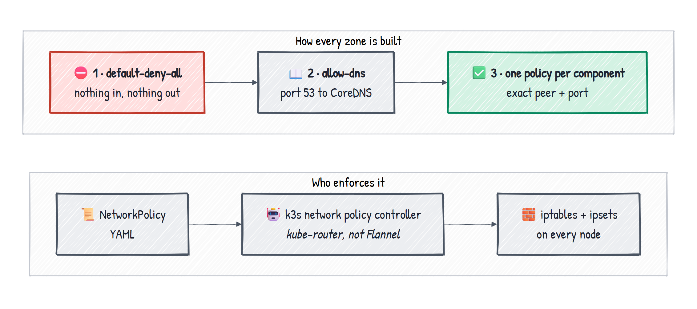

*Detailed poster: [Security boundary](project_explanation/diagrams/10-security-boundary.png)*

**Namespaces are the logical boundary.** They scope names, RBAC, Pod Security and Secrets, and they're what NetworkPolicies select on (`kubernetes.io/metadata.name`). On their own they don't isolate the network: by default, every pod can reach every other pod.

**NetworkPolicies are the network boundary.**
- Every zone starts with `default-deny-all` (ingress and egress, every pod), then `allow-dns` (UDP/TCP 53 to CoreDNS), then one policy per component that opens exactly the paths it needs.
- Rules match **namespace and pod label together**, plus a port. "The analyzer may reach Postgres on 5432", not "analysis may reach data".
- **Enforcement:** k3s's embedded **network policy controller** (from kube-router) turns the policies into iptables rules and ipsets on every node. Flannel, the CNI, moves packets but **doesn't enforce** policies. On another distribution, plain Flannel would accept these policies and enforce nothing.

**Pod Security Admission: `restricted`.** Each namespace has the `pod-security.kubernetes.io/enforce: restricted` label, so the API server **rejects** any pod that doesn't comply when it's created.

**Pod hardening, on every SkyPulse container:**
- `runAsNonRoot`, `seccompProfile: RuntimeDefault`
- `allowPrivilegeEscalation: false`, `capabilities: drop [ALL]`
- `readOnlyRootFilesystem: true`, with `emptyDir` mounted wherever a process must write (e.g. `/tmp`)
- `automountServiceAccountToken: false`, so no Kubernetes API token. **Prometheus is the only exception.**
- `enableServiceLinks: false`, so no `<SERVICE>_PORT` environment variables that could clash with app settings

**Database access per zone, not per pod.** Each zone logs in with its own least-privilege role (`ingestor`, `analysis`), with column-level `GRANT`s. The schema owner's credentials never leave `skypulse-data`.

**Config and secrets.** Non-secret settings live in `config.env` files that Kustomize turns into ConfigMaps with a **content hash in the name**, so changing a setting renames the ConfigMap and rolls the pods that use it. Passwords live only in Secrets.

**One honest limit:** this is software isolation on shared nodes and one kernel. It's strong, but it's not a physical separation (see chapter 14).

---

## 4. Getting in: from your browser to a pod

Analysts use `http://localhost:8090` (the app) and `http://grafana.localhost:8090` (dashboards). The request passes through five hops:

```
browser :8090
  → Docker port mapping           (host 8090 → container 80)
  → k3d load balancer (nginx) :80  spreads connections over the nodes
  → ServiceLB pod on a node :80    exposes the Traefik Service
  → Traefik pod                    applies the Ingress rule
  → api pod :8000                  reached directly by pod IP
```

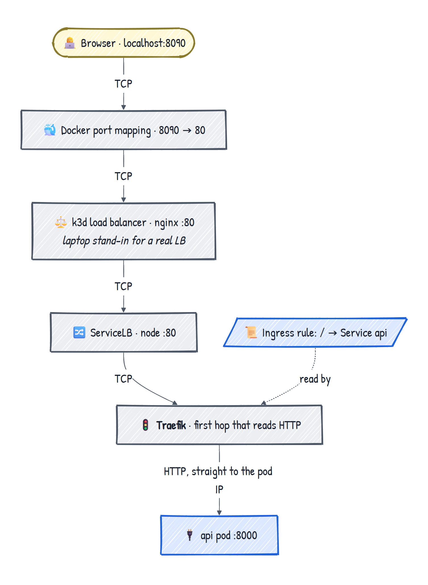

*Detailed poster: [The whole flow, from the browser and back](project_explanation/diagrams/12-request-flow.png)*

- **`cluster/k3d.yaml`** creates the local cluster, and is read once: `make start` runs `k3d cluster create --config ...` if the cluster doesn't exist. It sets up 1 server and 2 agents (3 nodes, so anti-affinity and node drains can be tested), a pinned k3s version, the `8090:80` mapping on the load balancer, and a private registry on `localhost:5050` that stands in for an on-prem one. It doesn't exist in production: there, k3s runs on real servers and only the manifests carry over.
- **The k3d load balancer** is a laptop stand-in for the external load balancer (HAProxy, F5, a keepalived VIP).
- **ServiceLB** (klipper-lb) is k3s's built-in implementation of `type: LoadBalancer`. It runs an `svclb-traefik` pod on every node that holds port 80.
- **Everything before Traefik is plain TCP.** Traefik is the first hop that reads HTTP.
- **Ingress ≠ ingress controller.** An Ingress is a rule stored in etcd (`/` → Service `api`). Traefik is the controller that watches those rules and does the proxying. Without a controller, an Ingress does nothing.
- **Traefik sends traffic to pod IPs directly**, using EndpointSlices rather than the Service's ClusterIP. That's why the api's NetworkPolicy allows traffic **from the Traefik pods**.

---

## 5. `kube-system`: the platform underneath

k3s is "batteries included": one install provides everything a bare Kubernetes would need you to add.

| Component | What it does for SkyPulse |
|---|---|
| **Traefik** | Ingress controller: the only way into the cluster over HTTP |
| **CoreDNS** | Resolves `feeddb-rw.skypulse-data.svc.cluster.local`, `llm`, etc. Every zone's `allow-dns` points here |
| **ServiceLB** | Exposes Traefik on port 80 of every node |
| **local-path provisioner** | Creates the PVCs for PostgreSQL and Prometheus on the node's disk |
| **metrics-server** | CPU usage for the api's HorizontalPodAutoscaler |
| **Network policy controller** | Enforces every NetworkPolicy (part of the k3s binary, not a pod) |

**`cluster/traefik-ha.yaml`** is the one change made here. k3s installs Traefik as a bundled Helm chart with **one** replica, and a `HelmChartConfig` overrides its values:
- `replicas: 2`, so one pod can crash,
- `topologySpreadConstraints` on hostname, so one node can die,
- a `PodDisruptionBudget` with `minAvailable: 1`, so a `kubectl drain` can't evict the last one.

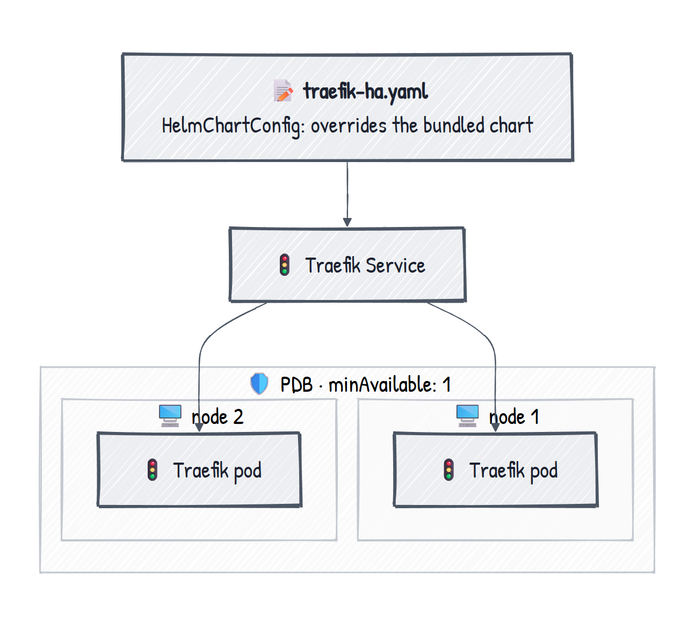

It was found in a drill: draining Traefik's node with one replica caused about 16 s of failed requests; with this file the same drill gave 59/59 successes. **The app is only as available as the weakest component on its request path, including the platform ones.**

---

## 6. `cnpg-system`: the database operator

**What it is.** CloudNativePG is a Kubernetes **operator**: a controller that holds a DBA's knowledge as code. It adds the `Cluster` custom resource and reconciles it continuously.

**Why it has its own namespace.**
- The upstream install manifest creates it (`make operator` applies the release YAML and waits for `cnpg-controller-manager`).
- It's **platform, not app**. It watches `Cluster` resources in *every* namespace, so a second team's database would use the same operator.
- It needs **broad cluster-wide permissions**. Keeping it apart keeps the most powerful component away from the most exposed ones.
- It has its **own lifecycle**: the operator and the app are upgraded independently.

**What it does with `postgres.yaml`.** From about 30 lines of `kind: Cluster` it creates:
- 2 instances (1 primary + 1 streaming replica) on **different nodes** (`podAntiAffinityType: required`),
- one PVC per instance,
- the Services `feeddb-rw` (always the primary), `feeddb-ro` and `feeddb-r`,
- TLS certificates,
- the database `skypulse` with owner `skypulse` and its Secret `feeddb-app`,
- the login roles `ingestor` and `analysis` (from `managed.roles`, with passwords from Secrets),
- the metrics exporter on :9187.

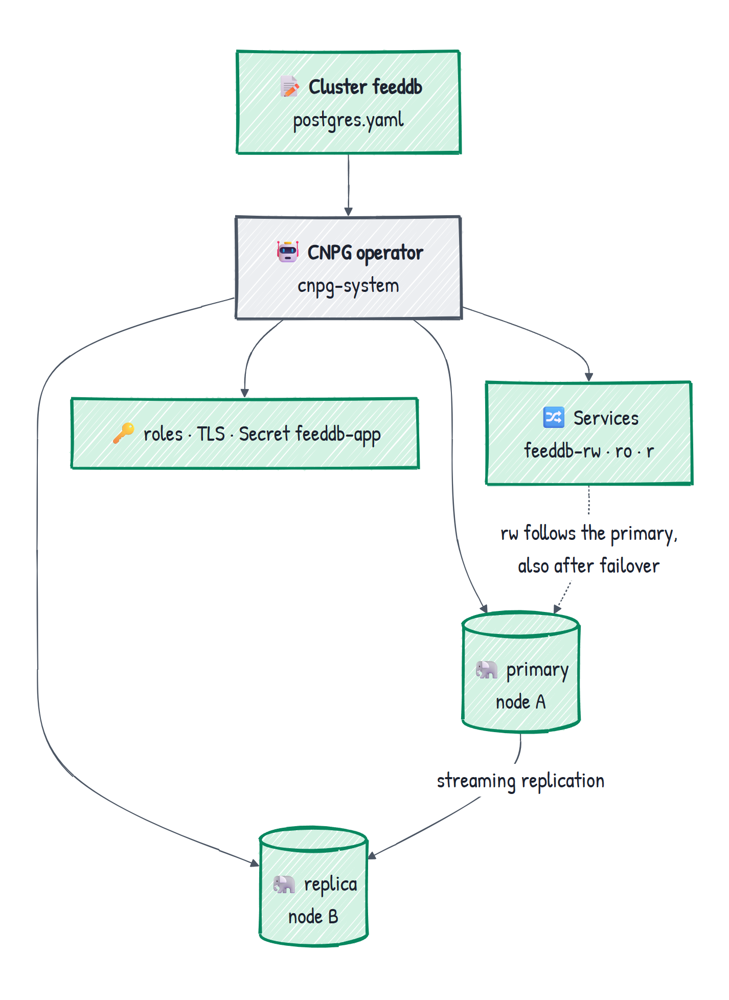

After that it **keeps reconciling**:
- **failover:** promotes the replica and moves `feeddb-rw` to it,
- **self-healing:** rebuilds a lost replica,
- **rolling upgrades:** replicas first, then a switchover,
- **drift:** puts back roles or Services deleted by hand.

**Why not a StatefulSet?** A StatefulSet doesn't know which pod is the primary. CNPG manages Pods and PVCs directly, because "who is primary, how far behind is replication, whom to promote" has to drive those decisions.

**The only path between the two namespaces** is a rule in the data NetworkPolicy allowing `cnpg-system` to reach ports 5432 and 8000 (instance status) for health checks. The operator reaches into the data zone, and nothing in the app reaches the operator.

---

## 7. `skypulse-analysis`: api, analyzer, LLM

**Role.** The zone analysts use and where the thinking happens. **No internet:** there are no `ipBlock` rules at all. It reaches Postgres and nothing outside the cluster.

**Its NetworkPolicies:**
- `api`: accepts traffic **only from Traefik** on :8000, and may reach only Postgres :5432.
- `analyzer`: `ingress: []` (nothing calls it); may reach Postgres :5432 and the LLM :11434.
- `llm`: accepts traffic only from the analyzer; `egress: []`, **no outbound traffic at all**.

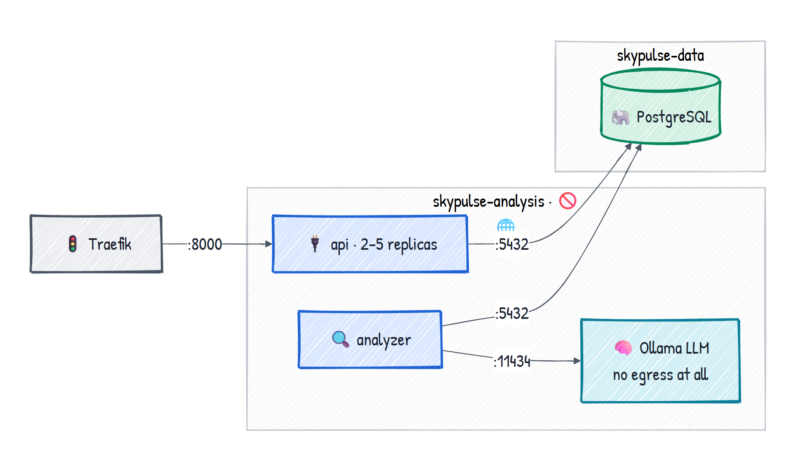

All three use the same login, `analysis`, with credentials from the `analysis-db-credentials` Secret.

### The api

`src/skypulse/api.py`, FastAPI. It serves the single-page UI (`static/index.html`) and three endpoints:

- `GET /api/subscriptions` reads `subscriptions LEFT JOIN summaries` and returns **precomputed** results.
- `POST /api/subscriptions` validates the input (`targets.py`: `#tag` or `@handle`, trimmed, lowercased; otherwise 422) and inserts one row (409 if it's already there). It returns `201` immediately.
- `DELETE /api/subscriptions/{id}` deletes the subscription; posts and the summary cascade.

**Precomputed summaries.** The api **never calls the LLM or Bluesky**. All slow work happens in the background, so a request costs one SQL query. The api keeps working while the LLM, the ingestor or the internet is down. The cost is freshness: a summary can be up to about 15 minutes old. The page refreshes itself every 10 s.

**High availability:**
- An HPA keeps 2 to 5 replicas at 70% CPU. The Deployment has no `replicas:` field, because the HPA owns that number.
- Topology spread puts replicas on different nodes, and a PDB with `minAvailable: 1` protects them during drains.
- **Probes:** `/healthz` (liveness: the process is alive) and `/readyz` (readiness: the database is reachable). A pod that can't reach the database stops getting traffic.
- **Connection pool** with `check=` on each connection: after a database failover, connections to the old primary are replaced silently.

### The analyzer

`src/skypulse/analyzer.py`. A **background worker, a plain `while True` loop**, with no HTTP port.

Each round:
1. **Classify** up to 10 posts. Claim the newest post where `analyzed_at IS NULL` with `FOR UPDATE SKIP LOCKED`, send its text to the LLM, validate the answer, and write `sentiment`, `score` and `analyzed_at`.
2. **Summarize** each stale subscription: missing summary, older than 15 min, or new analyzed posts since the last one. Take up to 50 posts from the last 7 days, ask the LLM for a two-sentence summary, compute the counts and the overall label in Python, and upsert into `summaries`.
3. **Clean up** once an hour: delete posts older than 14 days.
4. **Sleep 5 s only if the round found nothing to do.** A backlog drains back-to-back, and an idle queue costs one cheap query every 5 s.

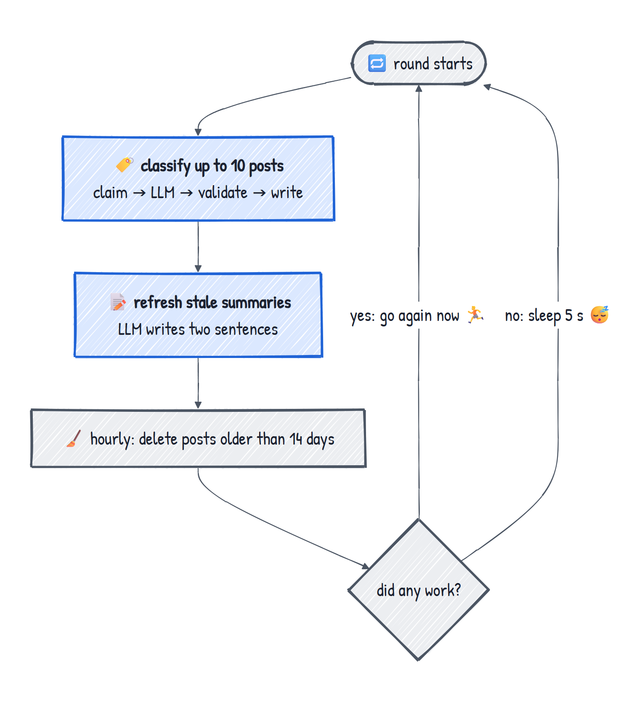

**The locks are what make it scale:**
- `FOR UPDATE SKIP LOCKED` locks the post row; other replicas **skip** it instead of waiting. The lock lives in Postgres, so it doesn't matter which nodes the replicas run on.
- `pg_try_advisory_xact_lock(42, sub_id)` stops two replicas from summarizing the same subscription.
- Both locks are **tied to the transaction**: if a pod dies mid-LLM-call, Postgres rolls back, the lock is released, and the post goes back into the queue. There's no "stuck in processing" state to clean up.
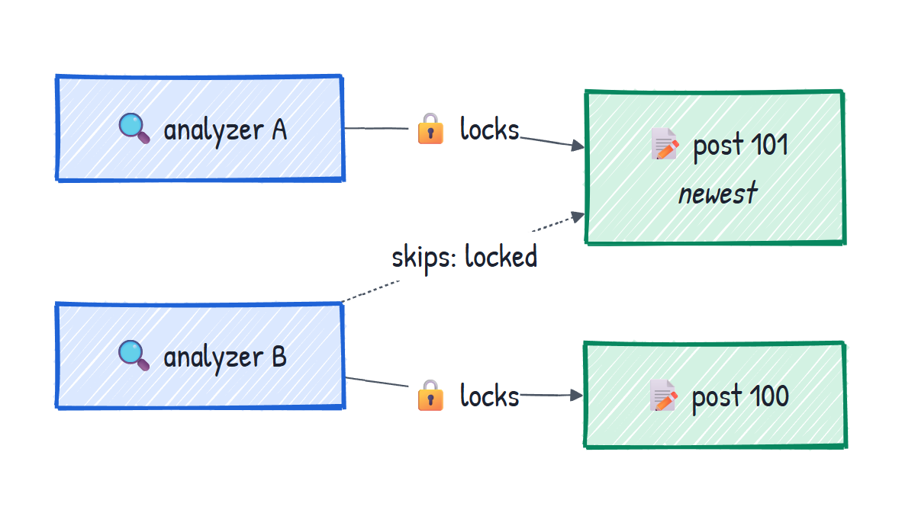

- **Trade-off:** the transaction stays open for the whole LLM call. That's fine with a few replicas; with dozens you'd switch to claim, commit, process, write, and add a timeout for dead workers.

**Who does the sentiment analysis?** The **LLM gives the judgement; the analyzer does the plumbing.** Its own logic is validation (`parse_classification`: clamp the score to [-1, 1], fix label/sign contradictions, fall back to a regex for non-JSON) and aggregation (`overall_label`: positive, negative, mixed or neutral from the scores).

**Liveness without HTTP:** each iteration touches `/tmp/heartbeat`, and the probe restarts the container if the file is older than 10 minutes, which catches a stuck loop.

**Failures it handles itself:**
- LLM down: roll back, wait 5 s, retry.
- Tables not there yet (first install): wait 5 s.
- Database connection lost: reconnect.

### The LLM (Ollama)

- Image `skypulse-llm`: Ollama with **`gemma4:e2b-it-qat`**, a small quantized model **built into the image** when it's made (`docker/llm.Dockerfile`). Nothing is downloaded at runtime.
- Called at `http://llm:11434/api/chat` with `temperature: 0` (same post, same answer) and, for classification, a **JSON schema** in `format` that forces valid structured output.
- `OLLAMA_NUM_PARALLEL=2`; requests 1 CPU / 3Gi, limit 8Gi. One replica locally, 2 in the production overlay.
- On CPU, classification takes about 1.5 s per post. **The LLM sets the throughput**: more analyzer replicas only help if the LLM can serve requests in parallel.

---

## 8. `skypulse-ingestion`: the only way out

**Role.** The only workload allowed to reach the internet, and the most likely to be compromised. So it gets the narrowest rights in the system.

**Its NetworkPolicies:**
- `ingress: []`: nothing can connect to it, from inside or outside.
- Egress to Postgres :5432.
- Egress to `0.0.0.0/0` on **TCP 443 only**, **except** `10/8`, `172.16/12`, `192.168/16`, `100.64/10` (CGNAT) and `169.254/16` (cloud metadata). A compromised ingestor can't scan the LAN.

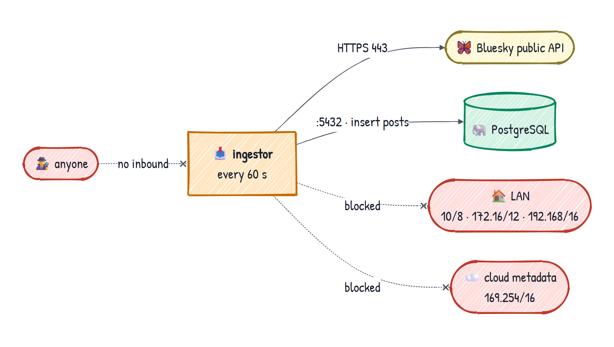

### The ingestor

`src/skypulse/ingestor.py` + `bluesky.py`. A loop that **every 60 s** (`POLL_INTERVAL_SECONDS`) does the following:
1. reads **all** subscriptions, so a new one is picked up on the next cycle,
2. calls the **public Bluesky API** (`api.bsky.app`): `getAuthorFeed` for a handle (no replies, no reposts) and `searchPosts` for a hashtag (latest first), up to 50 posts each,
3. inserts posts with `ON CONFLICT DO NOTHING` on `UNIQUE (subscription_id, uri)`, so overlapping polls add no duplicates. New posts start with `analyzed_at` NULL, which **puts them in the analyzer's queue**,
4. writes `last_polled_at` and `last_error` on the subscription, so "handle not found" appears on the analyst's card.

**Its DB role (`ingestor`)** may read only `id, kind, value` from subscriptions, update only `last_polled_at, last_error`, and **insert** posts. The worst a compromised ingestor can do is insert junk posts.

**Is it a DMZ? No.** A DMZ accepts **inbound** traffic from the internet behind physical firewalls. This zone accepts no inbound traffic, and it's separated by NetworkPolicies on shared nodes. For higher assurance, you'd move the ingestor to a separate cluster in a real DMZ and open one firewall rule to the database port. The code wouldn't change, because the zones only meet in Postgres.

---

## 9. `skypulse-data`: where the zones meet

**Role.** PostgreSQL and its migrations. The only place the ingestion and analysis zones meet. No internet.

**Its NetworkPolicies:** Postgres accepts 5432 only from:
- the ingestor, the api, the analyzer (namespace + pod must match),
- the migrate Job,
- its own instances (replication) and `cnpg-system` (5432, 8000),
- Prometheus, on **9187 only** (metrics, not SQL).

It may reach its peer instance and the Kubernetes API (for CNPG's instance manager), and nothing else.

### PostgreSQL (`feeddb`)

Covered in chapter 6. Apps connect to `feeddb-rw.skypulse-data.svc.cluster.local:5432` with `PGSSLMODE=require`.

**Four tables:**

| Table | What it holds |
|---|---|
| `subscriptions` | what to watch: `kind` (handle/hashtag), `value`, plus poll status. `UNIQUE (kind, value)` |
| `posts` | raw posts plus sentiment, and **the work queue** (`analyzed_at IS NULL`). `UNIQUE (subscription_id, uri)` |
| `summaries` | one precomputed row per subscription; the PK is also the FK, so the analyzer can upsert |
| `schema_migrations` | which migration versions have run |

Deleting a subscription cascades to its posts and its summary. A **partial index**, `posts_unanalyzed (posted_at DESC) WHERE analyzed_at IS NULL`, contains only the queue, so it stays small however many analyzed posts build up. That's what makes Postgres work well as a queue, with no Redis or Kafka.

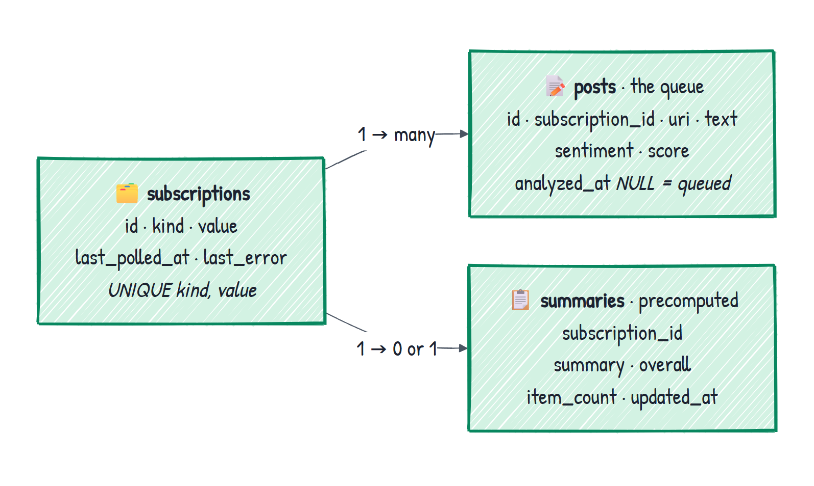

*Detailed poster: [Data model in UML](project_explanation/diagrams/13-data-model.png)* · *[Database](project_explanation/diagrams/08-database.png)*

**Roles:**

| Role | Created by | Used by | Rights |
|---|---|---|---|
| `skypulse` | CNPG `initdb` | migrate Job only | schema owner |
| `ingestor` | CNPG `managed.roles` | ingestor | read targets, update poll status, insert posts |
| `analysis` | CNPG `managed.roles` | api + analyzer | subscriptions, sentiment columns, summaries; no DDL |
| `pg_monitor` | built into Postgres | metrics exporter | timestamps and counters only, never post text |

Three parts work together to set this up:
1. `make secrets` generates the passwords into Secrets, in `skypulse-data` *and* the zone's namespace, because Secrets can't cross namespaces.
2. **CNPG** creates the login roles from those Secrets. At that point they can log in but can't touch any table.
3. **The migrate Job** creates the tables and then applies the column-level `GRANT`s.

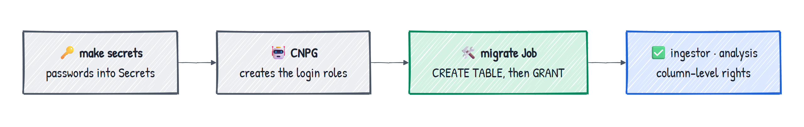

### The migrate Job

- **Defined in** `k8s/base/data/migrate.yaml`. **Runs** the same app image with `args: ["migrate"]`, which `__main__.py` sends to **`migrate()` in `db.py`**, where `MIGRATIONS` and the `GRANT`s live.
- It runs **in `skypulse-data`** because it needs the owner's Secret `feeddb-app`, which must never be copied into an app namespace.
- **It runs once per deploy, not once ever.** A Job's pod template can't be changed, so `make deploy` deletes the old Job, applies the new one, and **waits for it to complete**. Argo CD does the same through `hook: Sync` + `BeforeHookCreation`.
- **It's idempotent:**
  - `schema_migrations` skips versions that have already run,
  - `pg_advisory_lock` makes sure only one migrate process runs at a time,
  - re-applying the GRANTs is harmless and fixes drifted permissions.
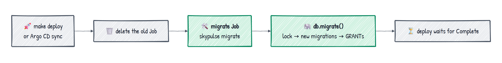

- `restartPolicy: OnFailure`, `backoffLimit: 10`: it retries while the database is still starting. Until it finishes, the workers see `UndefinedTable` and wait.

### Monitoring queries

`monitoring-queries.yaml` contains SQL that the CNPG exporter runs and publishes as Prometheus metrics: posts waiting, oldest waiting post, summary age, failing subscriptions. That's how the pipeline is monitored **without any instrumentation code in the app**.

---

## 10. `skypulse-monitoring`: watching without touching

**Role.** Metrics and dashboards. Not on the request path: if it goes down, analysts notice nothing and you lose a few minutes of graphs.

**The idea: no app instrumentation.** Prometheus never scrapes the api, the ingestor or the analyzer. The metrics come from two things that already exist:
- **Postgres** (:9187): database health plus the pipeline SQL from chapter 9.
- **Traefik** (:9100): request rate, 5xx errors and p95 latency for every analyst request, measured where users experience them.

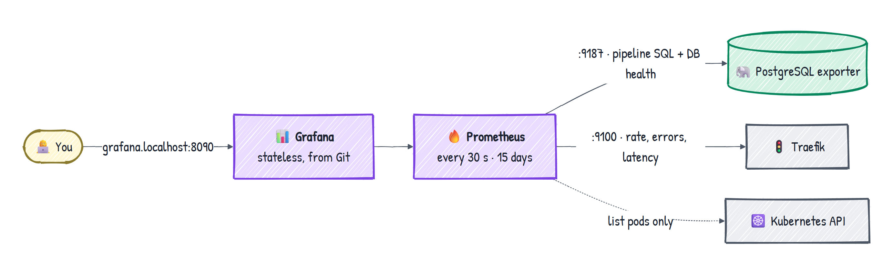

**Its NetworkPolicies:**
- Grafana accepts traffic only from Traefik (:3000) and may reach only Prometheus (:9090).
- Prometheus accepts traffic only from Grafana, and may reach Postgres **:9187 (not 5432)**, Traefik :9100, and the API server.
- No internet; the app zones can't reach it.

### Prometheus

- Scrapes every 30 s and keeps 15 days, capped at 1500MB on a 2Gi PVC.
- `replicas: 1`, `strategy: Recreate`, because a ReadWriteOnce volume can be mounted by only one pod.
- **Finds its targets** through the Kubernetes API (pods with a container port named `metrics`), so a replaced pod is picked up automatically.
- It's the **only SkyPulse pod with a ServiceAccount token**. Its Roles allow `get/list/watch` on **pods**, in **`skypulse-data` and `kube-system` only**.

### Grafana

- **Stateless:** the data source and the "SkyPulse" dashboard are provisioned from files in Git (`config/`). A restart gives the same result, and dashboard changes go through Git like code.
- Reached at `grafana.localhost:8090` through its own Ingress (Traefik routes by hostname).
- Anonymous read-only Viewer: fine on a laptop. In production it would sit behind SSO.

**Gaps:** no alerting (no rules, no Alertmanager), no logs (Loki), no long-term storage.

*Detailed poster: [Day 2: delivery and monitoring](project_explanation/diagrams/11-delivery-and-monitoring.png)*

---

## 11. The journey, end to end

1. **Request in.** Browser `:8090` → k3d LB → ServiceLB → Traefik (Ingress rule) → api pod.
2. **Subscribe.** `POST /api/subscriptions` → the api inserts one row as `analysis` → `201`. Nothing else happens during the request.
3. **Ingest.** Within 60 s the ingestor sees the subscription, fetches up to 50 posts over HTTPS, and inserts them with deduplication, unanalyzed.
4. **Analyze.** The analyzer claims each post (`SKIP LOCKED`), the LLM classifies it, the analyzer validates and writes `sentiment`, `score`, `analyzed_at`.
5. **Summarize.** The analyzer builds the subscription's summary with the LLM and upserts it.
6. **Result out.** The page's 10 s refresh → `GET /api/subscriptions` → `subscriptions LEFT JOIN summaries` → cards.

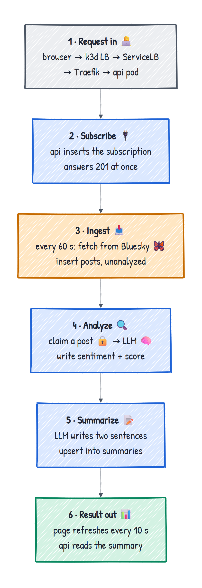

*Detailed posters: [Journey 1](project_explanation/diagrams/06-journey-subscribe-and-ingest.png) · [Journey 2](project_explanation/diagrams/07-journey-analyze-and-read.png)*

**Latency for a new subscription:** up to 60 s for the ingest poll, up to about 5 s for the analyzer to notice, about 1.5 s of LLM time per post, then the summary call. Most of the wait is the poll interval.

---

## 12. When things break

| What breaks | What happens |
|---|---|
| Bluesky down / handle doesn't exist | stored in `last_error` and shown on the card; other subscriptions keep polling |
| LLM down | analyzer rolls back and retries every 5 s; posts queue up; analysts still see the last summaries |
| One post the LLM rejects | marked neutral so it can't block the queue |
| Postgres primary dies | CNPG promotes the replica, `feeddb-rw` follows; workers reconnect, the api pool replaces stale connections |
| First install, no tables yet | workers wait; api pods stay unready until the migrate Job completes |
| A worker loop hangs | heartbeat older than 10 min → liveness probe restarts it |
| A node is drained | PDBs keep at least one api and one Traefik pod running; replicas are on different nodes |
| Two analyzer replicas | `SKIP LOCKED` and advisory locks: no double work |

*Detailed poster: [Loops and resilience](project_explanation/diagrams/09-loops-and-resilience.png)*

---

## 13. Build, deploy, deliver

*Detailed poster: [Build](project_explanation/diagrams/02-build.png)*

**One image, four roles.** `docker/app.Dockerfile` builds `skypulse-app` with `uv sync --locked`, and only the virtualenv goes into the runtime image. `ENTRYPOINT ["skypulse"]` + `args` chooses the role: `api | ingestor | analyzer | migrate`. The code lives in `src/skypulse/` (the src layout). `from skypulse.config import settings` is `src/skypulse/config.py`, installed into the venv as a package.

**Tests** (`make build` runs them before building images; pure, with no network, database or LLM):
- `test_bluesky.py`: parsing Bluesky JSON into posts (reposts and empty posts dropped, timezone-aware timestamps).
- `test_llm.py`: cleaning up LLM output (clamping, contradictions, fallbacks) and the overall label.
- `test_targets.py`: validating and normalizing `@handle` / `#hashtag` input.

Everything inside the running cluster (network boundary, DB rights, HA) is checked by **`make verify`** (`scripts/verify.sh`), from inside the pods.

**Kustomize.** `k8s/base` describes the whole system once. `overlays/local` and `overlays/production` change only what differs: registry and tags, replicas (3 Postgres instances, 2 LLMs, more api), volume sizes, hostname and TLS.

**Locally:** `make start` = cluster → operator → secrets → push → deploy (with the migrate Job). `make update` rebuilds and rolls out.

**Production path: Argo CD (`deploy/argocd/application.yaml`).** It's a design in this repo: nothing installs Argo CD, and the repo URL is a placeholder.
- An `Application` points at `k8s/overlays/production` in Git.
- Argo CD runs **inside** the cluster and **pulls** from Git (every 3 min, or when a webhook says "check now"). It renders the desired state, compares it with the live state, and syncs the difference.
- `prune` deletes what was removed from Git; `selfHeal` reverts manual `kubectl` changes.
- **It reacts to Git and to drift, not to the registry.** A new image goes live only when CI commits its tag to the overlay. Rollback = `git revert`.
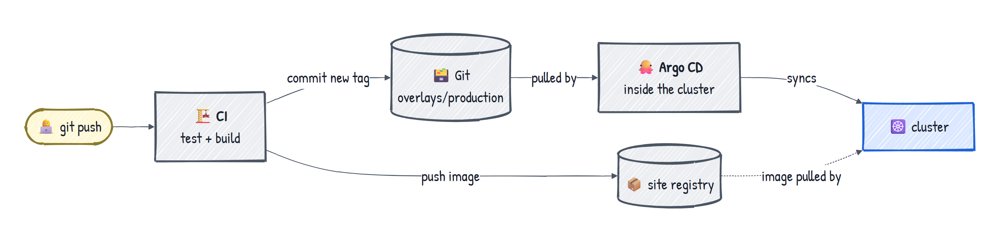

- **Pull-based** means CI needs no cluster credentials and the cluster needs no inbound access, which suits air-gapped sites.

---

## 14. Honest limits

Say these before someone else does:

1. **One cluster, software isolation.** All zones share nodes, a kernel and a control plane. For higher assurance, put ingestion in a separate cluster or DMZ, with one firewall rule to the database port.
2. **No database backups.** The replica protects against losing a node, not against `DROP TABLE` or corruption. Add `barmanObjectStore` for WAL archiving and point-in-time recovery.
3. **Secrets in plain files and base64 Secrets.** In production: Sealed Secrets or External Secrets/Vault, and encryption at rest.
4. **DNS is a possible exfiltration channel.** Analysis pods can *resolve* external names even though they can't connect.
5. **Single control-plane server locally.** Production: 3 servers with embedded etcd.
6. **No alerting.** Dashboards only.
7. **Small model.** Gemma 2B on CPU misses sarcasm and context. Evaluate it against a labelled sample before trusting the numbers.
8. **Polling, not streaming.** Up to 60 s ingest delay; the analyzer polls every 5 s when idle (`LISTEN/NOTIFY` would be the upgrade).
9. **Long transactions per LLM call.** Fine at this scale; switch to claim-and-commit for many workers.

---

## 15. Twelve lines to remember

1. Components never call each other; **Postgres is the only meeting point**.
2. Namespaces are the logical boundary; **NetworkPolicies** (enforced by k3s's kube-router controller, not Flannel) are the network boundary; **PSA `restricted`** controls what may run.
3. Every zone: default deny, allow DNS, then one narrow path per component.
4. **Ingress is a rule; Traefik is the controller.** Browser → k3d LB → ServiceLB → Traefik → pod.
5. Traefik ×2, spread across nodes, with a PDB: a drain went from 16 s of errors to zero.
6. **CNPG** turns a `Cluster` resource into a primary/replica Postgres and keeps it that way, including failover.
7. The api only reads **precomputed** summaries, so it's fast and stays up while the LLM is down.
8. The analyzer is a loop; **`FOR UPDATE SKIP LOCKED`** + advisory locks let replicas share the queue, and crashes roll back for free.
9. **The LLM judges, the analyzer validates**; temperature 0 + a JSON schema make the output usable.
10. The ingestor is the only way out: **443 to public IPs, no inbound**, and a DB role that can basically only insert posts.
11. Roles: **CNPG creates the logins, the migrate Job grants the rights**, and it runs once per deploy, idempotently.
12. Monitoring needs **no app instrumentation**: pipeline health from SQL in Postgres, API health from Traefik.
