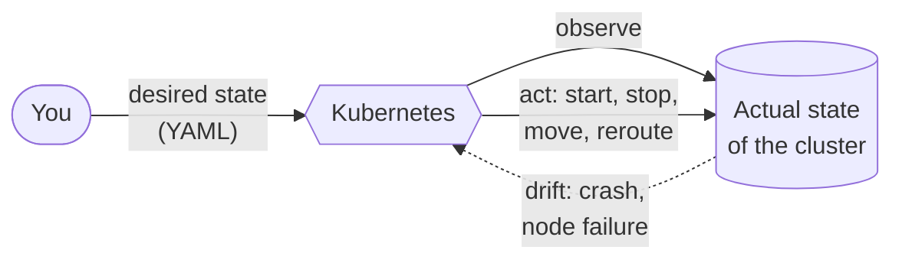

# 01 · Containers and why Kubernetes exists

🟢 Beginner · ⏱️ 20 min · [← Home](../README.md) · [Next: Architecture →](02-architecture.md)

## The problem: "it works on my machine"

Your Python app needs Python 3.12, a few libraries at specific versions, some environment variables, and a writable `/tmp`. On your laptop that's all true. On the server it's Python 3.9 and the wrong `psycopg`. On your colleague's Mac it's a different OpenSSL.

**A container packages an application together with everything it needs to run**: the runtime, the libraries, the files. The result runs identically everywhere a container runtime exists.


*Source: kubernetes.io. Traditional deployment shares one OS between apps (conflicts). VMs each carry a full OS (heavy). Containers share the host kernel but stay isolated from each other (light).*

## Images and containers

| Term | Analogy | What it is |
|---|---|---|
| **Image** | A class, or a recipe | A read-only, layered filesystem plus metadata (which command to run, which port, which user). Built once, stored in a **registry**. |
| **Container** | An object, or the cooked dish | A running *instance* of an image: a process with its own isolated filesystem, network and process tree. |
| **Registry** | An app store | A server that stores images: Docker Hub, GitHub's `ghcr.io`, or a private one like Harbor. |
| **Tag** | A version label | `python:3.12-slim`, `myapp:1.4.2`. Tags are mutable pointers; a **digest** (`@sha256:…`) is immutable. |

An image is described by a **Dockerfile**:

```dockerfile
FROM python:3.12-slim          # start from an existing image (the "base")
WORKDIR /app                   # cd /app (created if missing)
COPY requirements.txt .        # copy files from your machine into the image
RUN pip install -r requirements.txt   # run a command at BUILD time; result becomes a layer
COPY . .
USER 10001                     # don't run as root
EXPOSE 8000                    # documentation: the app listens here
CMD ["python", "app.py"]       # what runs when a container starts
```

```bash
docker build -t myapp:1.0 .          # build an image from the Dockerfile in "."
docker run -p 8000:8000 myapp:1.0    # start a container, map host port 8000 -> container 8000
docker ps                            # list running containers
docker push registry.example.com/myapp:1.0   # upload to a registry
```

**Layers and caching.** Each instruction creates a layer, and Docker reuses unchanged layers from cache. That's why you copy the dependency list and install dependencies *before* copying your source code. Editing code then doesn't reinstall every library.

> 🔗 **In the project:** [`skypulse/docker/app.Dockerfile`](../skypulse/docker/app.Dockerfile) is a *multi-stage* build. Stage 1 uses `uv` to build a virtualenv; stage 2 copies only that virtualenv into a slim image and runs as a non-root user. The final image has no compilers, no caches and no `uv`.

### How isolation works (one level deeper)

A container is not a VM. It's a normal Linux process that the kernel restricts with:

- **namespaces**: what the process can *see* (its own PIDs, network interfaces, mounts, hostname)
- **cgroups**: what it can *use* (CPU, memory, I/O limits)
- **capabilities, seccomp, AppArmor/SELinux**: what it's *allowed to do* (system calls, privileged operations)

On Windows and macOS, Docker Desktop runs a small Linux VM, and your containers live inside it.

## Why containers alone aren't enough

Containers solve packaging. Running them in production raises new questions:

- I have 3 servers. **Which one** should run each container?
- A container crashed at 3 a.m. **Who restarts it?**
- A server died. **Who moves its containers** elsewhere?
- I have 4 copies of my API. **How do clients find them**, and how is traffic **load-balanced**?
- How do I **update** to v2 without downtime, and **roll back** if v2 is broken?
- Where do **passwords and configuration** go?
- Traffic doubled. **Who adds copies**?
- How do I stop container A from **talking to** database B?

Doing all this by hand (or with shell scripts) doesn't scale. You need an **orchestrator**.

## Enter Kubernetes

**Kubernetes** (Greek for "helmsman"; "K8s" for the 8 letters between K and s) is an open-source container orchestrator. Google created it from its experience with its internal system *Borg* and donated it to the Cloud Native Computing Foundation (CNCF) in 2015.

The core idea, and the most important sentence in this guide:

> **You tell Kubernetes *what you want* (the desired state). Kubernetes continuously works to make reality match it.**

You don't say "start 3 containers on server B". You say "I want 3 replicas of this image, each with 256 MiB of memory, reachable under the name `api`". Kubernetes decides where they run, restarts them when they crash, replaces them when a server dies, and routes traffic to the healthy ones. This is **declarative** configuration, and you express it in YAML files (Chapter 04).



### What Kubernetes gives you

| Capability | Kubernetes feature | Chapter |
|---|---|---|
| Run N copies, restart on crash | Deployment, ReplicaSet | 06 |
| Stable name + load balancing | Service, DNS | 07 |
| Config and secrets | ConfigMap, Secret | 08 |
| Know if an app is healthy | Probes | 09 |
| Persistent data | PersistentVolume, StatefulSet | 10 |
| HTTP routing from outside | Ingress | 11 |
| Batch jobs | Job, CronJob | 12 |
| Isolation and permissions | Namespace, RBAC, Pod Security | 13 |
| Firewalls between apps | NetworkPolicy | 14 |
| Survive failures, autoscale | PDB, spreading, HPA | 15 |
| Zero-downtime updates | Rolling updates | 06, 17 |
| Extend with your own concepts | CRDs and Operators | 18 |

### What Kubernetes is *not*

- It is not a PaaS. It doesn't build your code, provide a database, or ship logs. It gives you the building blocks and the ecosystem fills the gaps.
- It is not always the right tool. For one container on one machine, `docker compose` is simpler. Kubernetes pays off when you need high availability, multiple services, multiple machines or many teams.
- It is not one product. There are many **distributions**: upstream (kubeadm), lightweight ones (**k3s**, k0s, MicroK8s), managed cloud offerings (EKS, GKE, AKS) and enterprise platforms (OpenShift, Rancher RKE2). They all pass the same conformance tests, so your YAML works on any of them.

## Try it

You don't need Kubernetes yet. Get comfortable with containers first (install Docker as described in [Chapter 03](03-setup-your-machine.md)):

```bash
docker run --rm hello-world
docker run --rm -it python:3.12-slim python -c "import sys; print(sys.version)"
docker run -d --name web -p 8081:80 nginx      # visit http://localhost:8081
docker logs web
docker rm -f web
```

## Key takeaways

- An **image** is a packaged app; a **container** is a running image.
- Containers solve *packaging*; **Kubernetes** solves *running many containers reliably on many machines*.
- Kubernetes is **declarative**: you describe the desired state and controllers keep reality in line with it, forever.

[Next: Kubernetes architecture →](02-architecture.md)
