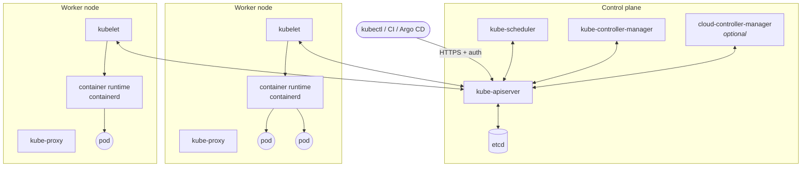
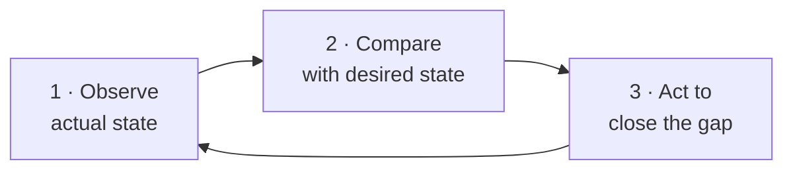
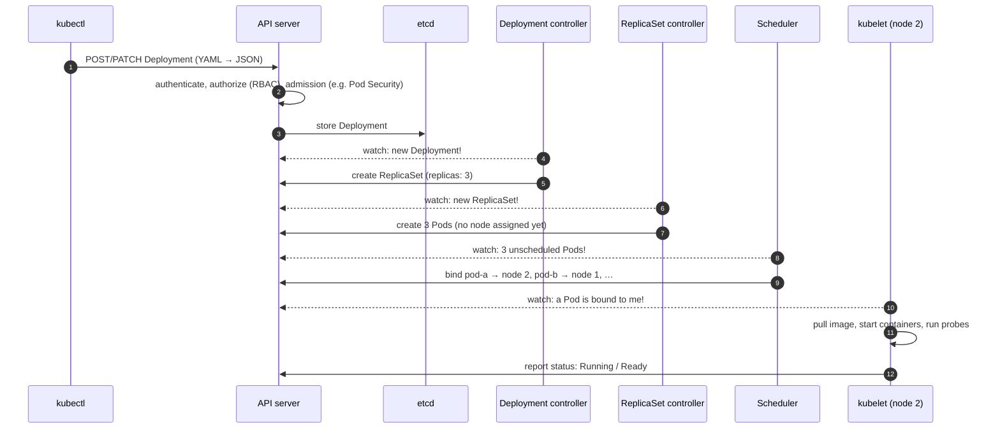

# 02 · Kubernetes architecture

🟢 Beginner · ⏱️ 25 min · [← Previous](01-containers-and-why-kubernetes.md) · [Home](../README.md) · [Next: Set up your machine →](03-setup-your-machine.md)

## The big picture

A Kubernetes **cluster** is a set of machines (**nodes**) split into two roles:

- the **control plane**, the brain: it stores the desired state and makes decisions
- the **worker nodes**, the muscle: they run your containers


*Source: kubernetes.io. Control plane on the left; nodes running kubelet and kube-proxy on the right.*



## Control plane components

| Component | Role | Analogy |
|---|---|---|
| **kube-apiserver** | The *only* entry point. Every client (kubectl, kubelets, controllers) talks to it over HTTPS/REST. It authenticates, authorizes (RBAC), validates and stores objects. | The front desk |
| **etcd** | A distributed, strongly consistent key-value store. It holds **all** cluster state. Lose etcd without a backup and you lose the cluster. | The ledger |
| **kube-scheduler** | Watches for pods that have no node yet and picks the best node, based on resource requests, affinity rules, taints and spreading. | The seating host |
| **kube-controller-manager** | Runs dozens of **controllers**, each a loop that reconciles one kind of object (Deployments, ReplicaSets, Nodes, Jobs, endpoints…). | The managers |
| **cloud-controller-manager** | Talks to a cloud provider (creates load balancers, attaches disks). Absent or replaced on bare metal. | The facilities team |

## Node components

| Component | Role |
|---|---|
| **kubelet** | An agent on every node. It receives pod specs from the API server and makes sure those containers run and stay healthy (it executes the **probes**). It reports status back. |
| **container runtime** | Actually runs containers via the Container Runtime Interface (CRI). Usually **containerd** or CRI-O. (Docker images run fine; "dockershim" was removed in 1.24, but images are an OCI standard.) |
| **kube-proxy** | Implements **Services**. It programs iptables/IPVS/nftables rules so that traffic to a Service IP reaches a healthy pod. Some network plugins (Cilium) replace it. |
| **CNI plugin** | Gives each pod an IP and connects pods across nodes (Flannel, Calico, Cilium…). It's also what enforces **NetworkPolicies**, if it supports them. |

## The reconciliation loop: how Kubernetes "thinks"

Every controller runs the same loop forever:



Nothing in Kubernetes is a one-shot command. When you "create a Deployment with 3 replicas", you write a record into etcd that says *there should be 3*. Controllers notice the record and make it true. If a pod dies an hour later, the same loop notices *2 ≠ 3* and creates another. This is called **self-healing**, and it falls out of the design for free.

## What happens when you run `kubectl apply -f deployment.yaml`



Notice that **no component talks to another directly**. Everything goes through the API server, and components *watch* for changes. This loose coupling is why Kubernetes is so extensible: you can add your own controllers (Chapter 18) that work exactly like the built-in ones.

## Objects: the nouns of Kubernetes

Everything you manage is an **object** (also called a *resource*) stored in the API: Pods, Deployments, Services, ConfigMaps, Nodes, Namespaces… Each object has:

- **`spec`**: what *you* want (desired state)
- **`status`**: what *Kubernetes* observed (actual state), written by controllers

```bash
kubectl api-resources        # list every object kind the cluster knows
```

## High availability of the control plane

In production the control plane itself must survive failures. That means **3 (or 5) control-plane nodes**, so etcd can keep a *quorum* (a majority) when one fails. Notice that 2 nodes are no better than 1: if either fails, the survivor has no majority. Workers can be added freely. See [Chapter 20](20-on-prem-production.md).

> 🔗 **In the project:** the local cluster in [`skypulse/cluster/k3d.yaml`](../skypulse/cluster/k3d.yaml) has 1 server (control plane) and 2 agents (workers). k3s bundles the control-plane components into one binary and uses SQLite instead of etcd when there's a single server. The same YAML would work on a 3-server k3s with embedded etcd.

## Key takeaways

- **Control plane** = API server + etcd + scheduler + controllers. **Nodes** = kubelet + container runtime + kube-proxy + CNI.
- Everything goes **through the API server**; components **watch** and **reconcile**.
- You declare `spec`; controllers fill in `status` and keep the two in line.

[Next: Set up your machine and your first cluster →](03-setup-your-machine.md)
