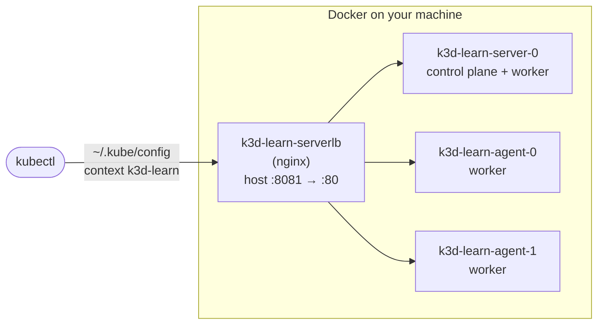

# 03 · Set up your machine and your first cluster

🟢 Beginner · ⏱️ 45 min · [← Previous](02-architecture.md) · [Home](../README.md) · [Next: YAML and kubectl →](04-yaml-and-kubectl.md)

By the end of this chapter you'll have a 3-node Kubernetes cluster running on your laptop and you'll have deployed something to it.

## What we install and why

| Tool | What it does | Needed for |
|---|---|---|
| **Docker** | Builds images and runs containers. Our local cluster's nodes are Docker containers. | Everything |
| **kubectl** | *The* Kubernetes command-line client. It talks to the API server. | Everything |
| **k3d** | Creates k3s clusters where every node is a Docker container. Multi-node in seconds. | Local cluster |
| **uv** | Fast Python package and project manager (installs Python too). | The project |
| **make** | Runs the project's `make build` / `make start` recipes. | The project |
| *Optional:* **helm**, **k9s** | Package manager for Kubernetes; a terminal UI for clusters. | Chapters 16, 19 |

## Step 1 · Platform-specific prerequisites

### Windows 10/11: use WSL2

Kubernetes tooling, Makefiles and shell scripts are Linux-first. On Windows the smoothest path is **WSL2** (Windows Subsystem for Linux), which gives you a real Ubuntu terminal.

```powershell
# PowerShell as Administrator
wsl --install -d Ubuntu      # reboot when asked, then create your Linux user
```

Then install **Docker Desktop** from <https://www.docker.com/products/docker-desktop/>. In *Settings → Resources → WSL integration*, enable integration with your Ubuntu distro. In *Settings → Resources*, give it **at least 8 GB of memory** (12+ GB recommended for the project's LLM).

**Run all following commands inside the Ubuntu terminal**, and keep your projects in the Linux filesystem (`~/projects/...`), not under `/mnt/c/...`, which is much slower.

> If you really want to stay in native Windows, use **Git Bash** as your shell and install the tools with [Chocolatey](https://chocolatey.org): `choco install kubernetes-cli k3d make`, plus uv via `powershell -c "irm https://astral.sh/uv/install.ps1 | iex"`. The project was tested this way too, but WSL2 has fewer surprises (line endings, paths with spaces, `.exe` suffixes).

### macOS

```bash
# Install Homebrew first if needed: https://brew.sh
brew install --cask docker      # Docker Desktop; start it once from Applications
brew install kubectl k3d uv make
```

In Docker Desktop → *Settings → Resources*, allow **8 GB+ memory**.

### Linux (Ubuntu/Debian)

```bash
curl -fsSL https://get.docker.com | sh      # Docker Engine
sudo usermod -aG docker $USER && newgrp docker   # run docker without sudo
sudo apt-get install -y make
```

## Step 2 · Install the CLIs (Linux / WSL2)

```bash
# kubectl: https://kubernetes.io/docs/tasks/tools/
curl -LO "https://dl.k8s.io/release/$(curl -Ls https://dl.k8s.io/release/stable.txt)/bin/linux/amd64/kubectl"
sudo install -m 0755 kubectl /usr/local/bin/kubectl && rm kubectl

# k3d: https://k3d.io
curl -s https://raw.githubusercontent.com/k3d-io/k3d/main/install.sh | bash

# uv: https://docs.astral.sh/uv/
curl -LsSf https://astral.sh/uv/install.sh | sh

# optional extras
curl -fsSL https://raw.githubusercontent.com/helm/helm/main/scripts/get-helm-3 | bash
curl -sS https://webi.sh/k9s | sh
```

Verify:

```bash
docker version && kubectl version --client && k3d version && uv --version && make --version
```

## Step 3 · Choose a local cluster tool

| Tool | How it works | Multi-node | NetworkPolicy out of the box | Best for |
|---|---|---|---|---|
| **k3d** ⭐ | k3s in Docker containers | ✅ seconds | ✅ (k3s embeds a policy controller) | This guide. Closest to an on-prem k3s production cluster |
| **kind** | Upstream Kubernetes in Docker | ✅ | ✅ in recent versions (kindnet) | Testing Kubernetes itself, CI pipelines |
| **minikube** | VM or container, many drivers | ⚠️ possible | ⚠️ needs a CNI addon (Calico) | Addons, GPU experiments |
| **Docker Desktop Kubernetes** | One-click in Docker Desktop | ⚠️ (kind-based mode) | ❌ | Quick single-node tests |

We use **k3d** because the project targets **on-premises** servers. [k3s](https://k3s.io) is a lightweight, CNCF-certified distribution that's popular on bare metal and at the edge, and k3d runs that same k3s on your laptop. What you test locally is what you'd run for real.

### "Is k3d *real* Kubernetes? Will what I learn transfer?"

Yes. **k3s** is a full Kubernetes distribution: it passes the same conformance tests as GKE, EKS, AKS or a cluster built with kubeadm. **k3d** is only a launcher that runs k3s "nodes" as Docker containers. It changes *where* nodes live, not how Kubernetes behaves.

**Identical everywhere:** the API and every object (Pods, Deployments, Services, Ingress, NetworkPolicy, RBAC, HPA, PDB, CRDs…), every YAML file in this guide, `kubectl`/Kustomize/Helm/Argo CD, and how the scheduler, kubelet and rolling updates work.

**Different: what comes pre-installed.**

| | k3s / k3d | "Bare" Kubernetes (kubeadm) / cloud |
|---|---|---|
| Control plane | One binary (apiserver, scheduler… inside) | Separate processes/pods you can see in `kube-system` |
| Cluster database | SQLite (single server) or embedded etcd (HA) | etcd |
| Network plugin (CNI) | Flannel + built-in NetworkPolicy enforcement | You install one (Calico, Cilium…) |
| Ingress controller | **Traefik**, pre-installed | You install one (ingress-nginx, Traefik…) or the cloud's |
| Storage | `local-path` provisioner | Cloud disks, Ceph, Longhorn… |
| `LoadBalancer` Services | ServiceLB (built in) | Cloud load balancer, or MetalLB on-prem |

So k3s hands you working defaults for things you'd otherwise install yourself. [Chapter 20](20-on-prem-production.md) shows what you'd set up on real servers. Remember too that k3d's "nodes" share one machine: draining a node tests Kubernetes' behaviour faithfully, but not real hardware failure.

### "Why Traefik? And where does Helm come in?"

- **Traefik**: an `Ingress` object (Chapter 11) is only a routing rule. Some *ingress controller* must implement it. k3s ships Traefik, so we use it rather than install another. With kind or kubeadm you'd install ingress-nginx or Traefik yourself, and your Ingress YAML wouldn't change.
- **Helm**: the project **doesn't use Helm**. Our manifests are plain YAML plus Kustomize (built into `kubectl`). Helm shows up only because k3s itself installs Traefik as a Helm chart. Our one k3s-specific file, [`cluster/traefik-ha.yaml`](../skypulse/cluster/traefik-ha.yaml), tunes that chart. Helm is covered in [Chapter 16](16-packaging-kustomize-helm.md) because you'll meet it everywhere.

**Want a vendor-neutral setup instead?** Use **kind** with 3 nodes (check its default CNI enforces NetworkPolicy, or install Calico), plus **ingress-nginx**, plus `kind load docker-image` or a `registry:2` container for images. Every manifest in `skypulse/k8s/` stays the same; only the cluster-creation step changes. Avoid Docker Desktop's built-in Kubernetes for this project: it accepts NetworkPolicy objects but doesn't enforce them, so the security boundary would exist only on paper.

## Step 4 · Create your first cluster

```bash
k3d cluster create learn --servers 1 --agents 2 --port "8081:80@loadbalancer"
```

What happened:



- 3 containers became 3 Kubernetes **nodes**.
- A small load balancer forwards your machine's port 8081 to port 80 on the nodes, where the cluster's ingress controller (Traefik) listens.
- k3d wrote credentials into **`~/.kube/config`** and switched kubectl to the new **context**.

```bash
kubectl get nodes
# NAME                 STATUS   ROLES           AGE   VERSION
# k3d-learn-agent-0    Ready    <none>          30s   v1.36.5+k3s1
# k3d-learn-agent-1    Ready    <none>          30s   v1.36.5+k3s1
# k3d-learn-server-0   Ready    control-plane   35s   v1.36.5+k3s1

kubectl get pods -A        # -A = all namespaces: the system components k3s runs for you
```

You'll see `coredns` (cluster DNS), `traefik` (ingress controller), `metrics-server` (CPU/memory metrics), `local-path-provisioner` (storage) and `svclb-*` (k3s's built-in LoadBalancer implementation).

## Step 5 · kubeconfig and contexts

`kubectl` reads `~/.kube/config` (or the file in `$KUBECONFIG`). It contains:

- **clusters**: API server URLs and CA certificates
- **users**: credentials (client certificates, tokens)
- **contexts**: a named *cluster + user + default namespace* combination

```bash
kubectl config get-contexts               # which clusters can I talk to? (* = current)
kubectl config use-context k3d-learn      # switch
kubectl config set-context --current --namespace=default   # change the default namespace
```

> ⚠️ **Always know your current context.** The classic production disaster is running `kubectl delete` against the wrong cluster. Tools like [kubectx/kubens](https://github.com/ahmetb/kubectx) and a shell prompt that shows the context (e.g. [kube-ps1](https://github.com/jonmosco/kube-ps1)) help a lot.

## Step 6 · Your first deployment (imperative, just to see it work)

```bash
kubectl create deployment hello --image=nginx --replicas=3
kubectl expose deployment hello --port=80
kubectl get pods -o wide                    # 3 pods, spread across nodes, each with its own IP
kubectl port-forward service/hello 8080:80  # open http://localhost:8080, Ctrl+C to stop
```

Now delete a pod and watch Kubernetes heal itself:

```bash
kubectl delete pod -l app=hello --wait=false; kubectl get pods -w   # Ctrl+C to stop watching
```

These `create`/`expose` commands are **imperative**. They're handy for experiments, but they leave no record of *what* you want. From the next chapter on, we write **YAML** instead.

## Step 7 · Cluster lifecycle

```bash
k3d cluster stop learn       # pause (keeps state)
k3d cluster start learn
k3d cluster delete learn     # gone, including all data
k3d cluster list
```

> 🔗 **In the project:** `make start` runs `k3d cluster create --config cluster/k3d.yaml`. A k3d *config file* is the declarative version of the flags above, and it also sets up a private image registry. See [`skypulse/cluster/k3d.yaml`](../skypulse/cluster/k3d.yaml).

## Troubleshooting setup

| Symptom | Fix |
|---|---|
| `Cannot connect to the Docker daemon` | Start Docker Desktop / `sudo systemctl start docker` |
| `Bind for 0.0.0.0:8081 failed: port is already allocated` | Something else uses that port. Pick another (`--port "8082:80@loadbalancer"`) |
| `kubectl` hangs or says `connection refused` | Wrong context, or the cluster is stopped: `kubectl config current-context`, `k3d cluster list` |
| Pods stuck `Pending`, Docker using lots of memory | Give Docker Desktop more memory, or delete old clusters |
| WSL2 very slow file access | Keep the project in `~/...`, not `/mnt/c/...` |

## Key takeaways

- k3d runs a real multi-node k3s cluster as Docker containers.
- `kubectl` talks to whatever **context** is current in your kubeconfig.
- Imperative commands are for exploring; YAML is for everything that matters.

[Next: YAML and kubectl →](04-yaml-and-kubectl.md)
