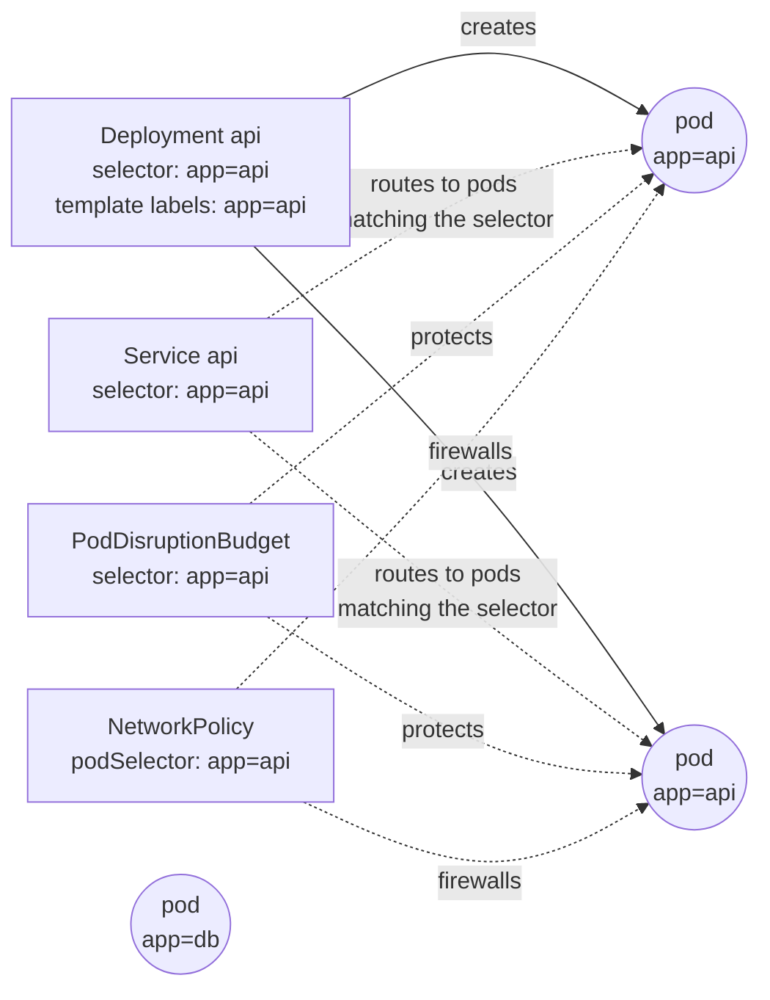
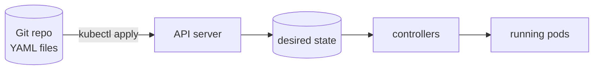

# 04 · YAML and kubectl: talking to the cluster

🟢 Beginner · ⏱️ 40 min · [← Previous](03-setup-your-machine.md) · [Home](../README.md) · [Next: Pods →](05-pods.md)

This chapter answers the question beginners ask most: **what are all these YAML files, and how do I write one?**

## Why YAML files?

A Kubernetes YAML file (a **manifest**) is the written form of "the desired state". You keep manifests in Git, review them in pull requests, and apply them to any cluster. The files *are* the system's documentation, history and deployment script at once. This practice is called **Infrastructure as Code**.

## YAML in 5 minutes

YAML is a human-friendly way to write nested data (a superset of JSON). The rules that matter:

```yaml
# A comment
name: skypulse            # key: value (a "mapping")
replicas: 3               # numbers are numbers...
port: "8080"              # ...unless quoted: then it's a string
enabled: true             # booleans: true / false
nothing: null

labels:                   # nesting is done with INDENTATION (spaces only, never tabs!)
  app: api                # 2 spaces is the convention
  tier: web

ports:                    # a list ("sequence"): each item starts with "- "
  - 80
  - 443

containers:               # a list of mappings: the most common pattern in Kubernetes
  - name: web
    image: nginx:1.27
  - name: sidecar
    image: busybox

command: ["sleep", "3600"]       # inline ("flow") list, same as JSON
resources: { cpu: 100m }         # inline mapping

script: |                 # multi-line string, newlines preserved
  echo hello
  echo world
---                       # three dashes separate several documents (objects) in one file
```

Gotchas that bite everyone:

- **Tabs are forbidden.** Configure your editor to insert spaces.
- **Indentation is structure.** One space too many and a field silently moves to a different parent.
- **Quote values that look like other types.** `"1.0"`, `"yes"`, `"0755"`, `"on"`. Env var values and ConfigMap data must be strings, so `"8000"`, not `8000`.

> 💡 Install the **YAML extension by Red Hat** in VS Code. With Kubernetes schemas enabled, it autocompletes fields and underlines mistakes before you ever run `kubectl`.

## The anatomy of every manifest

Every Kubernetes object has the same four top-level fields:

```yaml
apiVersion: apps/v1          # (1) which API group + version defines this kind
kind: Deployment             # (2) what type of object
metadata:                    # (3) identity: name, namespace, labels, annotations
  name: api
  namespace: skypulse-analysis
  labels:
    app.kubernetes.io/name: api
  annotations:
    description: "free-form notes for humans and tools"
spec:                        # (4) the desired state; its shape depends on the kind
  replicas: 2
  # ...
# status:                    # written by Kubernetes, never by you
```

| Field | What it is | Examples |
|---|---|---|
| `apiVersion` | `group/version`. The "core" group has no prefix. Versions graduate `v1alpha1` → `v1beta1` → `v1`. | `v1` (Pod, Service, ConfigMap), `apps/v1` (Deployment), `networking.k8s.io/v1` (Ingress, NetworkPolicy), `batch/v1` (Job), `postgresql.cnpg.io/v1` (a custom resource) |
| `kind` | The object type, CamelCase | `Pod`, `Deployment`, `Service` |
| `metadata.name` | Unique per kind *within a namespace*. Lowercase, digits, `-`. | `api`, `feeddb` |
| `metadata.namespace` | Which namespace it lives in (Chapter 13). Omitted = the current context's default. | `skypulse-analysis` |
| `metadata.labels` | Key/value tags used to **select** objects | `app.kubernetes.io/name: api` |
| `metadata.annotations` | Key/value notes that are **not** used for selection (tool config, descriptions) | `kubernetes.io/description` |
| `spec` | What you want | Differs per kind |
| `status` | What is | Filled in by controllers |

### How do I know which fields exist? `kubectl explain`

You don't memorize the schema. You ask the cluster:

```bash
kubectl explain deployment                         # top level
kubectl explain deployment.spec.strategy           # drill down
kubectl explain pod.spec.containers.readinessProbe --recursive | less   # everything under a field
```

Other ways to get YAML without writing it from scratch:

```bash
# Let kubectl generate a skeleton (nothing is created thanks to --dry-run)
kubectl create deployment web --image=nginx --replicas=2 --dry-run=client -o yaml > web.yaml
kubectl create service clusterip web --tcp=80:80 --dry-run=client -o yaml
kubectl create configmap app-config --from-literal=LOG_LEVEL=info --dry-run=client -o yaml

# Look at an existing object (lots of status and defaults you would NOT put in your file)
kubectl get deployment web -o yaml
```

## Labels and selectors: how objects find each other

This is the most important "glue" concept in Kubernetes. Objects don't reference each other by ID. They use **label selectors**: "all pods with `app=api`".



```bash
kubectl get pods -l app.kubernetes.io/name=api              # equality
kubectl get pods -l 'environment in (prod, staging)'        # set-based
kubectl get pods --show-labels
kubectl label pod mypod tier=web                            # add a label
```

A common convention is the **recommended labels**: `app.kubernetes.io/name`, `app.kubernetes.io/component`, `app.kubernetes.io/part-of`, `app.kubernetes.io/version`. Tools and dashboards understand them.

> ⚠️ A Deployment's `spec.selector` **must match** the labels in its pod `template`, and it's **immutable** after creation. Pick it carefully.

## Declarative workflow: `kubectl apply`

```bash
kubectl apply -f web.yaml              # create or update to match the file
kubectl apply -f k8s/                  # every manifest in a directory
kubectl apply -k k8s/overlays/local    # a Kustomize directory (Chapter 16)
kubectl diff -f web.yaml               # preview what apply would change. Use it all the time!
kubectl delete -f web.yaml             # delete what the file describes
```

`apply` is **idempotent**: run it 10 times and you get the same result. It computes the difference between your file, the live object and the last applied version, and only patches what changed. That's what makes YAML-in-Git workflows (and GitOps, Chapter 17) possible.



Imperative vs declarative, side by side:

| Imperative (do this) | Declarative (be like this) |
|---|---|
| `kubectl scale deploy web --replicas=5` | change `replicas: 5` in the file, `kubectl apply` |
| `kubectl set image deploy/web web=nginx:1.28` | change `image:` in the file, `kubectl apply` |
| Fast, but the change lives only in the cluster | Reviewable, repeatable, in Git |

## The kubectl commands you'll use every day

```bash
# Read
kubectl get pods                              # list (also: deploy, svc, ingress, all, ...)
kubectl get pods -o wide                      # + node and IP
kubectl get pod web-abc -o yaml               # the full object
kubectl get pods -w                           # watch for changes
kubectl get pods -n kube-system               # in another namespace (-A = all namespaces)
kubectl describe pod web-abc                  # human summary + EVENTS (first stop when debugging!)
kubectl logs web-abc                          # container stdout/stderr (-f follow, --previous after a crash)
kubectl logs deploy/web --all-containers      # logs from (one pod of) a deployment
kubectl get events --sort-by=.lastTimestamp   # what happened recently

# Interact
kubectl exec -it web-abc -- sh                # a shell inside a container
kubectl port-forward svc/web 8080:80          # tunnel localhost:8080 to a service
kubectl cp web-abc:/tmp/file ./file           # copy files

# Change
kubectl apply -f file.yaml
kubectl delete pod web-abc
kubectl rollout restart deploy/web            # restart all pods gracefully
kubectl edit deploy web                       # edit live in $EDITOR (handy, but not in Git!)
```

Short names save typing: `po` (pods), `deploy`, `svc`, `ns`, `cm` (configmap), `pvc`, `ing`, `netpol`, `hpa`, `pdb`.

Formatting output for scripts:

```bash
kubectl get pods -o name
kubectl get pods -o jsonpath='{.items[*].spec.nodeName}'
kubectl get pods -o custom-columns=NAME:.metadata.name,NODE:.spec.nodeName,IP:.status.podIP
```

## Writing your first manifest: step by step

Let's write, from nothing, the YAML for "2 nginx replicas, reachable inside the cluster as `web`". Save as `web.yaml`:

```yaml
apiVersion: apps/v1
kind: Deployment
metadata:
  name: web
  labels:
    app: web
spec:
  replicas: 2
  selector:                # which pods belong to this Deployment...
    matchLabels:
      app: web
  template:                # ...and the blueprint for creating them
    metadata:
      labels:
        app: web           # must match the selector above
    spec:
      containers:
        - name: nginx
          image: nginx:1.27
          ports:
            - containerPort: 80
---
apiVersion: v1
kind: Service
metadata:
  name: web
spec:
  selector:
    app: web               # send traffic to pods with this label
  ports:
    - port: 80             # the Service's port
      targetPort: 80       # the container's port
```

```bash
kubectl apply -f web.yaml
kubectl get deploy,pods,svc -l app=web
kubectl run tmp --rm -it --image=busybox --restart=Never -- wget -qO- http://web   # call it from inside the cluster
```

Now change `replicas: 2` to `4`, run `kubectl diff -f web.yaml`, then `kubectl apply -f web.yaml`. You've just done a declarative change. Clean up with `kubectl delete -f web.yaml`.

## Organizing YAML in a real project

```text
k8s/
├── base/                      # environment-independent
│   ├── kustomization.yaml     # list of files + shared settings
│   ├── namespaces.yaml
│   ├── api.yaml               # Deployment + Service + PDB + HPA for one component
│   └── networkpolicies.yaml
└── overlays/
    ├── local/                 # what differs locally (image registry, sizes)
    └── production/
```

Tips:

- **One component per file** (its Deployment, Service, PDB… together), separated by `---`.
- **Comment the *why***, not the *what*. `maxUnavailable: 0  # never drop below current capacity`.
- Never put secrets in Git in plain text (Chapter 08).

> 🔗 **In the project:** read [`skypulse/k8s/base/analysis/api.yaml`](../skypulse/k8s/base/analysis/api.yaml) top to bottom. It's a fully commented, production-grade example of one component, and by Chapter 15 you'll understand every line.

## Key takeaways

- Every object = `apiVersion` + `kind` + `metadata` + `spec` (+ `status` from the cluster).
- **Labels + selectors** connect objects together.
- Use `kubectl explain` for the schema, `--dry-run=client -o yaml` for skeletons, `kubectl diff` before `apply`.
- `kubectl describe` and `kubectl get events` are the first stops when something's wrong.

[Next: Pods →](05-pods.md)
