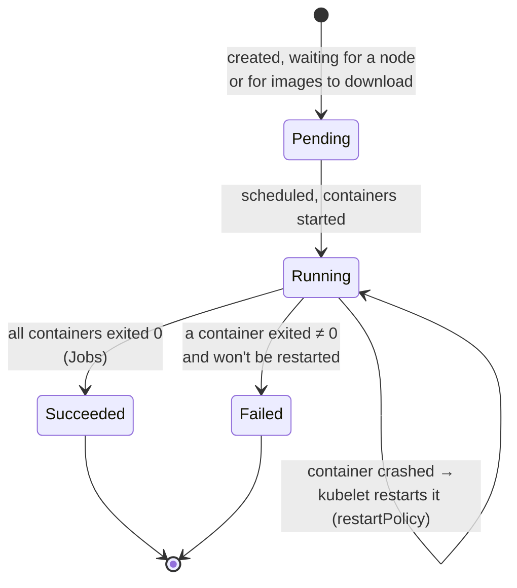
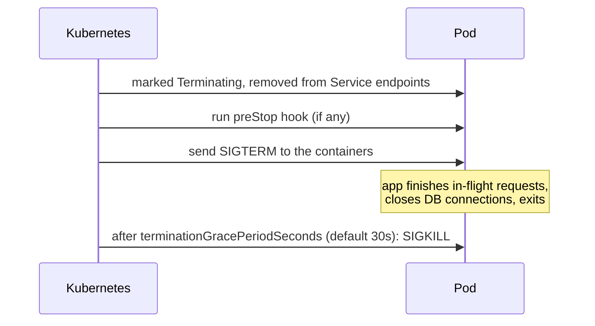

# 05 · Pods

🟢 Beginner · ⏱️ 25 min · [← Previous](04-yaml-and-kubectl.md) · [Home](../README.md) · [Next: Deployments →](06-deployments-and-rolling-updates.md)

## What is a Pod?

A **Pod** is the smallest thing Kubernetes runs: **one or more containers that are always scheduled together on the same node and share a network identity and storage**.


*Source: kubernetes.io. Pods with one or several containers and volumes.*

Inside a pod, containers:

- share **one IP address** and port space, so they talk to each other via `localhost`
- can share **volumes** (directories)
- are started, stopped and moved **together**

Most pods have exactly one container. Multiple containers are for tightly coupled helpers ("sidecars"): a log shipper, a proxy, a config reloader.

## A minimal pod

```yaml
apiVersion: v1
kind: Pod
metadata:
  name: hello
  labels:
    app: hello
spec:
  containers:
    - name: app
      image: python:3.12-slim
      command: ["python", "-m", "http.server", "8000"]
      ports:
        - containerPort: 8000
      env:
        - name: GREETING
          value: "hi"
```

```bash
kubectl apply -f hello-pod.yaml
kubectl get pod hello -o wide
kubectl logs hello
kubectl exec -it hello -- python -c "import os; print(os.environ['GREETING'])"
kubectl port-forward pod/hello 8000:8000      # http://localhost:8000
kubectl delete pod hello
```

### `command` and `args` vs the image's ENTRYPOINT/CMD

| Kubernetes | Docker | Meaning |
|---|---|---|
| `command` | `ENTRYPOINT` | The executable. Overrides the image's ENTRYPOINT. |
| `args` | `CMD` | Its arguments. Overrides the image's CMD. |

> 🔗 **In the project:** one image serves four roles. The image's ENTRYPOINT is `skypulse`, and each workload only sets `args: ["api"]`, `["analyzer"]`, `["ingestor"]` or `["migrate"]` (the last one is a Job). One build and one version, with four behaviours.

## The pod lifecycle



The `STATUS` column of `kubectl get pods` also shows reasons you'll learn to recognize:

| Status | Meaning | Usual cause |
|---|---|---|
| `Pending` | Not scheduled or not started | No node has enough CPU/memory; PVC not bound |
| `ContainerCreating` | Pulling the image, mounting volumes | Large image; slow registry |
| `ImagePullBackOff` / `ErrImagePull` | Can't fetch the image | Typo in the name/tag, private registry without credentials |
| `CrashLoopBackOff` | It starts, crashes, restarts, crashes… with growing delays | Bug, bad config, missing env var. Check `kubectl logs --previous` |
| `OOMKilled` | Exceeded its memory limit | Limit too low, or a memory leak |
| `Init:0/1` | Waiting for init containers to finish | Init container stuck or failing |
| `Terminating` | Shutting down | Graceful shutdown, or stuck finalizers |

`restartPolicy` (`Always` by default for pods managed by Deployments, `OnFailure`/`Never` for Jobs) decides whether the kubelet restarts a crashed container **in place, on the same node**.

## Pods are cattle, not pets

A pod is **ephemeral**:

- If its node dies, the pod is **not** resurrected elsewhere. It's gone.
- Its IP changes every time it's recreated.
- Its container filesystem is wiped on restart.

So **you almost never create Pods directly**. You create a *controller* that creates pods for you and replaces them when they disappear: a Deployment (Chapter 06), a StatefulSet (Chapter 10), a Job (Chapter 12). And you reach pods through a **Service** (Chapter 07), never by IP.

## Multi-container patterns

```yaml
spec:
  volumes:
    - name: logs
      emptyDir: {}                 # a scratch directory that lives as long as the pod
  containers:
    - name: app
      image: myapp:1.0
      volumeMounts:
        - { name: logs, mountPath: /var/log/app }
    - name: log-shipper            # "sidecar": reads what the app writes
      image: fluent/fluent-bit:3.0
      volumeMounts:
        - { name: logs, mountPath: /var/log/app, readOnly: true }
```

| Pattern | Example |
|---|---|
| **Sidecar** | Log shipper, service-mesh proxy (Envoy), certificate refresher |
| **Init container** | Run migrations or wait for a dependency *before* the app starts (Chapter 12) |
| **Ambassador / adapter** | A local proxy to an external system; a metrics format converter |

## Graceful shutdown

When a pod is deleted (scale down, rolling update, node drain):



Your app must **handle SIGTERM** and exit cleanly. Uvicorn, gunicorn and most frameworks already do. Because removing the pod from load balancers happens *in parallel* with SIGTERM, a short `preStop: sleep 5` avoids sending requests to a pod that's already shutting down.

> 🔗 **In the project:** the API has `lifecycle.preStop: sleep 5` and `terminationGracePeriodSeconds: 30`. Together with readiness probes, that's how rolling updates complete with **zero failed requests** (we measured it in Chapter 21).

## Try it

1. Create a pod with a typo in the image (`nginx:doesnotexist`). Observe `ErrImagePull`, then `kubectl describe pod` → *Events*.
2. Create a pod whose command is `["sh", "-c", "echo boom; exit 1"]`. Watch `CrashLoopBackOff` and read `kubectl logs <pod> --previous`.
3. Create a 2-container pod (nginx + busybox running `sleep 3600`). From busybox, run `wget -qO- localhost:80`: same network namespace!

## Key takeaways

- A Pod = co-scheduled containers sharing an IP and volumes.
- Pods are ephemeral and replaceable. Manage them through controllers and reach them through Services.
- Learn the status reasons (`Pending`, `ImagePullBackOff`, `CrashLoopBackOff`, `OOMKilled`): they're half of debugging.

[Next: Deployments and rolling updates →](06-deployments-and-rolling-updates.md)
