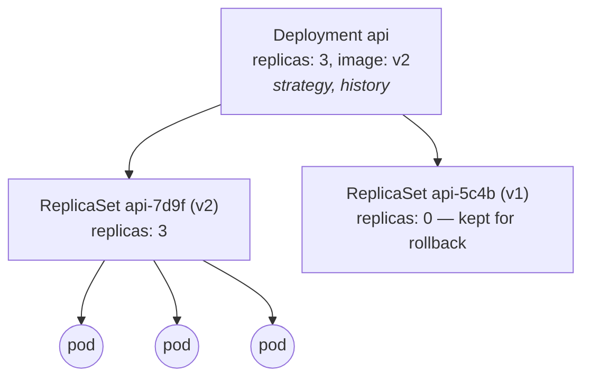
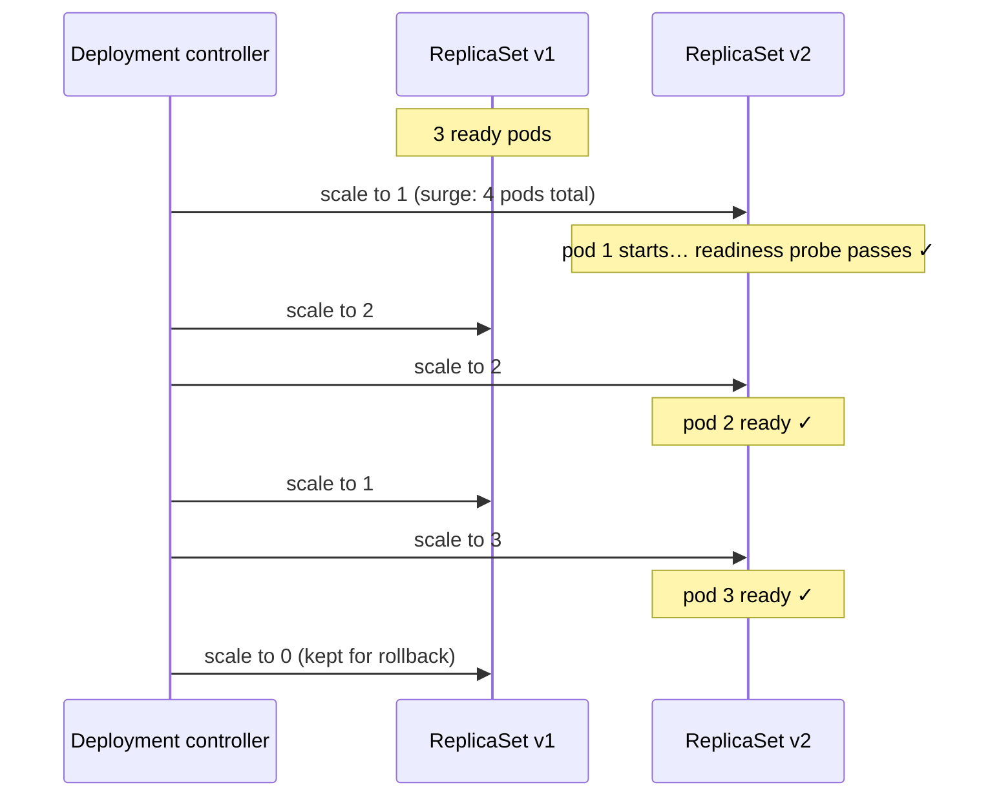

# 06 · Deployments and rolling updates

🟢 Beginner · ⏱️ 30 min · [← Previous](05-pods.md) · [Home](../README.md) · [Next: Services and DNS →](07-services-and-dns.md)

## Deployment → ReplicaSet → Pods

A **Deployment** manages a set of identical, interchangeable (stateless) pods. It's the workhorse of Kubernetes: web apps, APIs and workers are all Deployments.



- The **ReplicaSet** keeps exactly *N* pods matching its template alive.
- The **Deployment** manages ReplicaSets: each change to the pod template creates a new ReplicaSet, and the Deployment shifts pods from the old one to the new one. That's a **rolling update**.

You rarely touch ReplicaSets directly.


*Source: kubernetes.io. A Deployment scaled to 4 pods spread across nodes, behind a Service.*

## A complete Deployment, annotated

```yaml
apiVersion: apps/v1
kind: Deployment
metadata:
  name: api
  labels:
    app.kubernetes.io/name: api
spec:
  replicas: 3                          # how many pods
  revisionHistoryLimit: 5              # old ReplicaSets kept for rollback
  selector:
    matchLabels:
      app.kubernetes.io/name: api      # immutable; must match the template labels
  strategy:
    type: RollingUpdate                # or Recreate (stop all old, then start new)
    rollingUpdate:
      maxSurge: 1                      # at most 1 extra pod above "replicas" during an update
      maxUnavailable: 0                # never go below "replicas" ready pods
  template:                            # the pod blueprint (Chapter 05)
    metadata:
      labels:
        app.kubernetes.io/name: api
    spec:
      containers:
        - name: api
          image: registry.example.com/api:1.4.2   # ← change this to deploy a new version
          ports:
            - name: http
              containerPort: 8000
          readinessProbe:                          # REQUIRED for safe rolling updates (Chapter 09)
            httpGet: { path: /readyz, port: http }
```

## Scaling

```bash
kubectl scale deployment api --replicas=5     # imperative
# or edit replicas: in the YAML and kubectl apply (declarative)
kubectl get deploy api                        # READY 5/5, UP-TO-DATE, AVAILABLE
```

Automatic scaling based on CPU or other metrics is the job of the HorizontalPodAutoscaler ([Chapter 15](15-high-availability-and-scaling.md)).

## Rolling updates: shipping a new version with zero downtime

Anything that changes `spec.template` (the image tag, an env var, a label) triggers a rollout. With `maxSurge: 1, maxUnavailable: 0` and 3 replicas:




*Source: kubernetes.io. Mid-rollout: new pods replace old ones one by one, and the Service only routes to ready pods.*

The **readiness probe** is what makes this safe. The controller only continues once a new pod reports Ready, and the Service only sends traffic to Ready pods. If v2 never becomes ready (a bug, a bad config), the rollout **stalls with the old pods still serving**: a broken release doesn't take you down.

| Setting | Effect | Use when |
|---|---|---|
| `maxSurge: 1, maxUnavailable: 0` | Always full capacity; needs room for 1 extra pod | Default choice for user-facing services |
| `maxSurge: 0, maxUnavailable: 1` | No extra resources; capacity drops by 1 | Tight clusters |
| `maxSurge: 25%, maxUnavailable: 25%` | The Kubernetes default; fast | Large replica counts |
| `type: Recreate` | All old pods stop, then new ones start: **downtime** | Apps that can't run two versions at once (some DB-migration patterns, singletons with RWO volumes) |

### Watching and controlling a rollout

```bash
kubectl set image deployment/api api=registry.example.com/api:1.4.3   # or edit YAML + apply
kubectl rollout status deployment/api          # waits until done (great in CI/Makefiles)
kubectl rollout history deployment/api
kubectl rollout undo deployment/api            # back to the previous version
kubectl rollout undo deployment/api --to-revision=3
kubectl rollout pause deployment/api           # batch several changes...
kubectl rollout resume deployment/api          # ...into one rollout
kubectl rollout restart deployment/api         # new pods, same spec (e.g. to pick up a changed Secret)
```

Add a `kubernetes.io/change-cause` annotation so `rollout history` tells you *why* each revision exists.

### Image tags: never deploy `:latest`

If the YAML says `image: api:latest`, nothing in the pod template changes when you push a new `latest`, so **no rollout happens**. And when a node restarts a pod later, it may get a different `latest` than its neighbours. Use **immutable, unique tags** (a version like `1.4.3` or a git SHA), or even digests (`@sha256:…`).

> 🔗 **In the project:** every `make build` produces a tag like `a1b2c3d-20261003164949` (git SHA + timestamp). `make deploy` writes it into a generated Kustomize overlay, so every deploy changes the pod template and triggers a rolling update. See the `deploy` target in [`skypulse/Makefile`](../skypulse/Makefile).

## Deployments vs other workload controllers

| Controller | Pods are… | Use for | Chapter |
|---|---|---|---|
| **Deployment** | Identical, interchangeable | Stateless apps, APIs, workers | this one |
| **StatefulSet** | Uniquely named, with stable storage | Databases, queues, clustered apps | 10 |
| **DaemonSet** | One per node | Node agents (logs, monitoring, CNI) | 12 |
| **Job / CronJob** | Run to completion | Batch work, migrations, backups | 12 |

## Try it

```bash
kubectl create deployment web --image=nginx:1.26 --replicas=3
kubectl rollout status deploy/web
kubectl set image deploy/web nginx=nginx:1.27 && kubectl rollout status deploy/web
kubectl get rs                                   # two ReplicaSets: old at 0, new at 3
kubectl set image deploy/web nginx=nginx:does-not-exist
kubectl get pods                                 # new pod in ImagePullBackOff, old pods still serving!
kubectl rollout undo deploy/web
kubectl delete deploy web
```

## Key takeaways

- Deployment → ReplicaSets → Pods. Changing the pod template = a new ReplicaSet = a rolling update.
- `maxUnavailable: 0` + **readiness probes** = zero-downtime updates; broken versions stall instead of taking you down.
- Unique, immutable image tags; `kubectl rollout status/undo` for control.

[Next: Services and DNS →](07-services-and-dns.md)
