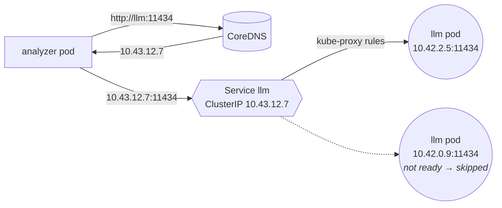
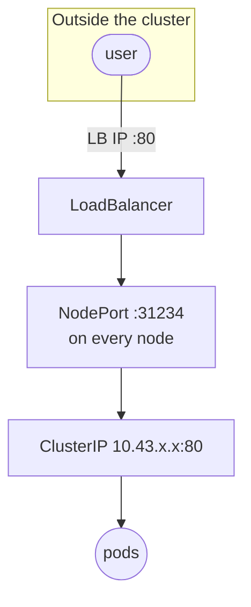

# 07 · Services and DNS

🟡 Intermediate · ⏱️ 30 min · [← Previous](06-deployments-and-rolling-updates.md) · [Home](../README.md) · [Next: ConfigMaps and Secrets →](08-configmaps-and-secrets.md)

## The problem

Pods come and go and their IPs change. If the analyzer had to know the LLM pod's IP, every restart would break it. A **Service** gives a set of pods **one stable name and virtual IP** and load-balances across the pods that are *ready*.


*Source: kubernetes.io. A Service selects its pods by label.*

## The Kubernetes network model (3 rules)

1. Every pod gets its **own IP**.
2. Every pod can reach every other pod **directly, without NAT**, across nodes (until a NetworkPolicy says otherwise, Chapter 14).
3. Agents on a node can reach all pods on that node.

The **CNI plugin** makes this true. Pod IPs come from a *pod CIDR* (k3s: `10.42.0.0/16`), Service IPs from a separate *service CIDR* (k3s: `10.43.0.0/16`).

## A ClusterIP Service

```yaml
apiVersion: v1
kind: Service
metadata:
  name: llm
  namespace: skypulse-analysis
spec:
  type: ClusterIP            # the default: reachable only inside the cluster
  selector:
    app.kubernetes.io/name: llm   # route to READY pods with this label
  ports:
    - name: http
      port: 11434            # the port clients connect to on the Service
      targetPort: http       # the container port (by name or number)
```



How it works under the hood: the Service controller keeps an **EndpointSlice** listing the IPs of ready, matching pods. **kube-proxy** on every node programs iptables/IPVS/nftables rules so that packets to the virtual ClusterIP are rewritten (DNAT) to one of those pod IPs. The ClusterIP isn't bound to any interface: it exists only as rules.

```bash
kubectl get svc,endpointslices -n skypulse-analysis
kubectl describe svc llm -n skypulse-analysis     # see "Endpoints:"
```

> 🩺 **Debugging rule #1 for Services:** if the endpoints list is empty, either the selector doesn't match the pods' labels or no pod is Ready.

## Service types

| Type | Reachable from | How | Typical use |
|---|---|---|---|
| **ClusterIP** | Inside the cluster | Virtual IP | Service-to-service (95% of Services) |
| **NodePort** | Outside, via `<any-node-IP>:30000-32767` | Opens the port on every node | Simple bare-metal exposure, debugging |
| **LoadBalancer** | Outside, via a dedicated IP | Asks an implementation (cloud LB, MetalLB, k3s ServiceLB) for an external IP | Exposing an ingress controller or a TCP service |
| **ExternalName** | Inside | A DNS CNAME to an external name | Aliasing an external database |
| **Headless** (`clusterIP: None`) | Inside | DNS returns the pod IPs directly, no load balancing | StatefulSets, client-side load balancing |



Each type builds on the previous one: a LoadBalancer Service also has a NodePort and a ClusterIP.

For HTTP you usually expose **one** LoadBalancer (the ingress controller) and route by hostname and path with **Ingress** ([Chapter 11](11-ingress.md)).

## DNS: service discovery for free

CoreDNS gives every Service a DNS name:

```text
<service>.<namespace>.svc.cluster.local
```

| From a pod in… | You can write |
|---|---|
| the same namespace | `llm`, or `llm:11434` |
| another namespace | `feeddb-rw.skypulse-data` or the full `feeddb-rw.skypulse-data.svc.cluster.local` |

Pods in StatefulSets with a headless Service also get per-pod names: `postgres-0.postgres.db.svc.cluster.local`.

```bash
kubectl run dns-test --rm -it --image=busybox --restart=Never -- nslookup kubernetes.default
```

> 🔗 **In the project:** the analyzer uses `LLM_URL=http://llm:11434` (same namespace). The database lives in its own namespace, so the api, analyzer and ingestor all use `PGHOST=feeddb-rw.skypulse-data.svc.cluster.local`. See [`skypulse/k8s/base/ingestion/config.env`](../skypulse/k8s/base/ingestion/config.env).

## Reaching services from your laptop

```bash
kubectl port-forward svc/api 8080:80 -n skypulse-analysis   # for debugging only
```

`port-forward` is a tunnel through the API server: perfect for debugging, never for production traffic.

## ⚠️ Service links: an old feature that can bite you

For compatibility with Docker "links", Kubernetes injects environment variables for **every Service in the namespace** into every container: `<SERVICE_NAME>_SERVICE_HOST`, `<SERVICE_NAME>_PORT`, and so on. A Service named `api` therefore creates `API_PORT=tcp://10.43.89.235:80` in all pods of that namespace.

We hit exactly this while building the project: our app read its listening port from `API_PORT`, got `tcp://10.43.89.235:80`, and crashed. The fix is a good default for all your pods:

```yaml
spec:
  enableServiceLinks: false    # use DNS for discovery; don't inject <SERVICE>_* env vars
```

and avoid configuration names like `<SERVICENAME>_PORT`. Full story in [Chapter 19](19-troubleshooting.md).

## Try it

```bash
kubectl create deployment echo --image=ealen/echo-server --replicas=3
kubectl expose deployment echo --port=80
kubectl run c --rm -it --image=busybox --restart=Never -- sh -c 'for i in 1 2 3 4 5 6; do wget -qO- http://echo | grep -o "\"HOSTNAME\":\"[^\"]*\""; done'
# different hostnames → load balancing across pods
kubectl scale deploy echo --replicas=0 && kubectl get endpointslices -l kubernetes.io/service-name=echo   # no endpoints
kubectl delete deploy,svc echo
```

## Key takeaways

- A **Service** = stable virtual IP + DNS name + load balancing over **ready** pods matching a **selector**.
- Use **ClusterIP** inside, a **LoadBalancer** for the ingress controller, and **Ingress** for HTTP routing.
- DNS name: `service.namespace.svc.cluster.local`. Set `enableServiceLinks: false`.

[Next: ConfigMaps and Secrets →](08-configmaps-and-secrets.md)
