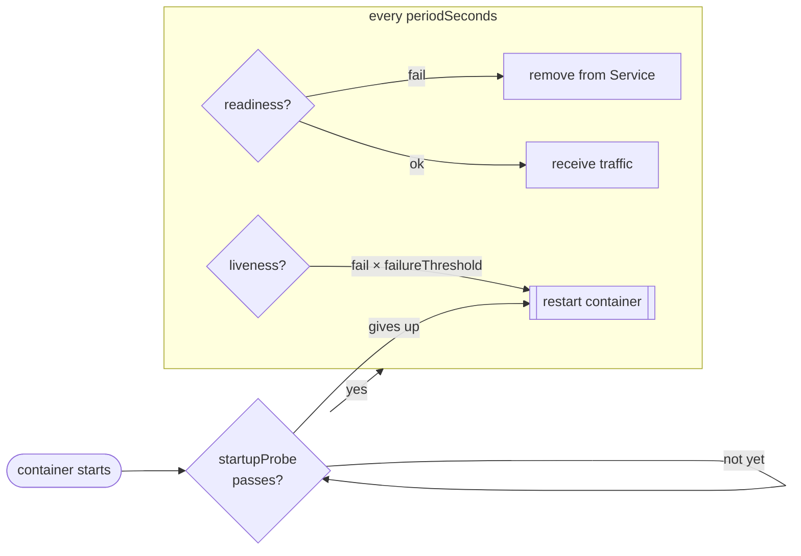

# 09 · Health probes and resources

🟡 Intermediate · ⏱️ 35 min · [← Previous](08-configmaps-and-secrets.md) · [Home](../README.md) · [Next: Storage and StatefulSets →](10-storage-and-statefulsets.md)

Two things Kubernetes can't guess about your app: **is it healthy?** and **how much does it need?** You tell it with probes and resource requests and limits. They're the difference between a demo and a production deployment.

## Part 1 · Probes

The kubelet runs probes against every container:

| Probe | Question | When it fails | Typical check |
|---|---|---|---|
| **readinessProbe** | "Can you take traffic *right now*?" | Pod is **removed from Service endpoints** (no restart) | Can reach its dependencies (DB) |
| **livenessProbe** | "Are you alive, or stuck beyond repair?" | Container is **restarted** | Process responds at all |
| **startupProbe** | "Have you finished starting?" | Liveness/readiness wait until it succeeds; restarted if it never does | Slow-starting apps (loading a model, warming caches) |



### Probe mechanisms

```yaml
readinessProbe:
  httpGet: { path: /readyz, port: http }     # 200–399 = success
livenessProbe:
  tcpSocket: { port: 5432 }                  # a TCP connection opens = success
startupProbe:
  exec:                                      # exit code 0 = success
    command: ["cat", "/tmp/started"]
# also: grpc: { port: 9000 }
```

Timing fields: `initialDelaySeconds`, `periodSeconds` (default 10), `timeoutSeconds` (1), `failureThreshold` (3), `successThreshold` (1).

### The golden rules

1. **Readiness checks dependencies; liveness doesn't.** If the database goes down and your *liveness* probe checks the database, Kubernetes restarts every replica in a loop. That doesn't fix the database and makes everything worse. Readiness failing is the right reaction: stop sending traffic until things recover.
2. **Liveness should only fail when a restart would help** (deadlock, a stuck event loop).
3. **Use a startupProbe for slow starters** instead of a huge `initialDelaySeconds` on liveness.
4. **Without a readiness probe, rolling updates aren't safe.** A pod counts as ready the moment its process starts.

> 🔗 **In the project:** [`skypulse/src/skypulse/api.py`](../skypulse/src/skypulse/api.py) exposes `/healthz` (liveness: "I'm up", no DB check) and `/readyz` (readiness: "I can query PostgreSQL *and* the schema exists"). Because migrations run as a separate Job, that second part keeps a freshly started API out of the load balancer until the tables are there. The background workers have no HTTP server, so they touch a **heartbeat file** every loop, and an `exec` liveness probe restarts them if it goes stale for 10 minutes:
>
> ```yaml
> livenessProbe:
>   exec:
>     command: [python, -c, "import os,sys,time; sys.exit(time.time() - os.path.getmtime('/tmp/heartbeat') > 600)"]
> ```

## Part 2 · Requests and limits

```yaml
resources:
  requests:          # what the scheduler RESERVES for the container
    cpu: 100m        # 100 millicores = 0.1 CPU
    memory: 128Mi
  limits:            # the hard ceiling at runtime
    memory: 384Mi    # exceed it → OOMKilled
    # cpu: 500m      # exceed it → throttled (slowed down), never killed
```

| | Requests | Limits |
|---|---|---|
| Used by | The **scheduler**: a pod only lands on a node with enough *unrequested* capacity | The **kernel** (cgroups) at runtime |
| CPU | Guaranteed share under contention | Throttling (can hurt latency badly) |
| Memory | Guaranteed for scheduling | **OOMKill** when exceeded |

Units: CPU in cores (`1`, `0.5`, `250m`); memory in bytes with binary suffixes (`Mi`, `Gi`). Careful: `M` is 10⁶, `Mi` is 2²⁰.

### Quality of Service classes

| QoS class | Condition | Evicted first under node memory pressure? |
|---|---|---|
| **Guaranteed** | requests == limits for CPU and memory, in every container | Last |
| **Burstable** | At least one request or limit set | Middle |
| **BestEffort** | Nothing set | **First** |

### Practical recommendations

- **Always set memory requests and limits.** Often limit ≈ 1.5–2× request, or equal for critical workloads.
- **Always set CPU requests.** Many teams **don't set CPU limits**: throttling causes latency spikes, and requests already guarantee fair sharing.
- Base numbers on **measurements**: `kubectl top pods` (needs metrics-server; k3s has it), or Prometheus over time.
- Requests drive autoscaling percentages (HPA "70% CPU" means 70% of the *request*).

```bash
kubectl top nodes
kubectl top pods -n skypulse-analysis
kubectl describe node <node> | grep -A8 "Allocated resources"   # how full is the node?
```

> 🔗 **In the project:** the LLM requests `memory: 3Gi` with a limit of `8Gi`, because model inference is memory-hungry and bursty. The API requests just `128Mi`. The scheduler uses those requests to decide which node has room for the 5 GB model server.

### Namespace guardrails

- **LimitRange** sets default requests/limits for containers that don't specify any, and min/max values.
- **ResourceQuota** caps the total CPU, memory, number of pods or PVCs in a namespace (useful for multi-team clusters).

```yaml
apiVersion: v1
kind: ResourceQuota
metadata: { name: team-quota, namespace: team-a }
spec:
  hard: { requests.cpu: "8", requests.memory: 16Gi, limits.memory: 32Gi, pods: "50" }
```

## Try it

1. Deploy a pod with a 50Mi memory limit running `python -c "x = bytearray(200*1024*1024); import time; time.sleep(60)"`. Watch it get `OOMKilled` and inspect `kubectl describe pod` → *Last State*.
2. Request `cpu: 100` (100 cores!) and watch the pod stay `Pending`: *Insufficient cpu*.
3. Give an nginx Deployment a readiness probe on a path that returns 404 (`/nope`). The pods run but never become Ready, and the Service has no endpoints.

## Key takeaways

- **Readiness** = may I get traffic (check dependencies). **Liveness** = should I be restarted (don't check dependencies). **Startup** = protect slow starters.
- **Requests** drive scheduling, **limits** cap usage. Memory over the limit → OOMKill; CPU over the limit → throttling.
- Measure, then set. Always set memory requests and limits and CPU requests.

[Next: Storage and StatefulSets →](10-storage-and-statefulsets.md)
