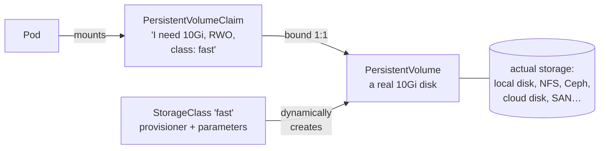

# 10 · Storage and StatefulSets

🟡 Intermediate · ⏱️ 35 min · [← Previous](09-health-probes-and-resources.md) · [Home](../README.md) · [Next: Ingress →](11-ingress.md)

Containers are disposable: their filesystem disappears when they restart. Databases are not. This chapter is about data that must survive.

## Volume types at a glance

| Volume | Lifetime | Use for |
|---|---|---|
| `emptyDir` | As long as the **pod** | Scratch space, sharing files between containers, writable `/tmp` with a read-only root filesystem |
| `configMap` / `secret` | Mirrors the object | Config files, certificates (Chapter 08) |
| `hostPath` | The **node's** disk | Node agents only. ⚠️ Dangerous for apps: ties the pod to a node and exposes the host |
| `persistentVolumeClaim` | **Independent** of the pod | Databases and anything that must survive restarts and rescheduling |

```yaml
spec:
  containers:
    - name: app
      volumeMounts:
        - { name: tmp, mountPath: /tmp }
  volumes:
    - name: tmp
      emptyDir: {}            # or emptyDir: { medium: Memory, sizeLimit: 64Mi } for a RAM disk
```

> 🔗 **In the project:** every container runs with `readOnlyRootFilesystem: true` (a security hardening, Chapter 13), so writable paths like `/tmp` (heartbeat files) and Ollama's home directory are `emptyDir` volumes.

## Persistent storage: PV, PVC, StorageClass



| Object | Who creates it | What it is |
|---|---|---|
| **PersistentVolume (PV)** | An admin, or a provisioner automatically | A piece of real storage |
| **PersistentVolumeClaim (PVC)** | You (the app) | A *request* for storage: size, access mode, class |
| **StorageClass** | The cluster admin | A *type* of storage and how to provision it (driver, replication, disk type) |

With **dynamic provisioning** (the norm), you only write the PVC. The StorageClass's provisioner (a CSI driver) creates the PV and the actual disk.

```yaml
apiVersion: v1
kind: PersistentVolumeClaim
metadata:
  name: data
spec:
  accessModes: [ReadWriteOnce]
  storageClassName: local-path      # omit to use the cluster's default class
  resources:
    requests:
      storage: 5Gi
```

### Access modes

| Mode | Meaning | Typical backends |
|---|---|---|
| `ReadWriteOnce` (RWO) | Mounted read-write by **one node** | Block storage: local disks, cloud disks, Ceph RBD, Longhorn |
| `ReadWriteOncePod` | One **pod** only | Same, stricter |
| `ReadOnlyMany` (ROX) | Many nodes, read-only | NFS, CephFS |
| `ReadWriteMany` (RWX) | Many nodes read-write | NFS, CephFS, Azure Files, EFS |

`reclaimPolicy` on the StorageClass decides what happens to the disk when the PVC is deleted: `Delete` (the default for dynamic provisioning) or `Retain`.

### ⚠️ Local storage pins pods to nodes

k3s's default `local-path` class stores data in a directory **on one node**. A pod using that PVC can only ever run on that node. We saw this during the project's node-drain drill: the drained node's PostgreSQL replica stayed `Pending` until the node came back, because its data lives there.

That's fine **if the application replicates the data itself** (PostgreSQL streaming replication, Kafka, Elasticsearch): losing one node's copy is survivable. For apps that don't, use **network/distributed storage** (Longhorn, Ceph/Rook, a SAN with a CSI driver) so the volume can follow the pod to another node. See [Chapter 20](20-on-prem-production.md).

## StatefulSets: identity for stateful apps

A Deployment's pods are interchangeable: random names, shared or no storage. Databases need more:

| | Deployment | StatefulSet |
|---|---|---|
| Pod names | `api-7d9f-xk2p9` (random) | `db-0`, `db-1`, `db-2` (stable, ordinal) |
| Storage | Shared PVC or none | **One PVC per pod** via `volumeClaimTemplates`; follows the pod identity |
| Start/stop order | Parallel | Ordered (0, 1, 2…) by default |
| DNS | Service only | Per-pod: `db-0.db.namespace.svc` (with a headless Service) |

```yaml
apiVersion: apps/v1
kind: StatefulSet
metadata:
  name: db
spec:
  serviceName: db            # a headless Service giving pods stable DNS names
  replicas: 3
  selector:
    matchLabels: { app: db }
  template:
    metadata:
      labels: { app: db }
    spec:
      containers:
        - name: postgres
          image: postgres:17
          volumeMounts:
            - { name: data, mountPath: /var/lib/postgresql/data }
  volumeClaimTemplates:      # → PVCs data-db-0, data-db-1, data-db-2
    - metadata:
        name: data
      spec:
        accessModes: [ReadWriteOnce]
        resources: { requests: { storage: 10Gi } }
```

### The hard truth about databases on Kubernetes

A StatefulSet gives you **stable identity and storage**. It does **not** give you replication, failover, backups or safe upgrades. Three `postgres` pods in a StatefulSet are three *independent* databases. Turning them into a replicated, self-healing cluster takes operational knowledge, which is what **Operators** encode ([Chapter 18](18-operators-and-crds.md)).

> 🔗 **In the project:** we don't write a StatefulSet for PostgreSQL. We declare a **CloudNativePG `Cluster`** ([`postgres.yaml`](../skypulse/k8s/base/data/postgres.yaml), in its own `skypulse-data` namespace) and the operator creates the pods, one PVC per instance, streaming replication, the Services and automatic failover. It manages pods directly rather than through a StatefulSet, because it needs finer control over which instance is primary.

## Backups

Replication isn't a backup: a `DROP TABLE` replicates instantly. Use:

- **Application-level backups**: `pg_dump`, or operator-managed continuous backups (CloudNativePG → S3-compatible storage like MinIO, with point-in-time recovery).
- **Volume snapshots** (`VolumeSnapshot` objects, if your CSI driver supports them).
- **Cluster-level backups** with Velero (objects + volumes).

And **test restores** regularly.

## Try it

```bash
kubectl get storageclass                       # local-path (default) on k3s
cat <<'EOF' | kubectl apply -f -
apiVersion: v1
kind: PersistentVolumeClaim
metadata: { name: demo }
spec: { accessModes: [ReadWriteOnce], resources: { requests: { storage: 100Mi } } }
---
apiVersion: v1
kind: Pod
metadata: { name: writer }
spec:
  containers:
    - name: c
      image: busybox
      command: ["sh", "-c", "date >> /data/log; cat /data/log; sleep 3600"]
      volumeMounts: [{ name: d, mountPath: /data }]
  volumes: [{ name: d, persistentVolumeClaim: { claimName: demo } }]
EOF
kubectl logs writer; kubectl delete pod writer
# re-apply the same YAML: the log now has two lines, so the data survived the pod
kubectl get pv,pvc
```

## Key takeaways

- `emptyDir` for scratch, **PVCs** for data that must survive. StorageClasses provision PVs dynamically.
- Local storage ties pods to nodes; that's OK only if the app replicates data itself.
- StatefulSets give identity and per-pod storage; for real databases, use an **operator**. Always back up and test restores.

[Next: Ingress →](11-ingress.md)
