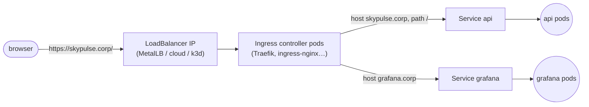

# 11 · Ingress

🟡 Intermediate · ⏱️ 25 min · [← Previous](10-storage-and-statefulsets.md) · [Home](../README.md) · [Next: Jobs, DaemonSets, init containers →](12-jobs-daemonsets-initcontainers.md)

## One door for all HTTP traffic

You could give every web app its own `LoadBalancer` Service. That's one IP each, no hostname or path routing, and TLS handled in every app. Instead, clusters run **one ingress controller** (a reverse proxy), expose *it* with a single LoadBalancer, and describe routing rules with **Ingress** objects.


*Source: kubernetes.io. Client → Ingress-managed load balancer → routing rule → Service → pods.*



Two parts:

1. **The Ingress controller**: actual software (Traefik, ingress-nginx, HAProxy, Contour…) running as pods. **Without one, Ingress objects do nothing.** k3s ships Traefik; most other distributions make you install one.
2. **Ingress objects**: declarative routing rules that the controller watches.

## An Ingress, annotated

```yaml
apiVersion: networking.k8s.io/v1
kind: Ingress
metadata:
  name: skypulse
  namespace: skypulse-analysis
  annotations:                                # controller-specific extras go here, e.g.
    traefik.ingress.kubernetes.io/router.middlewares: default-redirect-https@kubernetescrd
spec:
  ingressClassName: traefik                   # which controller handles this Ingress
  tls:
    - hosts: [skypulse.analysts.internal]
      secretName: skypulse-tls                # a kubernetes.io/tls Secret (cert + key)
  rules:
    - host: skypulse.analysts.internal        # omit host = match any hostname
      http:
        paths:
          - path: /
            pathType: Prefix                  # Prefix | Exact | ImplementationSpecific
            backend:
              service:
                name: api
                port:
                  name: http
```

- **Host-based routing**: `app.example.com` → app, `api.example.com` → API.
- **Path-based routing**: `/api` → backend, `/` → frontend.
- **TLS termination**: the controller holds the certificate and talks plain HTTP to pods inside the cluster (or re-encrypts, if you need end-to-end TLS).

### Certificates with cert-manager

[cert-manager](https://cert-manager.io) automates certificates. It issues and renews them from Let's Encrypt (internet-facing) or **your own internal CA** (typical on-prem), and stores them as the Secret named in `tls.secretName`.

```yaml
metadata:
  annotations:
    cert-manager.io/cluster-issuer: internal-ca
```

> 🔗 **In the project:** [`ingress.yaml`](../skypulse/k8s/base/analysis/ingress.yaml) routes everything to the `api` Service with no host, so `http://localhost:8090` just works locally. The [production overlay](../skypulse/k8s/overlays/production/kustomization.yaml) patches in a hostname and a TLS section.

## Ingress controllers are critical infrastructure

Every analyst request passes through the ingress controller. If it runs as **one replica**, it's a single point of failure, no matter how many replicas your app has.

We learned this while testing the project. Draining one node caused **~16 seconds of total outage**, because k3s's bundled Traefik had a single replica and it lived on that node. Our 2 API replicas were fine; nobody could reach them. The fix, in [`skypulse/cluster/traefik-ha.yaml`](../skypulse/cluster/traefik-ha.yaml), runs 2 replicas spread across nodes with a PodDisruptionBudget. The same drill afterwards: **0 failed requests**.

## Gateway API: the successor

Ingress is stable but limited: no traffic splitting, header matching or TCP/UDP without vendor annotations. The newer **[Gateway API](https://gateway-api.sigs.k8s.io/)** (`Gateway`, `HTTPRoute`, …) fixes that with a role-oriented, portable model:

```yaml
apiVersion: gateway.networking.k8s.io/v1
kind: HTTPRoute
metadata: { name: skypulse }
spec:
  parentRefs: [{ name: shared-gateway, namespace: infra }]
  hostnames: [skypulse.analysts.internal]
  rules:
    - backendRefs: [{ name: api, port: 80, weight: 90 }, { name: api-canary, port: 80, weight: 10 }]
```

Learn Ingress first (it's everywhere), and expect new projects to adopt Gateway API.

## Try it

```bash
kubectl create deployment hello --image=nginxdemos/hello:plain-text
kubectl expose deployment hello --port=80
kubectl create ingress hello --class=traefik --rule="/*=hello:80"
curl http://localhost:8081/        # the port you mapped to the load balancer in Chapter 03
kubectl get ingress
kubectl delete ingress,svc,deploy hello
```

## Key takeaways

- **Ingress** = HTTP routing rules; an **ingress controller** implements them. No controller, no routing.
- One LoadBalancer for the controller; hosts and paths route to Services; TLS terminates at the controller (cert-manager automates certificates).
- The ingress controller is on every request's path, so make it highly available too.

[Next: Jobs, CronJobs, DaemonSets and init containers →](12-jobs-daemonsets-initcontainers.md)
