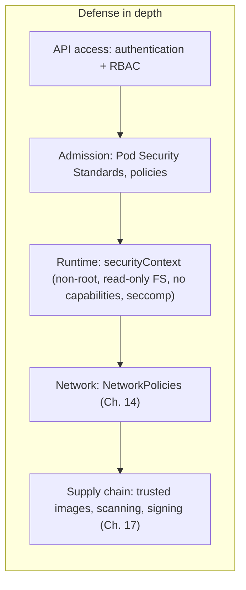

# 13 · Namespaces, RBAC and Pod Security

🟠 Advanced · ⏱️ 40 min · [← Previous](12-jobs-daemonsets-initcontainers.md) · [Home](../README.md) · [Next: NetworkPolicies →](14-network-policies.md)

Security in Kubernetes comes in layers. This chapter covers three of them: **who can do what to the API** (RBAC), **how objects are grouped** (namespaces) and **what a running container is allowed to do** (security contexts and Pod Security). The network layer is [Chapter 14](14-network-policies.md).



## Namespaces

A **namespace** is a named partition of the cluster. Names must be unique *within* a namespace, and many policies (RBAC, quotas, NetworkPolicies, Pod Security) are applied *per* namespace.

```bash
kubectl get namespaces
kubectl create namespace team-a
kubectl get pods -n team-a
kubectl config set-context --current --namespace=team-a
```

| Namespaced | Cluster-scoped |
|---|---|
| Pods, Deployments, Services, ConfigMaps, Secrets, PVCs, Ingresses, NetworkPolicies, Roles | Nodes, PersistentVolumes, StorageClasses, Namespaces, ClusterRoles, CRDs |

Namespaces are **not** a security boundary by themselves: by default pods in different namespaces can talk to each other freely. Combine them with RBAC, NetworkPolicies and Pod Security.

> 🔗 **In the project:** two namespaces are the two **security zones** from the [brief](../PROBLEM.md), `skypulse-ingestion` (may reach the internet) and `skypulse-analysis` (local network only). A third, `skypulse-data`, holds PostgreSQL. The zones never talk to each other, only to the database. Keeping the database apart also keeps its owner credentials, pods and backups out of reach of anyone with rights in the application namespaces, and lets you redeploy or delete an app namespace without touching the data. See [`namespaces.yaml`](../skypulse/k8s/base/namespaces.yaml).

## Authentication: who are you?

Kubernetes has no "user" objects. Humans authenticate with client certificates (what k3d puts in your kubeconfig), OIDC tokens (Keycloak, Dex, Azure AD, Google…) or cloud IAM. **Workloads** authenticate as a **ServiceAccount**: every pod runs as one (`default` if unspecified) and gets a token mounted at `/var/run/secrets/kubernetes.io/serviceaccount/`.

If a pod never talks to the Kubernetes API, **don't mount the token**:

```yaml
spec:
  automountServiceAccountToken: false
```

## RBAC: what may you do?

Role-Based Access Control has four objects:

| Object | Scope | Says |
|---|---|---|
| **Role** | One namespace | "These verbs on these resources" |
| **ClusterRole** | Cluster-wide (or reusable in namespaces) | Same, for any namespace / cluster resources |
| **RoleBinding** | One namespace | "Grant this Role/ClusterRole to these subjects *here*" |
| **ClusterRoleBinding** | Cluster | "Grant this ClusterRole everywhere" |

```yaml
apiVersion: v1
kind: ServiceAccount
metadata: { name: report-reader, namespace: skypulse-analysis }
---
apiVersion: rbac.authorization.k8s.io/v1
kind: Role
metadata: { name: read-pods, namespace: skypulse-analysis }
rules:
  - apiGroups: [""]                  # "" = core group (pods, services, configmaps…)
    resources: [pods, pods/log]
    verbs: [get, list, watch]
---
apiVersion: rbac.authorization.k8s.io/v1
kind: RoleBinding
metadata: { name: report-reader-reads-pods, namespace: skypulse-analysis }
subjects:
  - kind: ServiceAccount
    name: report-reader
    namespace: skypulse-analysis
  # - kind: User / Group  (from your OIDC provider)
roleRef:
  kind: Role
  name: read-pods
  apiGroup: rbac.authorization.k8s.io
```

```bash
kubectl auth can-i list secrets -n skypulse-analysis
kubectl auth can-i delete pods --as=system:serviceaccount:skypulse-analysis:report-reader -n skypulse-analysis
```

Built-in ClusterRoles worth knowing: `view`, `edit`, `admin`, `cluster-admin`. Give developers `edit` or `view` in their namespaces and keep `cluster-admin` for break-glass. Watch out for `secrets` access and `pods/exec`, which are powerful.

## Pod Security: what may a container do?

### securityContext

```yaml
spec:
  securityContext:                     # pod level
    runAsNonRoot: true                 # refuse to start if the image would run as root (UID 0)
    runAsUser: 10001                   # optional: force a UID
    fsGroup: 10001                     # group ownership for mounted volumes
    seccompProfile:
      type: RuntimeDefault             # filter dangerous syscalls
  containers:
    - name: app
      securityContext:                 # container level
        allowPrivilegeEscalation: false   # no setuid/sudo tricks
        readOnlyRootFilesystem: true      # an attacker can't drop binaries; use emptyDir for /tmp
        capabilities:
          drop: ["ALL"]                   # no raw sockets, no chown, nothing
        # privileged: true                # ← NEVER for apps: equivalent to root on the node
```

Your image must cooperate: create a non-root user in the Dockerfile (`USER 10001`), and don't write outside mounted volumes.

### Pod Security Standards (PSS) and Pod Security Admission

Kubernetes defines three standard profiles and enforces them per namespace with labels:

| Profile | Allows | For |
|---|---|---|
| `privileged` | Everything | System components (CNI, storage drivers) |
| `baseline` | Blocks known privilege escalations (hostNetwork, privileged…) | Legacy apps |
| `restricted` | Also requires non-root, dropped capabilities, seccomp, no privilege escalation | **Your apps** |

```yaml
apiVersion: v1
kind: Namespace
metadata:
  name: skypulse-analysis
  labels:
    pod-security.kubernetes.io/enforce: restricted   # reject non-compliant pods
    pod-security.kubernetes.io/warn: restricted      # warn kubectl users too
```

When a pod violates the profile, the API server **rejects** it with a message listing exactly which fields are wrong. Usually the pod's controller shows the error in its events: `kubectl describe replicaset …`.

For richer rules ("images must come from our registry", "every Deployment needs resource limits"), add a policy engine: **Kyverno** or **OPA Gatekeeper**, or the built-in **ValidatingAdmissionPolicy** (CEL expressions).

> 🔗 **In the project:** all three namespaces enforce `restricted`. Every pod sets `runAsNonRoot`, `seccompProfile: RuntimeDefault`, `allowPrivilegeEscalation: false`, `readOnlyRootFilesystem: true`, `capabilities.drop: [ALL]` and `automountServiceAccountToken: false`. The official Ollama image runs as root, so our [`llm.Dockerfile`](../skypulse/docker/llm.Dockerfile) switches to UID 10001 and moves Ollama's writable home to an `emptyDir`. The PostgreSQL pods created by CloudNativePG are restricted-compliant out of the box.

## Least privilege beyond Kubernetes

The same principle applies inside your app. In the project, each zone connects to PostgreSQL as its own role:

- **`ingestor`** (internet-facing) can only `SELECT` three columns of `subscriptions`, `UPDATE` two status columns and `INSERT` into `posts`. If it were compromised, it couldn't read the analysts' summaries or delete anything.
- **`analysis`** (api + analyzer) can manage subscriptions and write results but can't change the schema.
- Only the migration Job in `skypulse-data` uses the schema owner.

`make verify` proves it by attempting a `DELETE` from the ingestor pod and a `DROP TABLE` from an api pod, both inside transactions that are rolled back.

## Try it

```bash
kubectl create namespace psa-demo
kubectl label namespace psa-demo pod-security.kubernetes.io/enforce=restricted
kubectl -n psa-demo run bad --image=nginx            # rejected: lists every violation
kubectl -n psa-demo auth can-i create pods --as=system:serviceaccount:psa-demo:default   # no
kubectl delete namespace psa-demo
```

## Key takeaways

- Namespaces group things; RBAC (Role + RoleBinding) controls API access; ServiceAccounts are workload identities, so don't mount their tokens unless needed.
- Enforce the **restricted** Pod Security Standard on app namespaces, and build images that run as non-root with a read-only filesystem.
- Apply least privilege everywhere: API, containers, network and databases.

[Next: NetworkPolicies →](14-network-policies.md)
