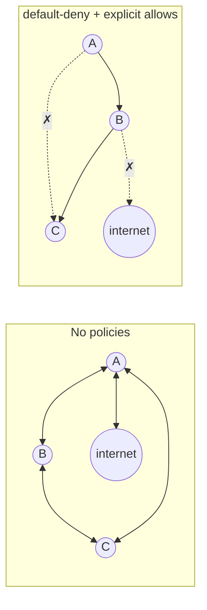
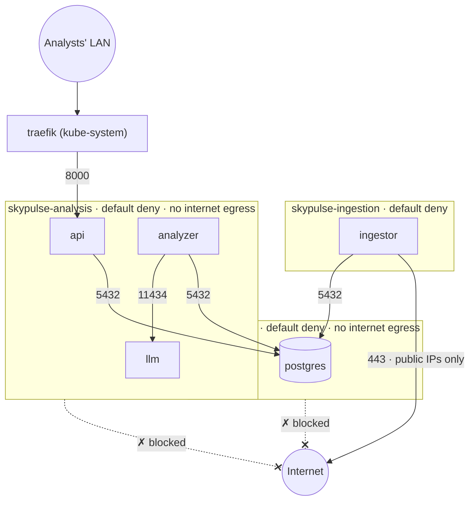

# 14 · NetworkPolicies

🟠 Advanced · ⏱️ 40 min · [← Previous](13-namespaces-rbac-security.md) · [Home](../README.md) · [Next: High availability and scaling →](15-high-availability-and-scaling.md)

By default, **every pod can talk to every other pod and to the internet**. A compromised web pod can probe your database, your monitoring and your cloud metadata endpoint. **NetworkPolicies** are Kubernetes' firewall rules between pods.

## How NetworkPolicies work

- They're **allow-lists**. Once *any* policy selects a pod for a direction (Ingress = incoming, Egress = outgoing), everything in that direction not explicitly allowed is **denied**.
- Policies are **additive**: if any policy allows a connection, it's allowed. There's no "deny" rule.
- They match pods by **labels**, namespaces by **namespace labels**, or external addresses by **CIDR** (`ipBlock`).
- They're enforced by the **CNI plugin**. If your CNI doesn't support them (Docker Desktop's built-in Kubernetes, plain Flannel), the objects are accepted and **silently ignored**. k3s embeds a policy controller; Calico and Cilium support them fully.
- Replies to an allowed connection are allowed automatically (the rules are stateful).



## Anatomy of a policy

```yaml
apiVersion: networking.k8s.io/v1
kind: NetworkPolicy
metadata:
  name: api
  namespace: skypulse-analysis
spec:
  podSelector:                      # WHICH pods this policy applies to (in this namespace)
    matchLabels:
      app.kubernetes.io/name: api
  policyTypes: [Ingress, Egress]    # which directions it restricts
  ingress:                          # allowed INCOMING connections
    - from:
        - namespaceSelector:        # pods in namespace kube-system…
            matchLabels:
              kubernetes.io/metadata.name: kube-system
          podSelector:              # …AND labelled traefik (same list item = AND)
            matchLabels:
              app.kubernetes.io/name: traefik
      ports:
        - { protocol: TCP, port: 8000 }
  egress:                           # allowed OUTGOING connections
    - to:
        - podSelector:
            matchLabels:
              cnpg.io/cluster: feeddb
      ports:
        - { protocol: TCP, port: 5432 }
```

### ⚠️ The AND/OR trap

```yaml
from:
  - namespaceSelector: { matchLabels: { team: a } }
    podSelector: { matchLabels: { role: client } }     # ONE item: namespace team=a AND role=client
---
from:
  - namespaceSelector: { matchLabels: { team: a } }    # TWO items: any pod in team=a
  - podSelector: { matchLabels: { role: client } }     # OR role=client pods in THIS namespace
```

One dash makes the difference between "client pods of team A" and "all of team A plus local clients".

## The standard recipe

1. **Default deny** everything in the namespace.
2. **Allow DNS** egress to CoreDNS, or nothing can resolve names.
3. **Allow each required flow** explicitly, from a diagram of who talks to whom.

```yaml
apiVersion: networking.k8s.io/v1
kind: NetworkPolicy
metadata: { name: default-deny-all, namespace: skypulse-analysis }
spec:
  podSelector: {}                   # every pod
  policyTypes: [Ingress, Egress]    # no rules listed = nothing allowed
---
apiVersion: networking.k8s.io/v1
kind: NetworkPolicy
metadata: { name: allow-dns, namespace: skypulse-analysis }
spec:
  podSelector: {}
  policyTypes: [Egress]
  egress:
    - to:
        - namespaceSelector: { matchLabels: { kubernetes.io/metadata.name: kube-system } }
          podSelector: { matchLabels: { k8s-app: kube-dns } }
      ports: [{ protocol: UDP, port: 53 }, { protocol: TCP, port: 53 }]
```

## Case study: the project's security boundary

> *Feed ingestion may connect to the internet to read the feed; the analysis application may only reach the analysts' local network.* ([`PROBLEM.md`](../PROBLEM.md), S1/S2)

This is how SkyPulse turns that sentence into enforced policy:



| Pod | May receive from | May send to |
|---|---|---|
| ingestor | nobody | DNS; PostgreSQL :5432; **public** internet :443 (with `except:` for 10/8, 172.16/12, 192.168/16, 100.64/10, 169.254/16) |
| api | Traefik :8000 | DNS; PostgreSQL :5432 |
| analyzer | nobody | DNS; PostgreSQL :5432; LLM :11434 |
| llm | analyzer :11434 | DNS only. The model is baked into the image, so it never needs to download anything |
| postgres *(skypulse-data)* | api, analyzer, ingestor, the migrate Job :5432; other instances and the operator :5432/:8000 | other instances; the Kubernetes API server (private ranges, :443/:6443) |

Notice the **symmetry**: the ingestion zone can reach the internet but *not* the LAN (so a compromised ingestor can't scan the internal network), and the analysis zone can reach the LAN but *not* the internet (so nothing can exfiltrate data). The two zones only meet at the database in `skypulse-data`, never directly. Because the database is in its own namespace, every egress rule in the analysis namespace points at pods; the only `ipBlock` rule (PostgreSQL → API server) lives in the data namespace. The full files: [`analysis/`](../skypulse/k8s/base/analysis/networkpolicies.yaml), [`ingestion/`](../skypulse/k8s/base/ingestion/networkpolicies.yaml) and [`data/networkpolicies.yaml`](../skypulse/k8s/base/data/networkpolicies.yaml).

### Proving it: test, don't assume

A policy that's never tested is a wish. `make verify` runs [`scripts/verify.sh`](../skypulse/scripts/verify.sh), which opens real TCP connections *from inside each pod*:

```text
== Security boundary: analysis zone has no internet access
  PASS  api      -> internet (api.bsky.app:443) (blocked)
  PASS  analyzer -> internet (1.1.1.1:443) (blocked)
  PASS  api      -> postgres (feeddb-rw.skypulse-data:5432) (allowed)
  PASS  analyzer -> llm (llm:11434) (allowed)
  PASS  api      -> llm (not needed, so not allowed) (blocked)
== Security boundary: ingestion zone reaches the internet, but not the local network
  PASS  ingestor -> internet (api.bsky.app:443) (allowed)
  PASS  ingestor -> postgres (feeddb-rw.skypulse-data:5432) (allowed)
  PASS  ingestor -> api (api.skypulse-analysis:80) (blocked)
  PASS  ingestor -> llm (llm.skypulse-analysis:11434) (blocked)
```

## Gotchas from the real world

- **Operators and the API server.** Pods that talk to the Kubernetes API (operators, CloudNativePG instance managers) need egress to it. Its address is a node IP on port 6443 (k3s, kubeadm) or 443, *after* the Service's DNAT, so allow it by `ipBlock`.
- **Ingress controllers live elsewhere.** Allow traffic *from* the controller's namespace and pods, or your Ingress returns 502/504.
- **Kubelet health probes** come from the node. Most CNIs (including k3s's) always allow them; some need an explicit rule.
- **DNS is a side channel.** Even with egress blocked, a pod can *resolve* external names through CoreDNS, which forwards upstream. For strict air-gaps, configure CoreDNS to resolve only internal zones, or use a DNS-aware policy (Cilium `toFQDNs`).
- **Image pulls aren't pod traffic.** The node's container runtime pulls images, so NetworkPolicies don't affect them. Control *those* with a private registry and node firewalls.
- **NetworkPolicy can't do L7** (URLs, HTTP methods) or FQDNs. Cilium and Calico add CRDs that can; service meshes (Istio, Linkerd) add mTLS and L7 authorization.

## Try it

```bash
kubectl create namespace np && kubectl -n np create deployment web --image=nginx && kubectl -n np expose deploy web --port=80
kubectl -n np run c --rm -it --image=busybox --restart=Never -- wget -qO- -T 3 http://web   # works
cat <<'EOF' | kubectl apply -f -
apiVersion: networking.k8s.io/v1
kind: NetworkPolicy
metadata: { name: deny-all, namespace: np }
spec: { podSelector: {}, policyTypes: [Ingress] }
EOF
kubectl -n np run c --rm -it --image=busybox --restart=Never -- wget -qO- -T 3 http://web   # times out
kubectl delete namespace np
```

## Key takeaways

- NetworkPolicies are additive allow-lists, enforced by the CNI. Verify yours actually enforces them.
- Recipe: **default deny → allow DNS → allow each flow**; mind the AND/OR indentation trap.
- Use `ipBlock` with `except` to allow "internet but not LAN". Prove your policies with tests run from inside pods.

[Next: High availability and scaling →](15-high-availability-and-scaling.md)
