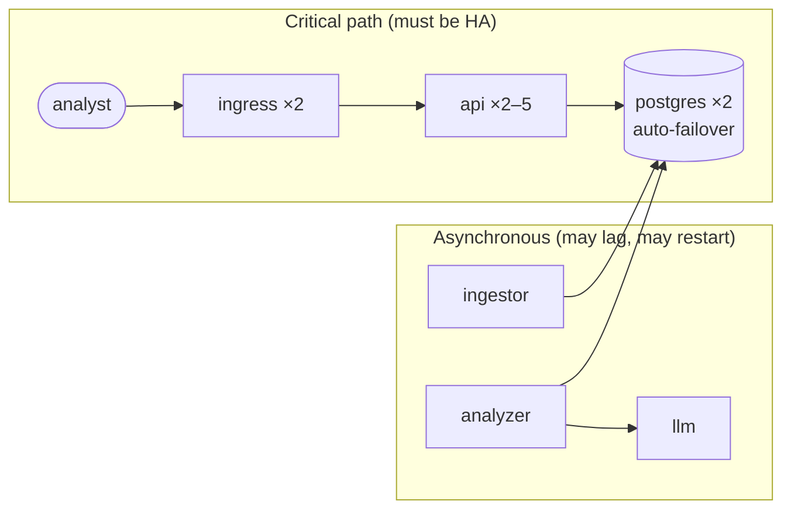

# 15 · High availability and scaling

🟠 Advanced · ⏱️ 45 min · [← Previous](14-network-policies.md) · [Home](../README.md) · [Next: Kustomize and Helm →](16-packaging-kustomize-helm.md)

**High availability (HA)** means users can keep working when parts of the system fail or are being changed. Kubernetes gives you the tools, but a cluster isn't HA just because it's Kubernetes. You must design for it.

## Think in failure scenarios

List what can go wrong and what must keep working:

| Event | Planned? | What protects you |
|---|---|---|
| A container crashes | No | Restart policy, liveness probes, multiple replicas |
| A pod is slow or broken after deploy | Yes | Readiness probes, rolling update with `maxUnavailable: 0`, rollback |
| A **node** dies or is drained for maintenance | Both | Replicas on **different nodes**, PodDisruptionBudgets |
| The database primary dies | No | Replicated database with automatic failover (operator) |
| Traffic spike | No | Autoscaling (HPA), resource requests, headroom |
| A shared component fails (ingress controller, DNS) | Both | Make the shared components HA too |
| A whole site or zone goes down | No | Multi-zone clusters, backups, DR (out of scope here) |

Then remove every **single point of failure (SPOF)** on the critical path. For SkyPulse the critical path is *analyst → ingress → api → PostgreSQL*. The LLM and the ingestor are *off* the critical path by design: the API only reads precomputed summaries, so analysts keep working when those are down.



That **async decoupling** is the most effective HA decision in the whole project, and it's an architecture choice, not a Kubernetes feature.

## Tool 1 · Replicas spread across nodes

Three replicas on the same node die together. Tell the scheduler to spread them:

```yaml
spec:
  template:
    spec:
      topologySpreadConstraints:
        - maxSkew: 1                              # pod counts per node differ by at most 1
          topologyKey: kubernetes.io/hostname     # spread over nodes (use topology.kubernetes.io/zone for zones)
          whenUnsatisfiable: ScheduleAnyway       # or DoNotSchedule (strict)
          labelSelector:
            matchLabels: { app.kubernetes.io/name: api }
```

or, the older way, **pod anti-affinity**:

```yaml
      affinity:
        podAntiAffinity:
          requiredDuringSchedulingIgnoredDuringExecution:     # strict ("preferred…" = best effort)
            - topologyKey: kubernetes.io/hostname
              labelSelector:
                matchLabels: { app.kubernetes.io/name: api }
```

Related scheduling tools: **nodeSelector / node affinity** (run on nodes with a GPU or SSD), **taints and tolerations** (keep normal pods *off* special nodes), **priorityClasses** (who gets evicted first).

## Tool 2 · PodDisruptionBudgets (PDBs)

**Voluntary disruptions** (`kubectl drain` for node upgrades, cluster autoscaler scale-downs) go through the *eviction API*, which respects PDBs:

```yaml
apiVersion: policy/v1
kind: PodDisruptionBudget
metadata: { name: api }
spec:
  minAvailable: 1                # or maxUnavailable: 1
  selector:
    matchLabels: { app.kubernetes.io/name: api }
```

With 2 replicas and `minAvailable: 1`, a drain evicts one pod, waits until its replacement is Ready elsewhere, and only then evicts the next. PDBs don't protect against involuntary failures (a node crash): that's what replicas and spreading are for.

> ⚠️ A PDB that can never be satisfied (`minAvailable: 1` with 1 replica) blocks node drains forever. Don't add PDBs to single-replica workloads.

## Tool 3 · Probes, rolling updates and graceful shutdown

Covered in Chapters 05, 06 and 09: readiness gates traffic, `maxUnavailable: 0` keeps capacity during deploys, and a `preStop` sleep plus SIGTERM handling avoid dropping in-flight requests.

## Tool 4 · Autoscaling

### HorizontalPodAutoscaler (HPA): more pods

```yaml
apiVersion: autoscaling/v2
kind: HorizontalPodAutoscaler
metadata: { name: api }
spec:
  scaleTargetRef: { apiVersion: apps/v1, kind: Deployment, name: api }
  minReplicas: 2                 # the HA floor
  maxReplicas: 5
  metrics:
    - type: Resource
      resource:
        name: cpu
        target: { type: Utilization, averageUtilization: 70 }   # % of the CPU *request*
```


*Source: kubernetes.io. The HPA reads metrics and adjusts the Deployment's replica count.*

- Needs **metrics-server** (built into k3s) and **CPU requests** on the pods.
- ⚠️ **Don't set `spec.replicas` in a Deployment managed by an HPA.** Every `kubectl apply` would reset it, fighting the autoscaler. Leave it out and let `minReplicas` set the floor.
- For queue depth, request rate and other custom metrics, use **KEDA** or the Prometheus adapter.

Also: the **VerticalPodAutoscaler** (right-sizes requests) and the **Cluster Autoscaler / Karpenter** (adds nodes; mostly cloud. On-prem, capacity is planned).

> 🔗 **In the project:** [`api.yaml`](../skypulse/k8s/base/analysis/api.yaml) combines everything above: HPA (2–5 replicas, no `replicas:` field), topology spread across nodes, a PDB, readiness/liveness probes, `maxSurge: 1 / maxUnavailable: 0`, and a `preStop` sleep.

## Tool 5 · HA for stateful components

Stateless pods are easy. State needs **replication + failover**, which the application (or its operator) provides. Kubernetes can't add it:

- **PostgreSQL**: CloudNativePG keeps a primary plus streaming replicas on different nodes (`enablePodAntiAffinity`), and the `feeddb-rw` Service always points at the current primary. If the primary fails, a replica is promoted automatically and clients reconnect to the same DNS name.
- **Your app must reconnect.** SkyPulse's connection pool validates connections before use (`check=ConnectionPool.check_connection`), and the workers catch `OperationalError` and reconnect.

## Don't trust it. Drill it!

HA you haven't tested is a hope. These are the drills we ran on the project, each with a request loop hammering the API every 0.2–0.5 s:

| Drill | Command | Result |
|---|---|---|
| Rolling update of every component | `make update` | **96/96** requests OK |
| Kill the PostgreSQL primary | `kubectl delete pod <primary>` | CNPG shut it down gracefully, promoted the replica: **114/114** OK |
| Drain a node (first attempt) | `kubectl drain <node> --ignore-daemonsets --delete-emptydir-data` | ❌ **33 failed requests (~16 s outage)** |
| Drain a node (after the fix) | same | **59/59** OK |

Why did the first drain fail? Our app was fine. **k3s's bundled ingress controller, Traefik, ran as a single replica**, and it was on the drained node. Our HA design had covered everything *we* deployed and missed the platform component in front of it. The fix: run it with 2 replicas, spread across nodes, with a PDB ([`cluster/traefik-ha.yaml`](../skypulse/cluster/traefik-ha.yaml)). **Audit the whole request path, including what the platform gives you.**

Another lesson from the same drill: the drained node's PostgreSQL *replica* stayed `Pending` until the node came back, because its data was on that node's local disk (Chapter 10). The primary kept serving, so analysts didn't notice. With 3 instances, or network storage, the cluster would also keep full redundancy during maintenance.

Run them yourself (Chapter 21 has the exact commands):

```bash
while true; do curl -s -o /dev/null -w "%{http_code}\n" localhost:8090/api/subscriptions; sleep 0.2; done
kubectl drain k3d-skypulse-agent-0 --ignore-daemonsets --delete-emptydir-data
kubectl uncordon k3d-skypulse-agent-0
```

## Key takeaways

- HA = remove SPOFs on the critical path. Decouple slow or fragile work from user-facing paths.
- Spread replicas across nodes, protect them with PDBs, gate traffic with readiness, scale with an HPA (and don't set `replicas:` alongside it).
- Stateful HA comes from replication and failover (operators); clients must reconnect.
- **Test failure.** The SPOF you didn't think of (here, the ingress controller) only shows up in a drill.

[Next: Packaging with Kustomize and Helm →](16-packaging-kustomize-helm.md)
