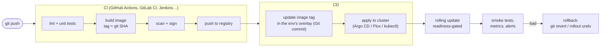

# 17 · Continuous delivery and GitOps

🟠 Advanced · ⏱️ 40 min · [← Previous](16-packaging-kustomize-helm.md) · [Home](../README.md) · [Next: Operators and CRDs →](18-operators-and-crds.md)

"Able to receive continuous software updates" means a commit can reach production **safely, repeatedly and without downtime**, and a bad release can be undone quickly.

## The pipeline



### 1 · Build reproducible, traceable images

- **Lock dependencies** (`uv.lock`, `package-lock.json`) and build with `--locked`, so the image is exactly what you tested.
- **Tag with the git SHA** (and a semver tag for releases). Never deploy `:latest` (Chapter 06).
- **Multi-stage builds**, slim bases, non-root users.
- **Scan** for vulnerabilities (Trivy, Grype), produce an SBOM (Syft), **sign** (cosign), and verify signatures at admission (Kyverno, Sigstore policy-controller).

### 2 · Promote the *same* image through environments

Build once. Dev, staging and production run the **same digest** with different configuration. Promotion means changing the tag in the next environment's overlay, nothing more.

### 3 · Deploy with zero downtime

Rolling updates plus readiness probes plus PDBs (Chapters 06, 09, 15). For extra safety:

| Strategy | How | Tooling |
|---|---|---|
| **Rolling** | Replace pods gradually | Built in |
| **Blue/green** | Run v2 beside v1, switch the Service/Ingress at once | Two Deployments + a label switch; Argo Rollouts |
| **Canary** | Send 5% → 25% → 100% of traffic to v2 while watching metrics | Argo Rollouts, Flagger, Gateway API weights |

### 4 · Handle the database

Old and new pods run side by side during a rollout, so schema changes must be **backward compatible**: *expand* (add a nullable column), *deploy* the code that uses it, *contract* (drop the old column) in a later release. Migrations run before the new code: an init container or a pre-deploy Job (as in SkyPulse).

## Push vs pull: what is GitOps?

| | Push-based CD | **GitOps** (pull-based) |
|---|---|---|
| Who applies | The CI pipeline runs `kubectl apply`/`helm upgrade` | An agent **inside** the cluster pulls from Git |
| Cluster credentials | Stored in CI | Stay in the cluster |
| Source of truth | Whatever was last applied | **Git**, always |
| Drift (manual `kubectl edit`) | Persists unnoticed | Detected and reverted (self-heal) |
| Rollback | Re-run an old pipeline | `git revert` |
| Fits air-gapped/on-prem | Needs inbound access to the cluster | ✅ Only needs outbound access to Git |

**GitOps** means: the desired state of every environment is declared in Git, and software agents (Argo CD, Flux) continuously reconcile the cluster towards it. It's the Kubernetes reconciliation loop (Chapter 02) applied to your whole deployment process.

### Argo CD in practice

```bash
kubectl create namespace argocd
kubectl apply -n argocd -f https://raw.githubusercontent.com/argoproj/argo-cd/stable/manifests/install.yaml
kubectl -n argocd get secret argocd-initial-admin-secret -o jsonpath='{.data.password}' | base64 -d
kubectl -n argocd port-forward svc/argocd-server 8443:443      # https://localhost:8443, user admin
```

```yaml
apiVersion: argoproj.io/v1alpha1
kind: Application
metadata:
  name: skypulse
  namespace: argocd
spec:
  project: default
  source:
    repoURL: https://git.analysts.internal/platform/skypulse.git
    targetRevision: main
    path: k8s/overlays/production
  destination:
    server: https://kubernetes.default.svc
  syncPolicy:
    automated:
      prune: true       # delete what was removed from Git
      selfHeal: true    # undo manual drift
```

Ordering is controlled with **sync waves** (annotations), and hooks run Jobs before or after a sync.

> 🔗 **In the project:**
> - **Locally**, `make update` is a mini pipeline: `uv sync --locked` → `pytest` → build an image tagged `<git-sha>-<timestamp>` → push to the cluster registry → generate an overlay pinning that tag → `kubectl apply -k` → `kubectl rollout status`. We measured **0 failed requests out of 96** during a full update.
> - **In production**, [`deploy/argocd/application.yaml`](../skypulse/deploy/argocd/application.yaml) points Argo CD at the production overlay. CI only has to push the image and commit the new tag.
> - The LLM image is tagged by *content* (`<ollama-version>-<model>`). It's rebuilt only when the model changes, so code releases stay small and fast.

### Air-gapped and on-prem specifics

- Mirror images into a **site registry** (Harbor, Zot) and point overlays at it. Promotion = copying a signed image from the build registry to the site registry (`skopeo copy`, `crane copy`).
- Run Argo CD or Flux **inside** each site, pulling from an internal Git mirror.
- Models, Helm charts and operator manifests are artifacts too: version and mirror them the same way.

## Rollback playbook

```bash
kubectl rollout undo deployment/api -n skypulse-analysis         # fast, but now Git and cluster disagree
git revert <bad-commit> && git push                              # GitOps: the agent rolls back for you
kubectl rollout history deployment/api -n skypulse-analysis
```

## Key takeaways

- Build once (locked deps, SHA tags), scan and sign, promote the same image through environments.
- Rolling updates gated by readiness give zero downtime; canary and blue/green add safety; schema changes must be backward compatible.
- **GitOps** = Git is the source of truth and an in-cluster agent reconciles. It's great for on-prem and air-gapped sites.

[Next: Operators and Custom Resources →](18-operators-and-crds.md)
