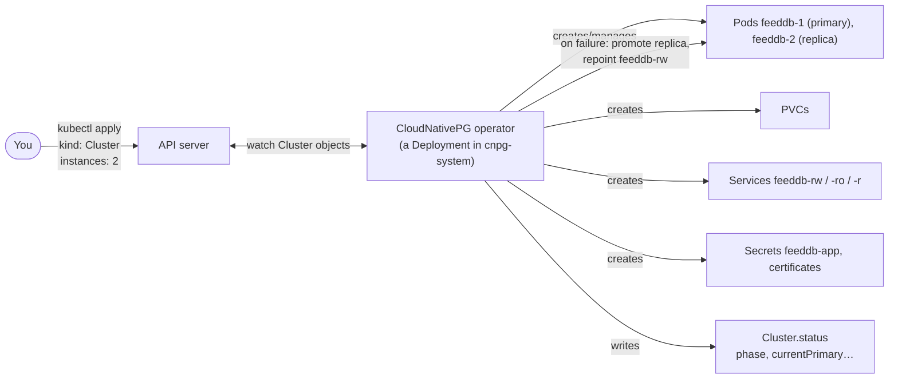

# 18 · Operators and Custom Resources

🔴 Expert · ⏱️ 35 min · [← Previous](17-continuous-delivery-gitops.md) · [Home](../README.md) · [Next: Troubleshooting →](19-troubleshooting.md)

## Extending the Kubernetes API

Kubernetes knows about Pods and Deployments. What if you want it to know about *PostgreSQL clusters*, *certificates* or *backups*, and manage them with the same declarative loop?

1. A **CustomResourceDefinition (CRD)** teaches the API server a new kind (schema, versions, validation). After that, `kubectl get postgresclusters` works like any built-in type.
2. An **operator** is a controller (Chapter 02's reconciliation loop) that watches those custom resources and does whatever is needed to make reality match. It encodes the knowledge of a human operator: how to bootstrap, replicate, fail over, back up and upgrade.



## A custom resource in practice

```yaml
apiVersion: postgresql.cnpg.io/v1
kind: Cluster
metadata:
  name: feeddb
  namespace: skypulse-data
spec:
  instances: 2
  storage: { size: 1Gi }
  bootstrap:
    initdb: { database: skypulse, owner: skypulse }
  managed:
    roles:
      - name: ingestor
        login: true
        passwordSecret: { name: ingestor-db-credentials }
      - name: analysis
        login: true
        passwordSecret: { name: analysis-db-credentials }
  affinity:
    enablePodAntiAffinity: true
    topologyKey: kubernetes.io/hostname
```

From ~20 lines the operator delivers a primary and replica on different nodes, streaming replication, TLS, a generated password for the schema owner (`feeddb-app` Secret, including a ready-made `uri`), stable Services for read-write and read-only traffic, managed least-privilege roles, automatic failover and rolling minor-version upgrades. Built by hand, that would be hundreds of lines of scripts nobody wants to own.

```bash
kubectl get crds | grep cnpg
kubectl explain cluster.spec.backup --api-version=postgresql.cnpg.io/v1    # CRDs are self-documenting too
kubectl -n skypulse-data get cluster.postgresql.cnpg.io feeddb
# NAME     AGE   INSTANCES   READY   STATUS                     PRIMARY
# feeddb   9m    2           2       Cluster in healthy state   feeddb-2
```

The optional `kubectl cnpg` plugin adds commands like `kubectl cnpg status feeddb` and `kubectl cnpg promote feeddb feeddb-2`.

> 🔗 **In the project:** the operator is installed by `make operator` (one pinned manifest, applied server-side) and the database is declared in [`postgres.yaml`](../skypulse/k8s/base/data/postgres.yaml). The failover drill in Chapter 15 was handled entirely by this operator.

## Operators you'll meet

| Domain | Operators |
|---|---|
| Databases | CloudNativePG, Crunchy PGO, Zalando (PostgreSQL); Percona (MySQL/MongoDB); Redis/Valkey operators |
| Messaging | Strimzi (Kafka), RabbitMQ Cluster Operator |
| Certificates | cert-manager (`Certificate`, `Issuer`) |
| Monitoring | Prometheus Operator (`ServiceMonitor`, `PrometheusRule`) |
| Storage | Rook (Ceph), Longhorn |
| GitOps | Argo CD (`Application`), Flux (`Kustomization`, `HelmRelease`) |
| Secrets | External Secrets (`ExternalSecret`) |

Browse [OperatorHub.io](https://operatorhub.io) and the [CNCF landscape](https://landscape.cncf.io).

## Choosing an operator: a checklist

- **Maturity**: CNCF project status, release cadence, number of production users.
- **Day-2 coverage**: backups *and restores*, upgrades, failover, monitoring. Not just "install".
- **Blast radius**: operators often need cluster-wide permissions. Read their RBAC.
- **Exit strategy**: can you get your data out if you stop using it?

## Writing your own (a peek)

Frameworks: **Kubebuilder** / **Operator SDK** (Go), **kopf** (Python), **Metacontroller**. The core of every operator is the same idempotent function:

```python
# kopf (Python) — illustrative
import kopf

@kopf.on.create("example.com", "v1", "summaryjobs")
@kopf.on.update("example.com", "v1", "summaryjobs")
def reconcile(spec, name, namespace, **_):
    desired = build_cronjob(spec)               # what should exist
    apply(desired)                              # create or patch it (idempotent!)
    return {"phase": "Scheduled"}               # becomes .status
```

Rules of thumb: reconcile is **level-based** (look at the whole current state, don't count on events), **idempotent**, and writes progress to `.status`. Use **owner references** so children get garbage-collected, and **finalizers** for cleanup of external resources.

## Key takeaways

- **CRDs** add new object kinds; **operators** are controllers that reconcile them with domain knowledge.
- Run stateful systems (databases, queues) with a mature operator rather than bare StatefulSets.
- Evaluate operators on day-2 capabilities and permissions, not just installation.

[Next: Troubleshooting →](19-troubleshooting.md)
