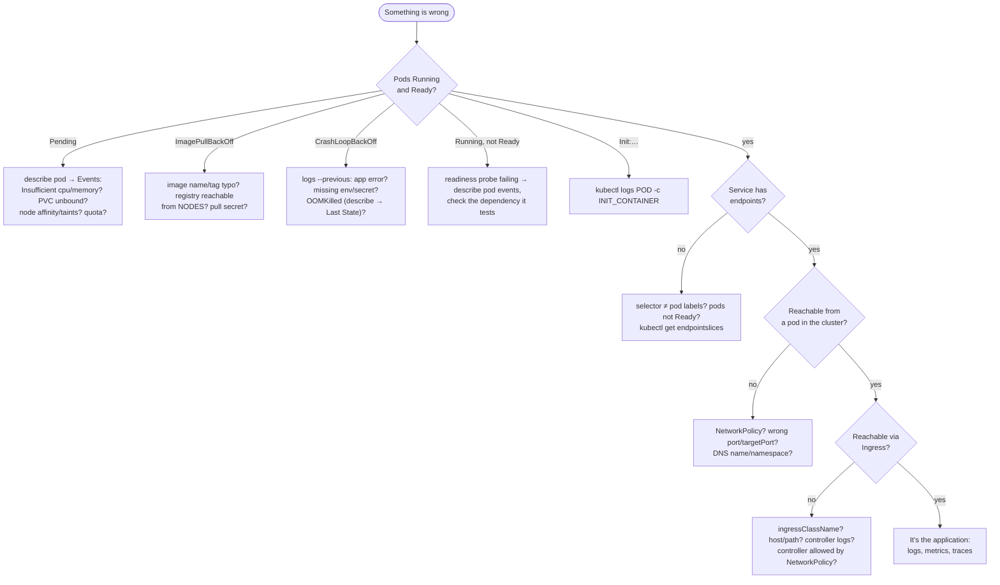

# 19 · Troubleshooting

🔴 Expert · ⏱️ 40 min · [← Previous](18-operators-and-crds.md) · [Home](../README.md) · [Next: On-prem in production →](20-on-prem-production.md)

Debugging Kubernetes is a skill you can learn: follow the request path, read the events, form a hypothesis, test it from inside the cluster.

## The method



## The toolbox

```bash
kubectl get pods -o wide -n <ns>                         # status, restarts, node, IP
kubectl describe pod <pod> -n <ns>                       # config + EVENTS at the bottom
kubectl logs <pod> [-c container] [--previous] [-f]      # --previous = the crashed instance
kubectl get events -n <ns> --sort-by=.lastTimestamp      # timeline of everything
kubectl get endpointslices -n <ns>                       # does the Service have backends?
kubectl exec -it <pod> -- sh                             # look around inside (if the image has a shell)
kubectl debug -it <pod> --image=nicolaka/netshoot --target=<container>   # ephemeral debug container with network tools
kubectl run tmp --rm -it --image=busybox --restart=Never -- sh            # a throwaway client pod
kubectl top pods / nodes                                 # resource usage
kubectl get pod <pod> -o yaml | less                     # what the API really has (vs what you think you applied)
kubectl auth can-i <verb> <resource> --as=<user>         # RBAC questions
```

Hardened images (like ours) often have no shell or curl. A one-line Python snippet works anywhere Python exists:

```bash
kubectl exec deploy/api -n skypulse-analysis -- python -c "import socket; socket.create_connection(('llm', 11434), timeout=3); print('ok')"
```

Install **[k9s](https://k9scli.io/)** for an interactive terminal UI. It makes all of the above a few keystrokes away.

## Common symptoms → causes

| Symptom | Likely causes | Check |
|---|---|---|
| `Pending` | Not enough resources; PVC not bound; node affinity/anti-affinity unsatisfiable; local volume on an unavailable node | `describe pod` → Events (*FailedScheduling*) |
| `ImagePullBackOff` | Typo; tag doesn't exist; private registry without `imagePullSecrets`; registry not reachable **from the nodes** | `describe pod`; try `docker pull` the exact name |
| `CrashLoopBackOff` | App exception; missing config; wrong command; can't reach a dependency at startup | `logs --previous` |
| `OOMKilled` | Memory limit too low or a leak | `describe pod` → *Last State: Terminated, Reason: OOMKilled* |
| `Running` but `0/1 Ready` | Readiness probe failing | Events show *Readiness probe failed: …* |
| `CreateContainerConfigError` | Referenced ConfigMap/Secret or key doesn't exist | `describe pod` |
| Rejected at creation, *violates PodSecurity "restricted"* | Missing securityContext fields | Read the message: it lists every field |
| Service connection refused / timeout | No endpoints; wrong `targetPort`; NetworkPolicy | `get endpointslices`; test from a pod |
| Ingress 404 | No matching host/path; wrong `ingressClassName` | Controller logs |
| Ingress 502/503/504 | Backend pods not Ready; NetworkPolicy blocks the controller | `get endpointslices`; policies |
| Stuck `Terminating` | Finalizers; node gone | `get -o yaml` → `metadata.finalizers` |
| Changes to a ConfigMap "don't apply" | Env vars are read at start | `rollout restart`, or hashed ConfigMaps (Ch. 08) |

## War stories from building SkyPulse

These all happened while building the project in this guide. Each is a lesson.

### 1 · "invalid literal for int(): 'tcp://10.43.89.235:80'"

The API and analyzer crash-looped on first deploy:

```text
File "/app/.venv/lib/python3.12/site-packages/skypulse/config.py", line 12, in _int
ValueError: invalid literal for int() with base 10: 'tcp://10.43.89.235:80'
```

The app read its port from `API_PORT`. But there's a Service called `api` in the namespace, and Kubernetes injects **service-link environment variables** into every pod: `API_PORT=tcp://10.43.89.235:80`, `API_SERVICE_HOST=…`. The kubelet overwrote our setting.

**Fix:** `enableServiceLinks: false` on every pod spec (DNS is the discovery mechanism anyway), and the setting was renamed to `HTTP_PORT`. **Lesson:** never name your settings `<SERVICE>_PORT` / `<SERVICE>_SERVICE_HOST`.

### 2 · Workers crash-looping on first install

```text
psycopg.errors.UndefinedTable: relation "posts" does not exist
```

The analyzer started before the migration step had created the tables. (At the time migrations ran in an init container of the API; they now run as a Job in the `skypulse-data` namespace. The lesson is the same.) Kubernetes eventually converged (restart → retry), but `CrashLoopBackOff` on a fresh install looks broken and slows startup with backoff delays.

**Fix:** the workers treat "schema not ready" (`UndefinedTable`, `InsufficientPrivilege`) as a *wait* condition, not a crash. **Lesson:** in Kubernetes components start in any order. Design every component to wait and retry for its dependencies instead of assuming they're ready.

### 3 · The hidden single point of failure

Draining a node caused ~16 s of total outage even though the API had 2 replicas on different nodes. `kubectl get pods -A -o wide` showed the culprit: k3s's bundled **Traefik ingress controller had one replica**, on the drained node. **Fix:** [`cluster/traefik-ha.yaml`](../skypulse/cluster/traefik-ha.yaml). **Lesson:** audit every hop of the request path, including platform components you didn't deploy.

### 4 · PostgreSQL replica stuck `Pending` after a drain

`describe pod` showed the volume's **node affinity** didn't match any available node. The `local-path` StorageClass keeps data on one node's disk, so the pod can only run there. **Lesson:** know your StorageClass. Local volumes are fine when the application replicates data (here the primary kept serving), but the redundancy only comes back with the node.

### 5 · "port is already allocated"

`k3d cluster create` failed: `Bind for 127.0.0.1:8080 failed: port is already allocated`. Another local cluster already used 8080. `docker ps --format '{{.Names}} {{.Ports}}'` found it in seconds. **Lesson:** local clusters are Docker containers, so Docker tooling debugs them.

### 6 · "Deleting the primary didn't fail over for two minutes!"

After `kubectl delete pod feeddb-1` (the primary), it stayed `Terminating` for about two minutes before the replica was promoted. Nothing was broken: CloudNativePG performs a **graceful (smart) shutdown** of the primary first, so in-flight transactions finish and the API kept serving throughout. A real crash (node power loss) triggers failover after the failure is detected, with no graceful phase. **Lesson:** know what your operator does on deletion versus on a crash before you run drills.

## Key takeaways

- Follow the path: Pod status → Events → logs → endpoints → network from inside → ingress.
- `describe` + `get events` + `logs --previous` solve most problems.
- Build components that tolerate any start order, and test from inside the cluster.

[Next: On-premises Kubernetes in production →](20-on-prem-production.md)
