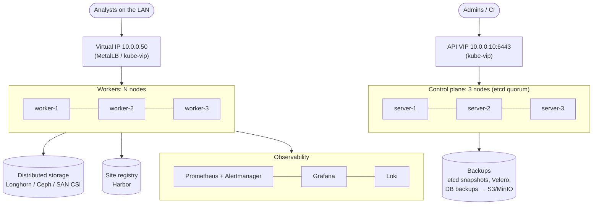

# 20 · On-premises Kubernetes in production

🔴 Expert · ⏱️ 45 min · [← Previous](19-troubleshooting.md) · [Home](../README.md) · [Next: Hands-on project →](21-project-skypulse.md)

In the cloud you click "create cluster" and get load balancers, disks and an HA control plane. On-premises you provide all of that yourself. This chapter maps out what a production on-prem cluster needs.

## Reference architecture



## 1 · Choosing a distribution

| Distribution | Notes |
|---|---|
| **k3s** | Single binary, low footprint, embedded etcd HA, batteries included (Traefik, ServiceLB, local-path, network policies). Great for small and medium sites and the edge. Used by this guide. |
| **RKE2** | Rancher's security-focused sibling of k3s (CIS-hardened defaults, FIPS options); common in government and regulated environments. |
| **kubeadm** | Upstream building blocks. Maximum control, maximum work. |
| **OpenShift / OKD**, **Talos Linux**, **Charmed Kubernetes**, **VMware Tanzu** | Platforms with opinions and (often) support contracts. Talos is an immutable, API-managed OS made just for Kubernetes. |

## 2 · An HA control plane with k3s

```bash
# server-1: initialize the embedded etcd cluster
curl -sfL https://get.k3s.io | K3S_TOKEN=<secret> sh -s - server --cluster-init \
  --tls-san 10.0.0.10 --secrets-encryption
# server-2 and server-3: join it
curl -sfL https://get.k3s.io | K3S_TOKEN=<secret> sh -s - server --server https://10.0.0.10:6443
# workers
curl -sfL https://get.k3s.io | K3S_TOKEN=<secret> sh -s - agent --server https://10.0.0.10:6443
```

- **3 servers** for etcd quorum (tolerates 1 failure); 5 tolerates 2.
- Put a **virtual IP** in front of the API servers (kube-vip, keepalived + HAProxy) and use it everywhere (`--tls-san`).
- Automate with Ansible (k3s-ansible), Cluster API, or Rancher. Never hand-configure production nodes.

## 3 · Load balancers on bare metal

`Service type: LoadBalancer` needs an implementation:

- **MetalLB** (L2/ARP or BGP mode) hands out IPs from a pool on your LAN.
- **kube-vip** does both control-plane VIPs and Service load balancing.
- k3s's **ServiceLB** is simple (uses node IPs), fine for small setups.

```yaml
apiVersion: metallb.io/v1beta1
kind: IPAddressPool
metadata: { name: lan, namespace: metallb-system }
spec: { addresses: ["10.0.0.50-10.0.0.60"] }
---
apiVersion: metallb.io/v1beta1
kind: L2Advertisement
metadata: { name: lan, namespace: metallb-system }
```

**Security tie-in:** giving the ingress controller an IP **only on the analysts' VLAN** (plus host firewalls) is what keeps the app reachable from the local network only.

## 4 · Storage

| Option | Pros | Cons |
|---|---|---|
| Local disks (local-path, TopoLVM) | Fastest, simplest | Pods pinned to nodes; app must replicate |
| **Longhorn** | Easy replicated block storage, snapshots, backups to S3 | Overhead on small clusters |
| **Rook-Ceph** | Block, file (RWX) and object; scales big | Operational complexity |
| Existing SAN/NAS with a CSI driver | Reuses enterprise storage | Vendor dependency |

## 5 · Registries and air-gapped installs

- Run a **site registry** (Harbor: scanning, signing, replication, RBAC).
- Configure the container runtime to use it as a mirror. In k3s, `/etc/rancher/k3s/registries.yaml` (exactly what [`cluster/k3d.yaml`](../skypulse/cluster/k3d.yaml) does for the local registry):

  ```yaml
  mirrors:
    docker.io:
      endpoint: ["https://harbor.site.internal/v2/dockerhub-proxy"]
  ```

- Fully air-gapped sites: k3s/RKE2 ship **airgap image tarballs**; mirror Helm charts, operator manifests and **model weights** as versioned artifacts, and bring them in through a controlled transfer process.

## 6 · Day-2 operations

| Area | Practice |
|---|---|
| **Upgrades** | One minor version at a time; control plane first, then workers. Drain, upgrade, uncordon, one node at a time (k3s's *system-upgrade-controller* automates this). Read deprecation notes; test in staging. |
| **Backups** | etcd snapshots (`k3s etcd-snapshot`, scheduled by default in k3s HA); **Velero** for objects + volumes; **application-level** DB backups (CNPG → MinIO with point-in-time recovery). **Rehearse restores.** |
| **Monitoring** | kube-prometheus-stack (Prometheus, Alertmanager, Grafana, node-exporter, kube-state-metrics). Alert on symptoms (error rate, latency, failing probes), not just CPU. |
| **Logging** | Loki + Promtail/Alloy, or OpenSearch + Fluent Bit |
| **Certificates** | cert-manager with your internal CA; k3s rotates its own certificates on restart when they're close to expiry |
| **Security** | CIS benchmark (kube-bench), Pod Security `restricted`, Kyverno policies, image signing, secrets encryption at rest, audit logging, regular node OS patching |
| **Capacity** | No autoscaler for hardware: track requests vs allocatable per node, keep N+1 headroom so a node's pods fit elsewhere during failures and drains |

## 7 · How the SkyPulse design maps to production

| Local (this repo) | Production on-prem |
|---|---|
| k3d: 1 server + 2 agents in Docker | k3s/RKE2: 3 servers + N workers, API VIP |
| k3d load balancer on `localhost:8090` | MetalLB IP on the analysts' VLAN, hostname + TLS (cert-manager, internal CA) |
| k3d registry `localhost:5050` | Harbor, images signed and scanned |
| `local-path` storage | Longhorn/Ceph, or local disks + 3 CNPG instances |
| `make update` | CI builds and pushes; Argo CD syncs [`overlays/production`](../skypulse/k8s/overlays/production/kustomization.yaml) |
| `make secrets` | External Secrets from Vault, or Sealed Secrets |
| CNPG without backups | CNPG `backup:` to MinIO + scheduled backups + restore drills |
| `kubectl logs` | Prometheus/Grafana/Loki with alerts |
| CoreDNS forwards to the internet | CoreDNS restricted to internal zones for the analysis side, or DNS-aware policies |

## Key takeaways

- On-prem you own the control-plane HA, load balancing, storage, registries and backups.
- k3s/RKE2 + MetalLB + Longhorn/Ceph + Harbor + Argo CD + kube-prometheus-stack is a proven, compact stack.
- Plan day-2 from day 1: upgrades, backups (with restore drills), monitoring, capacity headroom.

[Next: Hands-on project: SkyPulse →](21-project-skypulse.md)
