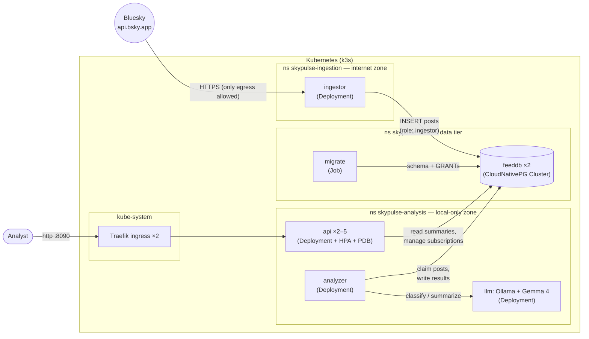
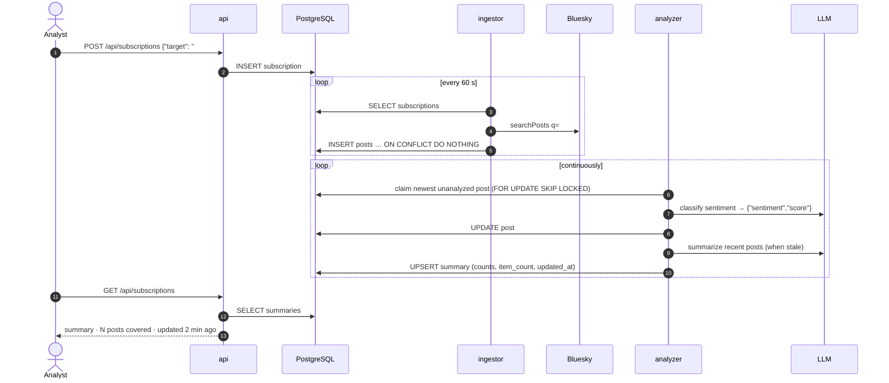

# 21 · Hands-on project: SkyPulse

🛠️ Project · ⏱️ 3–4 hours · [← Previous](20-on-prem-production.md) · [Home](../README.md) · [Cheat sheet →](cheatsheet.md)

Time to build something real. We'll solve the problem described in [`PROBLEM.md`](../PROBLEM.md) **with all of its constraints**, and use most of the guide along the way.

The finished code is in [`skypulse/`](../skypulse/). You can work in two ways:

- **Follow along:** read each step, open the files it points to, run the commands. (Recommended.)
- **Rebuild it:** create an empty folder and write each file as you go, using the repo as the answer key.

---

## Step 0 · Understand the problem

> Analysts follow curated public social-media sources. They must be able to:
> 1. Subscribe to and unsubscribe from **Bluesky handles and hashtags**.
> 2. See a **summary of the recent sentiment** for each subscription.
> 3. See **how many items** the summary covers.
> 4. See **when** the summary was last updated.
>
> Use a **small local LLM** (such as Gemma 4 E2B). Build it on-premises deployable, with Kubernetes and Python/uv 3.12+.
> - **Security:** ingestion may connect to the internet; the analysis application must only have access to the local network.
> - **Deployment:** highly available to analysts; able to receive continuous software updates.
> - **Deliverable:** README with build/run instructions, `make build` and `make start`, a design document.

Before writing code, turn every requirement into a design decision:

| Requirement | Decision | Why |
|---|---|---|
| Subscriptions + summaries | A small web app (FastAPI) + PostgreSQL | Simple, transactional, one source of truth |
| Read Bluesky | An **ingestor** polling the public AppView API (`getAuthorFeed`, `searchPosts`); no account needed | Easiest reliable access; idempotent inserts make polling safe |
| Local LLM | **Ollama** serving **Gemma 4 E2B**, with the model **baked into the image** | The analysis zone has no internet, so the model can't be downloaded at runtime |
| Sentiment summaries | An **analyzer** worker: per-post classification (JSON-constrained output) + a periodic per-subscription summary | Precomputed results keep the UI instant |
| Internet vs local boundary | **Ingestion and analysis namespaces** that only meet at a third **data** namespace, default-deny **NetworkPolicies**, a least-privilege DB role per zone | The boundary is enforced by the network, not by trust; the database's owner credentials stay out of the app namespaces |
| Highly available | API ≥2 replicas across nodes, PDB, probes; PostgreSQL ×2 via **CloudNativePG** (auto-failover); HA ingress; LLM *off* the critical path | Analysts' path has no single point of failure |
| Continuous updates | Immutable image tags, rolling updates (`maxUnavailable: 0`), Kustomize overlays, GitOps-ready | Zero-downtime releases and easy rollback |
| On-prem | **k3s** (k3d locally), private registry | Same distribution on laptop and servers |

## Step 1 · The architecture



**The data flow:**



Three properties fall out of this design:

1. **The API never waits on the LLM or the internet.** It reads precomputed rows, so it's fast and stays up when the LLM or ingestor don't.
2. **PostgreSQL is the only state.** Every other pod can be killed, moved or scaled freely.
3. **The two zones only meet at the database**, in its own namespace, through one port, each with its own restricted role. The schema owner's credentials never leave `skypulse-data`.

## Step 2 · The Python project (uv)

```bash
cd skypulse
uv sync          # creates .venv with Python 3.12 + locked dependencies
uv run pytest -q # 24 unit tests
```

Look at [`pyproject.toml`](../skypulse/pyproject.toml): FastAPI, uvicorn, httpx, psycopg 3 + pool, and a single console script:

```toml
[project.scripts]
skypulse = "skypulse.__main__:main"     # skypulse api | ingestor | analyzer | migrate
```

**One codebase, one image, four roles.** That's simpler to build, version and secure than four images, and Kubernetes picks the role with `args:`.

A tour of [`src/skypulse/`](../skypulse/src/skypulse/):

| File | What to notice |
|---|---|
| [`config.py`](../skypulse/src/skypulse/config.py) | All settings come from environment variables (12-factor). `DATABASE_URL` empty → libpq's `PG*` variables are used (the ingestor relies on this). |
| [`targets.py`](../skypulse/src/skypulse/targets.py) | Validates `@handle` / `#hashtag` input. The API can't ask Bluesky whether a handle exists (no internet!), so the ingestor reports unknown handles back via `last_error`. |
| [`bluesky.py`](../skypulse/src/skypulse/bluesky.py) | Public AppView API, no auth. Skips reposts and image-only posts. |
| [`ingestor.py`](../skypulse/src/skypulse/ingestor.py) | Poll loop. `INSERT … ON CONFLICT DO NOTHING` makes re-polling (and multiple replicas) safe. Reconnects on DB failover. |
| [`llm.py`](../skypulse/src/skypulse/llm.py) | Calls Ollama's `/api/chat` with a **JSON schema** in `format`, so the model can only answer `{"sentiment": …, "score": …}`. Parsing is still defensive. If `LLM_MODEL` is empty, it uses whatever model the server ships. |
| [`analyzer.py`](../skypulse/src/skypulse/analyzer.py) | `SELECT … FOR UPDATE SKIP LOCKED` lets several analyzers share the work without duplicates; `pg_try_advisory_xact_lock` does the same for summaries. "Recent" = last 7 days, max 50 posts (configurable). |
| [`api.py`](../skypulse/src/skypulse/api.py) | JSON API + a static single-page UI. `/healthz` (liveness, no DB) vs `/readyz` (readiness: the DB is reachable and migrated). The connection pool validates connections, so failovers heal transparently. |
| [`db.py`](../skypulse/src/skypulse/db.py) | Migrations under an advisory lock (safe to run concurrently), then **least-privilege GRANTs** for the `ingestor` and `analysis` roles. |

## Step 3 · Containerize

### The app image: [`docker/app.Dockerfile`](../skypulse/docker/app.Dockerfile)

```dockerfile
FROM python:3.12-slim-bookworm AS build
COPY --from=ghcr.io/astral-sh/uv:0.12.20 /uv /bin/uv
COPY pyproject.toml uv.lock ./
RUN uv sync --locked --no-dev --no-install-project   # deps layer: cached until the lock changes
COPY src ./src
RUN uv sync --locked --no-dev --no-editable          # our code: rebuilds in seconds

FROM python:3.12-slim-bookworm                       # runtime: no uv, no build tools
RUN useradd --uid 10001 ... skypulse
COPY --from=build /app/.venv /app/.venv
USER 10001                                           # required by the "restricted" Pod Security profile
ENTRYPOINT ["skypulse"]
```

Result: ~58 MB compressed, non-root, with exactly the locked dependencies.

### The LLM image: [`docker/llm.Dockerfile`](../skypulse/docker/llm.Dockerfile)

```dockerfile
FROM ollama/ollama:0.35.1
ENV OLLAMA_MODELS=/models
RUN ollama serve & pid=$!; …wait…; ollama pull "gemma4:e2b-it-qat"; kill $pid
ENV OLLAMA_NOPRUNE=1 HOME=/home/ollama
USER 10001
```

**Why bake the model into the image?** The analysis zone can't reach the internet, so a pod can't `ollama pull` at startup. Baking it in also means the model is **versioned, scanned and promoted like code**, and works in air-gapped sites. The trade-off is size: about 7 GB compressed (the Ollama base image alone is ~3.6 GB because of GPU libraries). It's rebuilt only when the model or the Ollama version changes, because its tag is derived from them: `0.35.1-gemma4-e2b-it-qat`.

> 💡 **Low on RAM?** Gemma 4 E2B needs ~5 GB of memory to run. Use a smaller model with `make build LLM_MODEL=gemma3:1b` (≈1 GB). The analyzer auto-detects whichever model the image contains.

```bash
make build        # = uv sync --locked + pytest + build both images (tagged for the local registry)
docker images | grep skypulse
```

## Step 4 · The cluster: [`cluster/k3d.yaml`](../skypulse/cluster/k3d.yaml)

```yaml
servers: 1
agents: 2                       # 3 nodes: enough to test spreading and node failures
image: rancher/k3s:v1.36.5-k3s1 # pinned: reproducible
ports:
  - port: 8090:80               # analysts' entry point → Traefik
    nodeFilters: [loadbalancer]
registries:
  create:                       # a private registry container, like an on-prem Harbor
    name: k3d-skypulse-registry
    hostPort: "5050"
  config: |                     # nodes pull "localhost:5050/…" from that registry
    mirrors:
      "localhost:5050":
        endpoint: [http://k3d-skypulse-registry:5000]
```

`make cluster` creates it, then applies [`cluster/traefik-ha.yaml`](../skypulse/cluster/traefik-ha.yaml) to run the ingress controller with 2 replicas. (Why that's essential is in Step 11.)

## Step 5 · The PostgreSQL operator

```bash
make operator   # kubectl apply --server-side -f <pinned CloudNativePG 1.30.1 manifest>
kubectl get pods -n cnpg-system
kubectl get crds | grep cnpg        # new kinds: Cluster, Backup, ScheduledBackup, Pooler…
```

([Chapter 18](18-operators-and-crds.md) explains operators.)

## Step 6 · Secrets

```bash
make secrets
```

This generates one random password per zone role (`.secrets/ingestor-password`, `.secrets/analysis-password`, git-ignored) and creates each Secret in **two** namespaces: `skypulse-data` (where CloudNativePG reads it to create the role) and the zone's own namespace (where its pods read it to log in). Secrets can't be read across namespaces. The schema *owner's* password is generated by the operator itself (`feeddb-app`) and never leaves `skypulse-data`. Nobody types or sees it.

## Step 7 · The manifests, one by one

Everything lives in [`k8s/base/`](../skypulse/k8s/base/), stitched together by [`kustomization.yaml`](../skypulse/k8s/base/kustomization.yaml). Read each file. They're heavily commented.

| File | Kind(s) | Key ideas (chapter) |
|---|---|---|
| [`namespaces.yaml`](../skypulse/k8s/base/namespaces.yaml) | Namespace ×3 | Two security zones + the data tier; `pod-security.kubernetes.io/enforce: restricted` (13) |
| [`analysis/config.env`](../skypulse/k8s/base/analysis/config.env), [`ingestion/config.env`](../skypulse/k8s/base/ingestion/config.env) | → ConfigMaps (generated) | Hash-suffixed names, so config changes trigger rollouts (08, 16) |
| [`data/postgres.yaml`](../skypulse/k8s/base/data/postgres.yaml) | CNPG `Cluster` | 2 instances, required anti-affinity, managed `ingestor` and `analysis` roles (10, 18) |
| [`data/migrate.yaml`](../skypulse/k8s/base/data/migrate.yaml) | Job | Schema + GRANTs with the owner's credentials, which stay in this namespace (12) |
| [`data/networkpolicies.yaml`](../skypulse/k8s/base/data/networkpolicies.yaml) | NetworkPolicy ×4 | PostgreSQL accepts only the two zones' clients, migrate, replication and the operator (14) |
| [`analysis/llm.yaml`](../skypulse/k8s/base/analysis/llm.yaml) | Deployment + Service | Big memory request; read-only FS + `emptyDir`; non-root (09, 13) |
| [`analysis/analyzer.yaml`](../skypulse/k8s/base/analysis/analyzer.yaml) | Deployment | Heartbeat-file liveness probe; logs in as the `analysis` role (08, 09) |
| [`analysis/api.yaml`](../skypulse/k8s/base/analysis/api.yaml) | Deployment, Service, PDB, HPA | Readiness checks the migrated schema, liveness, `maxUnavailable: 0`, preStop, topology spread, no `replicas:` (06, 09, 15) |
| [`analysis/ingress.yaml`](../skypulse/k8s/base/analysis/ingress.yaml) | Ingress | Traefik routes `/` to the api Service (11) |
| [`analysis/networkpolicies.yaml`](../skypulse/k8s/base/analysis/networkpolicies.yaml) | NetworkPolicy ×5 | Default deny; only the flows in the diagram, no `ipBlock` rules at all (14) |
| [`ingestion/ingestor.yaml`](../skypulse/k8s/base/ingestion/ingestor.yaml) | Deployment | `PGUSER`/`PGPASSWORD` from the Secret, `PGHOST` = FQDN in the data namespace (07, 08) |
| [`ingestion/networkpolicies.yaml`](../skypulse/k8s/base/ingestion/networkpolicies.yaml) | NetworkPolicy ×3 | Internet :443 **except private ranges**; DB :5432 only (14) |

Patterns repeated in every pod spec:

```yaml
automountServiceAccountToken: false     # none of our pods talk to the Kubernetes API
enableServiceLinks: false               # no injected <SERVICE>_PORT variables (war story #1, Ch. 19)
securityContext:
  runAsNonRoot: true
  seccompProfile: { type: RuntimeDefault }
containers:
  - securityContext:
      allowPrivilegeEscalation: false
      readOnlyRootFilesystem: true
      capabilities: { drop: ["ALL"] }
```

Render the whole thing and read it as Kubernetes will see it:

```bash
kubectl kustomize k8s/overlays/local | less
```

## Step 8 · Deploy

```bash
make start
```

`make start` = `check-tools` → `cluster` → `operator` → `secrets` → `push` → `deploy`. In another terminal, watch the system assemble itself:

```bash
kubectl get pods -A -w
```

What you'll see, in order:

1. `feeddb-1-initdb-…` (a Job pod) initializes the database, then `feeddb-1` (primary) starts and `feeddb-2-join-…` clones it into the replica `feeddb-2`.
2. The `migrate-…` Job pod waits for the database, creates the schema and grants the `ingestor` and `analysis` roles, then shows `Completed`.
3. `api-…` pods run but stay `0/1` (not Ready) until the schema exists; `analyzer` and `ingestor` politely wait for it too (they don't crash: war story #2).
4. `llm` takes the longest the first time: the node pulls a ~7 GB image from the registry.

A fresh install on a 12-core laptop took **6.5 minutes** with **zero pod restarts**.

## Step 9 · Use it

Open **<http://localhost:8090>**, type `#kubernetes`, then `@bsky.app`, and click *Subscribe*.

Or use the API:

```bash
curl -X POST localhost:8090/api/subscriptions -H 'Content-Type: application/json' -d '{"target":"#kubernetes"}'
curl -s localhost:8090/api/subscriptions | python -m json.tool
curl -X DELETE localhost:8090/api/subscriptions/1
```

Within about a minute the ingestor fetches posts; the analyzer then classifies them (~1.5 s per post on CPU) and writes a summary like:

> **#kubernetes** · POSITIVE · *The sentiment is mixed, with positive engagement around learning and successful CI/CD pipelines, contrasted by negative discussions on critical security vulnerabilities in container storage and database connection pooling issues…* · **50 posts covered** · updated 2 min ago

Each card shows all four required facts: the subscription, the sentiment summary (text + overall label + positive/neutral/negative bar), **how many posts** it covers and **when** it was last updated. A non-existent handle shows *"Not found on Bluesky"*.

Peek behind the scenes:

```bash
make logs                                                          # all components
kubectl -n skypulse-data exec -it feeddb-1 -c postgres -- psql -U postgres -d skypulse \
  -c "select sentiment, round(score::numeric,2), left(text, 60) from posts where analyzed_at is not null limit 5"
```

(If `feeddb-1` isn't the primary any more, any instance can serve reads.)

## Step 10 · Prove the security boundary

```bash
make verify
```

```text
== Security boundary: analysis zone has no internet access
  PASS  api      -> internet (api.bsky.app:443) (blocked)
  PASS  analyzer -> internet (1.1.1.1:443) (blocked)
  PASS  api      -> postgres (feeddb-rw.skypulse-data:5432) (allowed)
  PASS  analyzer -> llm (llm:11434) (allowed)
  PASS  api      -> llm (not needed, so not allowed) (blocked)
== Security boundary: ingestion zone reaches the internet, but not the local network
  PASS  ingestor -> internet (api.bsky.app:443) (allowed)
  PASS  ingestor -> postgres (feeddb-rw.skypulse-data:5432) (allowed)
  PASS  ingestor -> api (api.skypulse-analysis:80) (blocked)
  PASS  ingestor -> llm (llm.skypulse-analysis:11434) (blocked)
== Least privilege: the zones' database roles
  PASS  ingestor cannot delete subscriptions (permission denied)
  PASS  analysis role cannot change the schema (permission denied)
  PASS  the schema owner's credentials exist only in skypulse-data
== High availability
  PASS  2 api replicas on 2 different nodes
  PASS  PostgreSQL instances on 2 different nodes

14 passed, 0 failed
```

Every check runs **inside a real pod**, so it tests what the workloads can actually do. Try breaking it: delete the `default-deny-all` policy in `skypulse-analysis` (`kubectl -n skypulse-analysis delete netpol default-deny-all api`) and re-run `make verify` to see the boundary fall. Then restore it with `make deploy`.

## Step 11 · Break it on purpose: HA drills

Open a second terminal with a request loop:

```bash
while true; do curl -s -o /dev/null -w "%{http_code} " --max-time 3 localhost:8090/api/subscriptions; sleep 0.3; done
```

**Drill A: kill an API pod.**

```bash
POD=$(kubectl -n skypulse-analysis get pods -l app.kubernetes.io/name=api -o name | head -1)
kubectl -n skypulse-analysis delete "$POD" --wait=false
```

Only `200`s: the other replica serves while the Deployment replaces the dead one.

**Drill B: kill the database primary.**

```bash
kubectl -n skypulse-data get cluster.postgresql.cnpg.io feeddb      # note PRIMARY
kubectl -n skypulse-data delete pod <primary> --wait=false
kubectl -n skypulse-data get cluster.postgresql.cnpg.io feeddb -w   # PRIMARY changes after the graceful shutdown
```

We measured **114/114 successful requests** through the failover. `feeddb-rw` follows the new primary; the API's pool and the workers reconnect on their own.

**Drill C: drain a node (maintenance).**

```bash
kubectl get pods -A -o wide | grep -E "api|traefik|llm"        # who runs where
kubectl drain k3d-skypulse-agent-0 --ignore-daemonsets --delete-emptydir-data
kubectl uncordon k3d-skypulse-agent-0
```

The PDBs make the drain evict pods one at a time, waiting for replacements to be Ready.

> 🔎 **The bug we found here.** The first time we ran Drill C, the loop printed **`000` for ~16 seconds**: a full outage. Our API was fine. The single-replica **Traefik** that k3s installs was on the drained node, and every request passes through it. After adding [`cluster/traefik-ha.yaml`](../skypulse/cluster/traefik-ha.yaml) (2 replicas, spread, PDB), the same drill gave **59/59** successes. HA has to cover the *whole* request path.

You'll also notice that a drained node's PostgreSQL instance stays `Pending` until `uncordon`: its data lives on that node's local disk. The primary keeps serving meanwhile. See [Chapter 10](10-storage-and-statefulsets.md).

## Step 12 · Ship updates continuously

### A code change

Change something visible, for example the subtitle in [`src/skypulse/static/index.html`](../skypulse/src/skypulse/static/index.html). Keep the request loop running, then:

```bash
make update     # build (tests!) → push new tag → kubectl apply → wait for rollouts
```

Watch `kubectl get pods -n skypulse-analysis -w`: one new API pod starts and becomes Ready, then an old one terminates, and so on. Reload the page: new version, **no failed requests** (we measured 96/96).

```bash
kubectl -n skypulse-analysis rollout history deployment/api
kubectl -n skypulse-analysis rollout undo deployment/api      # instant rollback
make deploy                                                    # back to what the last build says
```

### A configuration change

Edit `SUMMARY_MAX_ITEMS=50` → `20` in [`k8s/base/analysis/config.env`](../skypulse/k8s/base/analysis/config.env), then `make deploy`. The ConfigMap gets a new hashed name, so the api and analyzer roll automatically. Nothing to remember.

### In production

Replace `make update` with CI + Argo CD ([Chapter 17](17-continuous-delivery-gitops.md)): CI builds and pushes `registry.analysts.internal/skypulse/app:<sha>`, commits the tag into [`overlays/production`](../skypulse/k8s/overlays/production/kustomization.yaml), and Argo CD ([`deploy/argocd/application.yaml`](../skypulse/deploy/argocd/application.yaml)) rolls it out. Rollback = `git revert`.

## Step 13 · Clean up

```bash
make stop     # pause the cluster, keep data
make clean    # delete the cluster, registry and data
```

## Requirements checklist

| Requirement | ✔ | Where |
|---|---|---|
| Subscribe/unsubscribe handles & hashtags | ✅ | UI + `POST/DELETE /api/subscriptions` |
| Summary of recent sentiment | ✅ | Analyzer + Gemma 4: label, counts, 2-sentence summary |
| How many items the summary covers | ✅ | `item_count`, shown as "N posts covered" |
| When it was last updated | ✅ | `summary_updated_at`, shown as "updated X ago" |
| Small local LLM | ✅ | Ollama + `gemma4:e2b-it-qat`, baked into the image |
| Ingestion may use the internet | ✅ | `ingestion/networkpolicies.yaml`, verified |
| Analysis only on the local network | ✅ | `analysis/networkpolicies.yaml` (no internet egress), verified |
| Highly available | ✅ | Drills A–C with zero failed requests |
| Continuous updates | ✅ | `make update` rolling deploys; GitOps-ready overlays |
| Kubernetes + Python/uv 3.12+ | ✅ | k3s; `pyproject.toml`, `uv.lock` |
| README, `make build`, `make start`, design doc | ✅ | [`README.md`](../skypulse/README.md), [`Makefile`](../skypulse/Makefile), [`DESIGN.md`](../skypulse/DESIGN.md) |

## Extend it (exercises)

1. **Scale the analyzer** to 3 replicas. Verify with SQL that no post is analyzed twice (`SKIP LOCKED`).
2. Add a **CronJob** that deletes posts older than 14 days (and remove the cleanup from the analyzer).
3. Extend the **monitoring** (Prometheus + Grafana, see `k8s/base/monitoring/` and DESIGN.md D-11): add **alert rules** for stale summaries and a growing backlog, or Phase 2, **Loki + Alloy** for logs. Remember the NetworkPolicies!
4. Configure **CloudNativePG backups** to a MinIO instance in the cluster, then restore into a new `Cluster`.
5. Replace polling with Bluesky's **Jetstream** websocket firehose in the ingestor.
6. Use **Argo CD** locally: install it, point an `Application` at your own Git repo, and deploy by committing.
7. Make the LLM image smaller: a multi-stage build that copies only the Ollama binary, CPU libraries and `/models`.
8. Run 2 LLM replicas and watch how the analyzer's throughput changes.

Congratulations: you've built, secured, broken and updated a production-style Kubernetes system. 🎉

[Cheat sheet →](cheatsheet.md)
