# SkyPulse in pictures

Thirteen posters that explain the whole project: how it is built and set up, what runs where, and how the code flows, with the real code snippets next to each step. Yellow letters such as **A** on the posters point at the exact line of code a sentence talks about, and each code card shows its file and line numbers.

For an interactive version you can pan, zoom and click through, see the **[SkyPulse Atlas](../interactive-map/README.md)**.

Read them in order, or jump to the one you need:

| # | Poster | What it explains |
|---|---|---|
| 1 | [At a glance](01-overview.png) | The central idea (four roles meeting only in PostgreSQL) and which file does what |
| 2 | [Build](02-build.png) | `make build`: locked dependencies, tests, the two images and their tags |
| 3 | [Setup](03-setup-make-start.png) | `make start`: cluster, operator, secrets, push, deploy, then the in-cluster controllers |
| 4 | [Runtime topology](04-runtime-topology.png) | What runs where, and the full matrix of allowed connections |
| 5 | [Pod startup](05-pod-startup.png) | From a manifest to a running process: role, settings, database login, probes |
| 6 | [Journey, part 1](06-journey-subscribe-and-ingest.png) | Subscribe → the ingestor fetches posts from Bluesky → `posts` table |
| 7 | [Journey, part 2](07-journey-analyze-and-read.png) | The analyzer classifies and summarizes with the LLM → the page reads the result |
| 8 | [Database](08-database.png) | Schema, work-queue patterns, rights per column, the migrate Job |
| 9 | [Loops & resilience](09-loops-and-resilience.png) | The worker loops and what happens when each dependency fails |
| 10 | [Security boundary](10-security-boundary.png) | Namespaces, NetworkPolicies, database roles, pod hardening, and `make verify` |
| 11 | [Day 2](11-delivery-and-monitoring.png) | Zero-downtime updates, Argo CD, and monitoring from the database up |
| 12 | [The whole flow](12-request-flow.png) | Every hop from `localhost:8090` to an api pod (k3d LB → ServiceLB → Traefik), then the six steps from subscribing to reading the summary |
| 13 | [Data model (UML)](13-data-model.png) | UML class diagram of the four tables and the Python models that become their rows; constraints, indexes, rights per column |

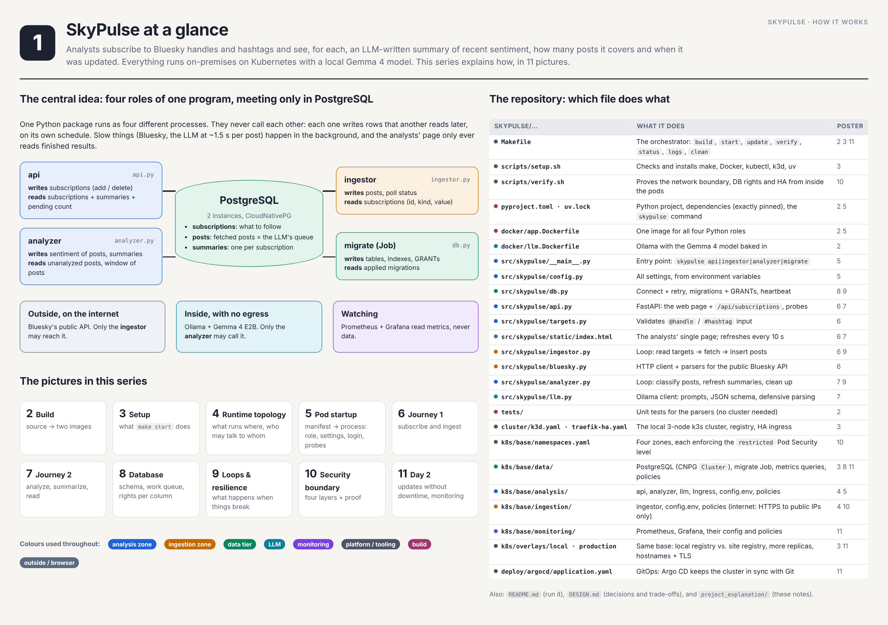
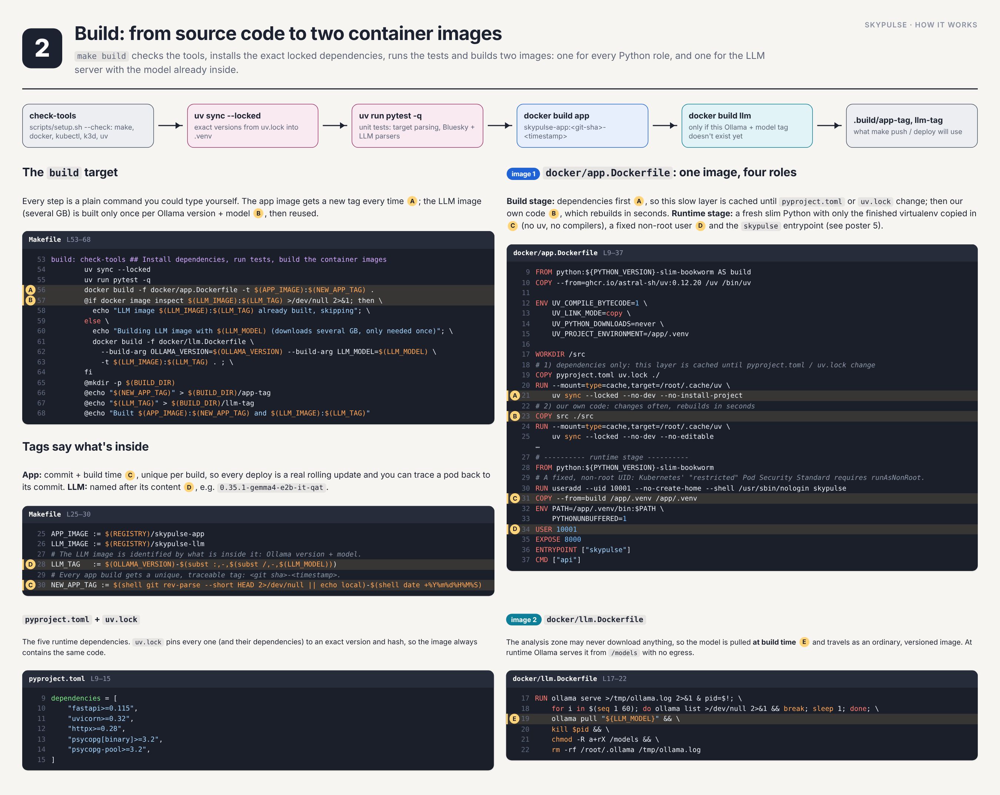
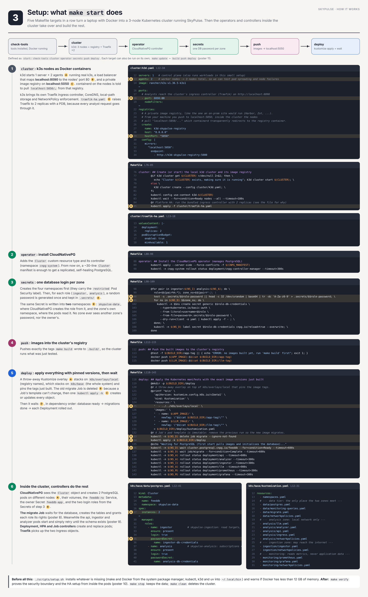
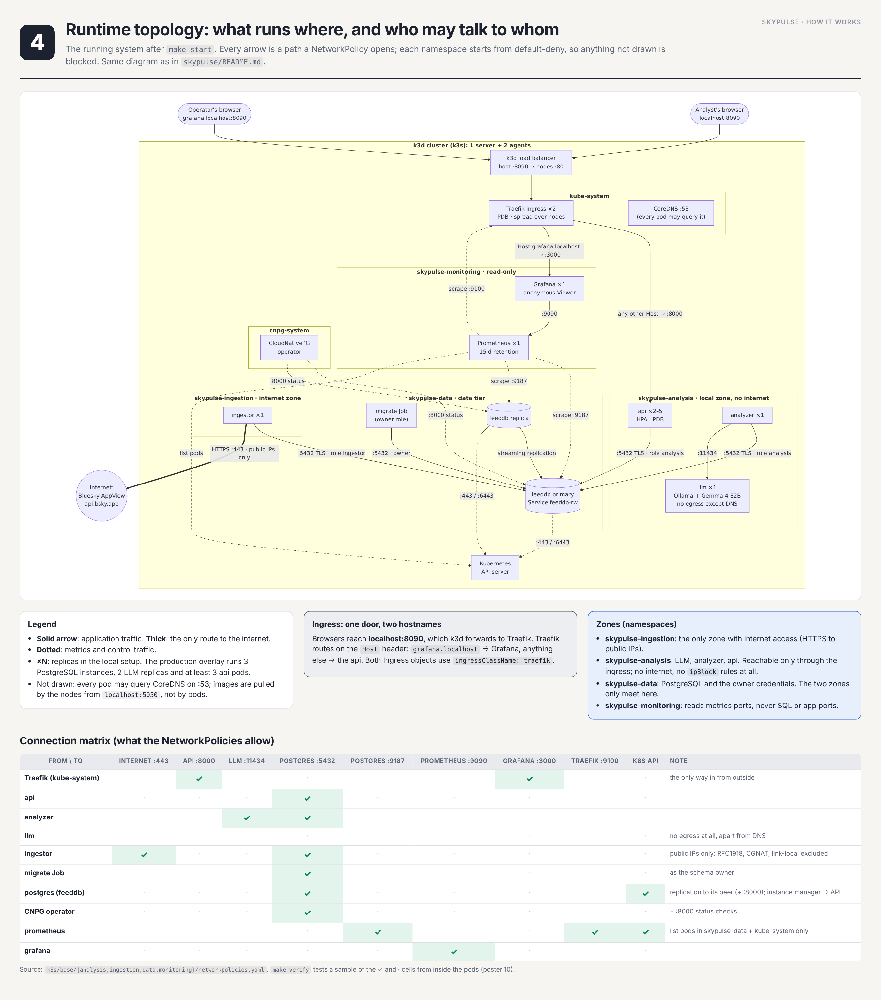
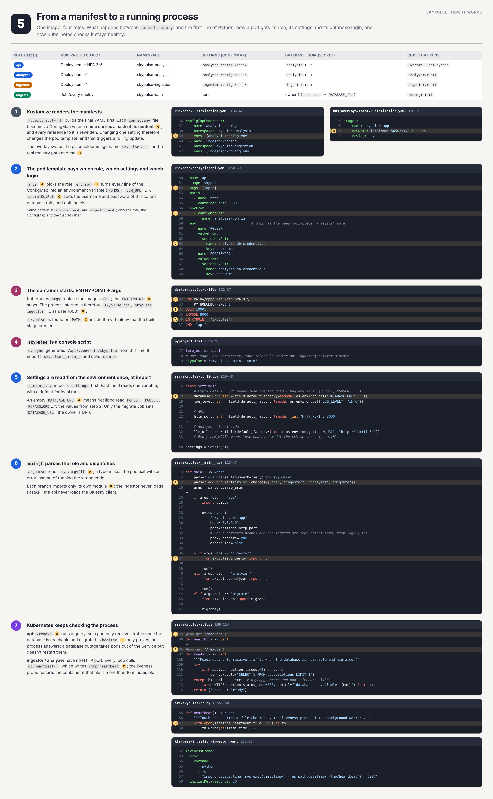
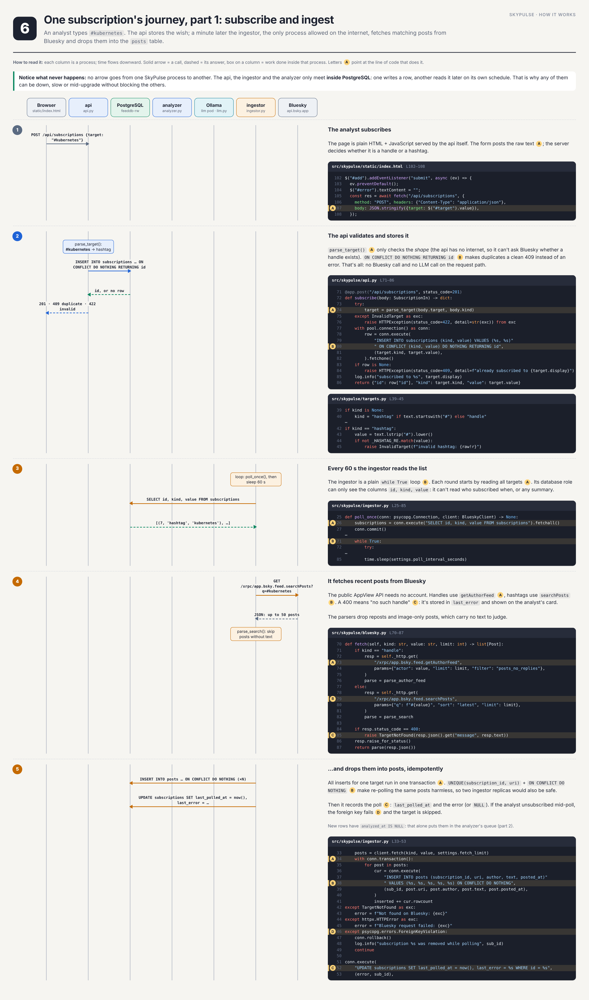
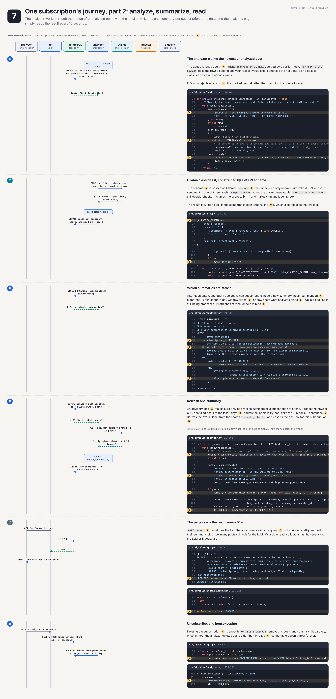
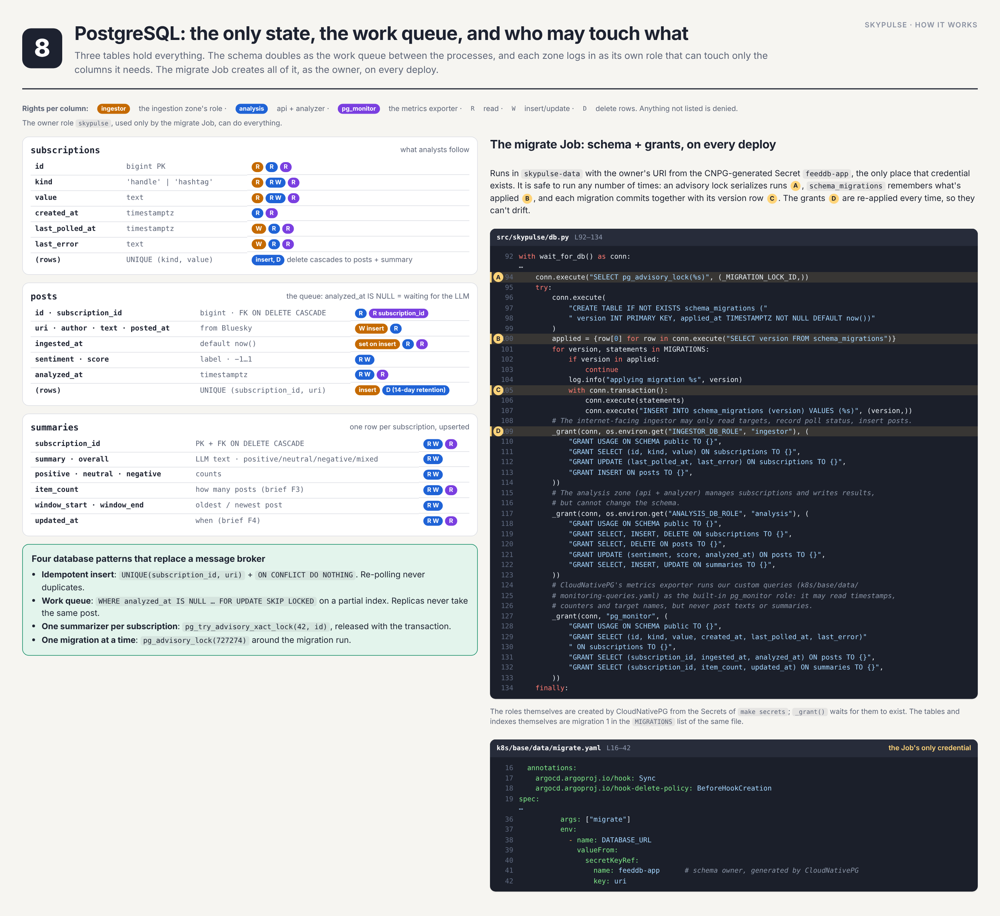
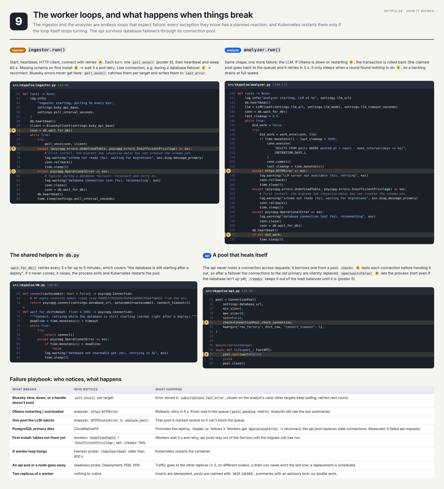
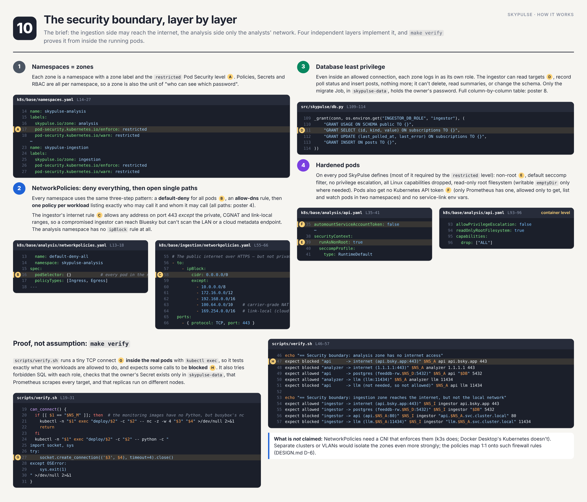
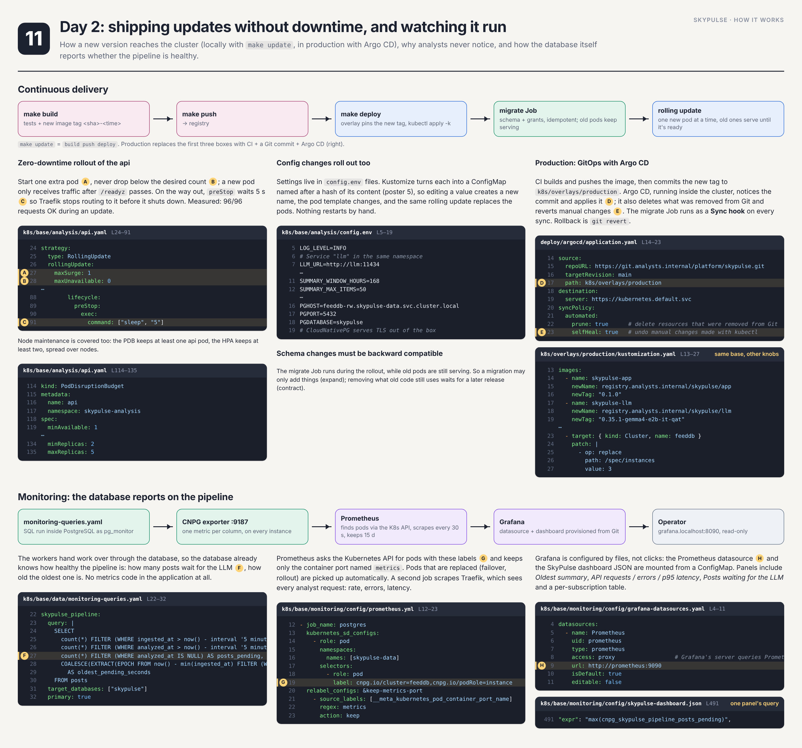
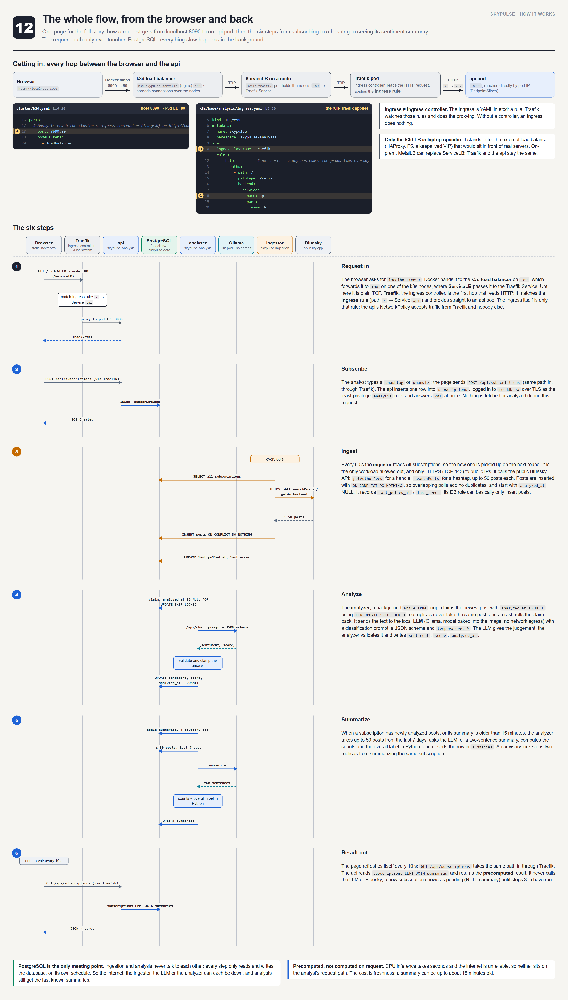
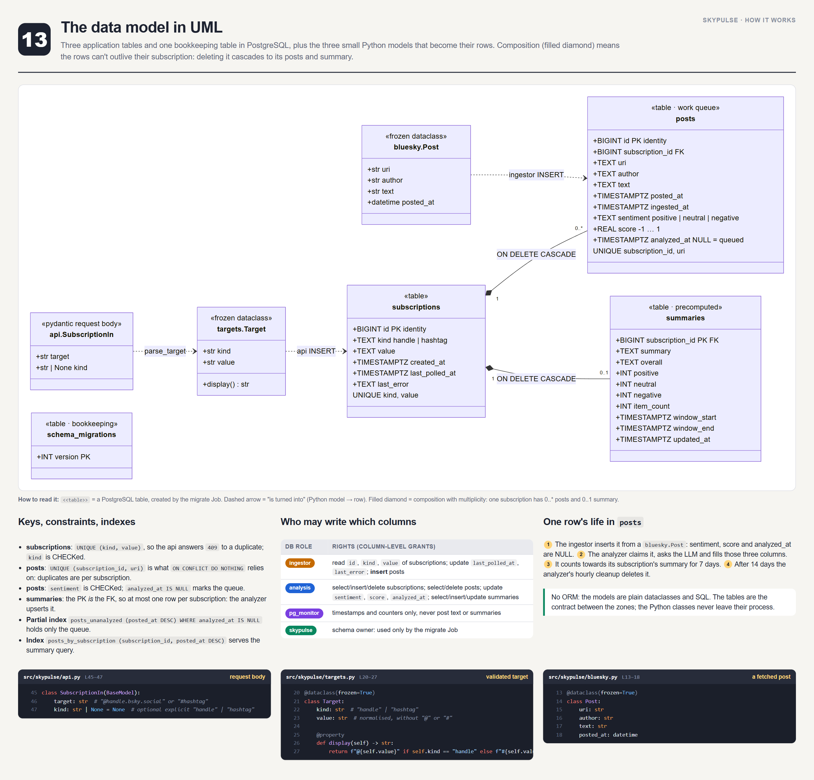

## How they are made (and kept accurate)

The posters are generated by `src/`: each one is a small HTML layout in `src/posters/`, rendered to PNG with headless Chromium. Code snippets are **not copied by hand**: they are read from `skypulse/` at build time, located by anchor text rather than line numbers, and the build fails if an anchor or a marked line disappears. The topology diagram is the mermaid diagram from `skypulse/README.md`. After changing the code, regenerate them:

```bash
cd project_explanation/diagrams/src
npm install
node build.mjs            # all posters
node build.mjs journey    # only the posters whose file name contains "journey"
```

It needs a Chromium; set `CHROME_PATH` if it isn't found automatically. The prose on the posters is written by hand, so re-read the affected poster when behaviour changes.

## Simple diagrams

[`simple/`](simple/) holds 16 lighter, hand-drawn diagrams (one idea each, a few large boxes, Excalidraw-style via Mermaid's `handDrawn` look) used by [`final_summary.md`](../../final_summary.md). Their Mermaid sources are in `src/simple/diagrams.mjs`; regenerate them with:

```bash
cd project_explanation/diagrams/src
node build-simple.mjs            # all of them
node build-simple.mjs journey    # only those whose file name contains "journey"
```
