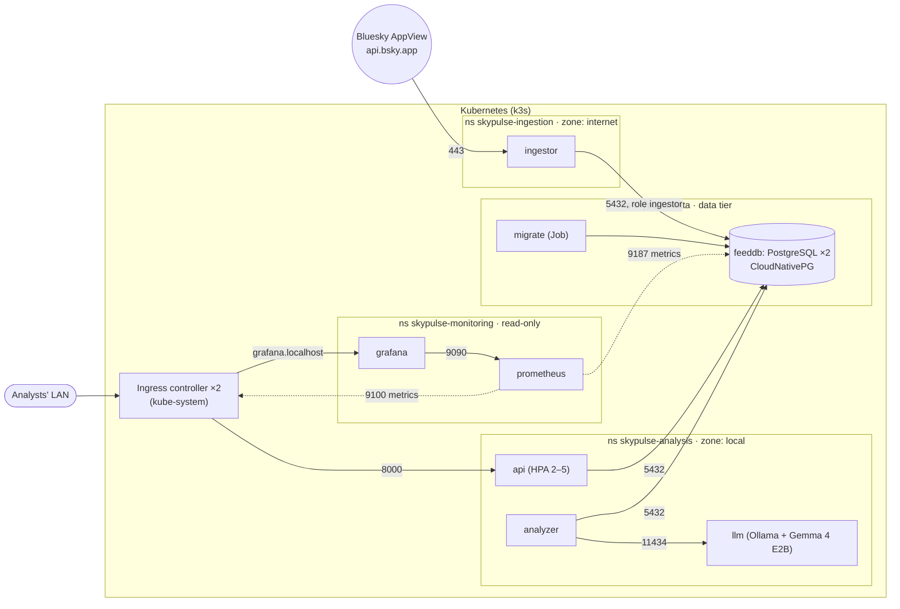

# SkyPulse: design document

This document explains the key decisions for the stack and the software, the alternatives considered, and what's left open.

## 1. Goals and constraints

| # | Requirement | Type |
|---|---|---|
| F1 | Subscribe/unsubscribe Bluesky handles and hashtags | Functional |
| F2 | Summary of recent sentiment per subscription | Functional |
| F3 | Number of items the summary covers | Functional |
| F4 | When the summary was last updated | Functional |
| F5 | Sentiment via a small, local LLM (the brief suggests Gemma 4 A2B; see D-5 for the model used) | Functional |
| S1 | Feed ingestion may connect to the internet | Security |
| S2 | The analysis application may only access the analysts' local network | Security |
| D1 | Highly available to analysts | Deployment |
| D2 | Able to receive continuous software updates | Deployment |
| T1 | Kubernetes, Python/uv 3.12+, `make build` / `make start`, on-prem deployable | Technical |

## 2. Architecture

| Component | Kind | Responsibility |
|---|---|---|
| **api** | Deployment (2–5, HPA) | Web UI + JSON API: manage subscriptions, read summaries. Never calls the LLM or the internet. |
| **ingestor** | Deployment (1) | Polls Bluesky every 60 s for each subscription; inserts new posts idempotently; records poll errors. |
| **analyzer** | Deployment (1, scalable) | Classifies each new post with the LLM; maintains one summary per subscription. |
| **llm** | Deployment (1; 2 in production) | Ollama serving Gemma 4 E2B (QAT, 4-bit) from a model baked into the image. |
| **feeddb** | CloudNativePG `Cluster` (2; 3 in production), namespace `skypulse-data` | The only state: subscriptions, posts, summaries. |
| **migrate** | Job, namespace `skypulse-data` | Schema migrations + per-role GRANTs on every deploy, with the owner's credentials. |
| **prometheus** | Deployment (1), namespace `skypulse-monitoring` | Scrapes metrics every 30 s from the database and the ingress controller; keeps 15 days. |
| **grafana** | Deployment (1), namespace `skypulse-monitoring` | The SkyPulse dashboard, provisioned from files in Git; read-only. |

**Data model.** `subscriptions(kind, value, last_polled_at, last_error)`, `posts(subscription_id, uri, text, posted_at, sentiment, score, analyzed_at)` with `UNIQUE(subscription_id, uri)`, `summaries(subscription_id, summary, overall, positive, neutral, negative, item_count, window_start, window_end, updated_at)`.

**"Recent sentiment" definition.** The newest ≤ 50 analyzed posts from the last 7 days (both configurable). The summary shows an overall label (positive / neutral / negative / mixed, derived from the mean and spread of per-post scores), the label distribution, a ≤ 2-sentence LLM summary of what drives the sentiment, `item_count` (F3) and `updated_at` (F4). Summaries refresh when newly analyzed posts arrive (debounced to ≥ 60 s while a backlog is processed) and at least every 15 min so the window slides.

## 3. Key decisions

### D-1 · Asynchronous pipeline with precomputed summaries
The API only reads rows that the workers precomputed. **Why:** CPU inference takes ~1.5 s per post and the internet is slow and unreliable. Neither belongs on the analyst's request path. This decoupling is also the main HA lever: the LLM, the ingestor and Bluesky can all be down or mid-upgrade while analysts keep working with the last known summaries. *Alternative:* summarize on request (simpler, but slow and ties API availability to the LLM).

### D-2 · PostgreSQL as the single state store and work queue
Posts awaiting analysis are rows with `analyzed_at IS NULL`, claimed with `FOR UPDATE SKIP LOCKED`; summaries are guarded by advisory locks. **Why:** one stateful component to make HA, with transactional guarantees and no extra broker. Workers scale horizontally without coordination. *Alternative:* Redis/NATS/Kafka queue: another stateful system to secure and run HA for no benefit at this scale.

### D-3 · PostgreSQL via the CloudNativePG operator
**Why:** declarative HA PostgreSQL (primary + streaming replica on different nodes, automatic failover, a stable `-rw` Service, generated credentials, TLS, managed roles) in ~30 lines. A hand-written StatefulSet would give storage but not failover. *Measured:* deleting the primary → replica promoted, 0 failed API requests.

### D-4 · One Python image, four roles
`skypulse api|ingestor|analyzer|migrate` from one uv-managed package. **Why:** one build, one version and one vulnerability surface; roles can't drift apart. Multi-stage Dockerfile: `uv sync --locked` into a venv, copied into a slim, non-root runtime (~58 MB).

### D-5 · Ollama with the model baked into the image
**Why:** S2 forbids the analysis zone from downloading anything at runtime, and on-prem sites may be air-gapped. Shipping weights as an image makes the model a versioned, scannable, promotable artifact; the LLM pod has **no egress at all**. The image tag encodes its content (`<ollama>-<model>`), so it's rebuilt only when that changes. Structured output (a JSON schema in Ollama's `format`) constrains the classifier to valid JSON. **Model:** `gemma4:e2b-it-qat`, Gemma 4 E2B in its QAT 4-bit variant (4.3 GB vs 7.5 GB for the default tag, quality preserved by quantization-aware training). The brief suggests Gemma 4 A2B; E2B QAT was chosen because it runs on a laptop CPU in about 5 GB of RAM, and the model is a build argument, so swapping it needs no code change. Any Ollama model works: `make build LLM_MODEL=…`. *Alternatives:* vLLM or llama.cpp server (vLLM is better for GPUs and throughput; Ollama is simplest on CPUs); a PVC filled by a download Job (would need an internet hole in the analysis zone).

### D-6 · Security boundary = namespaces + default-deny NetworkPolicies + least privilege
- Two namespaces, one per zone, plus a **`skypulse-data` namespace** for PostgreSQL and its migrate Job (see D-10) and a **`skypulse-monitoring` namespace** (see D-11). All four enforce the **`restricted` Pod Security Standard**; all pods are non-root with read-only root filesystems, dropped capabilities, seccomp and no service links. Only Prometheus gets a service-account token, because it discovers pods through the Kubernetes API.
- **Analysis zone**: default deny; only the arrows in the diagram are allowed; **no egress to the internet** and no `ipBlock` rules at all.
- **Data tier**: default deny; PostgreSQL accepts 5432 only from the ingestor, the api, the analyzer and its migrate Job (plus replication and the operator), and may reach the Kubernetes API server (a private address) for CNPG's instance manager. No internet.
- **Monitoring namespace**: default deny; Prometheus may reach only the database's metrics port (9187, not SQL), the ingress controller's metrics port (9100) and the Kubernetes API (to discover pods, with a Role that can only list pods in `skypulse-data` and `kube-system`). Grafana only talks to Prometheus. No internet, and the application zones can't reach it.
- **Ingestion zone**: default deny; egress to **public** IPs on 443 only (RFC1918, CGNAT and link-local ranges are excluded, so a compromised ingestor can't scan the LAN), plus PostgreSQL :5432. Nothing may connect to it.
- **Database least privilege**: one role per zone. The ingestor logs in as `ingestor` with `SELECT(id, kind, value)` and `UPDATE(last_polled_at, last_error)` on `subscriptions` and `INSERT` on `posts`, and nothing else. The api and analyzer log in as `analysis`: they can manage subscriptions and write results, but can't change the schema. Only the migrate Job uses the owner.
- **Verified, not assumed**: `make verify` runs connection, permission and secret-placement tests from inside the pods, including the monitoring paths.

*Why not separate clusters or VLANs for the two zones?* That's stronger isolation, and a reasonable production choice for high-assurance sites. The NetworkPolicy design maps 1:1 to it (the ingestor would write through a single firewall opening to the database). For one-evening scope, one cluster with enforced policies gives most of the benefit.

### D-7 · High availability on the analysts' critical path
Ingress (2 replicas, PDB, spread) → api (HPA min 2, topology spread, PDB, readiness gate on DB, `preStop`, `maxUnavailable: 0`) → PostgreSQL (2 instances, required anti-affinity, auto-failover). The API's connection pool validates connections, so failovers heal transparently. *Found by testing:* k3s's bundled Traefik runs one replica, which caused a ~16 s outage in a node-drain drill; fixed with `cluster/traefik-ha.yaml` (afterwards 59/59 requests OK).

### D-8 · Continuous delivery
- **Immutable tags** (`<git-sha>-<timestamp>`); a generated Kustomize overlay pins them, so every deploy is a real rolling update.
- Rolling updates with `maxSurge: 1, maxUnavailable: 0` + readiness probes; migrations run as a Job in the data namespace before the rollout is awaited (idempotent, advisory-locked; the API's readiness probe waits for the schema) and must be backward compatible (expand → contract). *Measured:* full update, 96/96 requests OK.
- Config via hashed ConfigMaps (`configMapGenerator`), so config changes roll out automatically.
- Production path: CI pushes to the site registry and commits the tag to `k8s/overlays/production`; **Argo CD** (`deploy/argocd/application.yaml`) syncs it. Pull-based GitOps suits on-prem and air-gapped sites (no inbound access to the cluster needed).

### D-9 · k3s (k3d locally)
**Why:** a CNCF-conformant, lightweight distribution widely used on-prem and at the edge, with batteries included (ingress controller, ServiceLB, local-path storage, metrics-server, **NetworkPolicy enforcement**). k3d runs the same k3s as Docker containers: a 3-node cluster with a private registry in under a minute, so local testing matches production.

**One control plane locally, three in production.** A single server is a single point of failure for the control plane: if it dies, running pods keep serving, but nothing is rescheduled, Service endpoints stop updating, CNPG can't fail over (it works through the API) and `kubectl`/`make update` stop working. Locally that is accepted on purpose: every "node" is a container on the same machine, behind one k3d load-balancer container, so the laptop is the real single point of failure and three servers would only add memory (the LLM already needs ~12 GB) without adding availability. The 2 agents are there to test what does matter locally: pod spreading, PodDisruptionBudgets and node drains. Production runs 3 servers with embedded etcd (quorum survives one loss) behind an API VIP (see §4). *Alternatives:* kind (needs a CNI that enforces policies, an ingress controller and registry wiring); Docker Desktop's built-in Kubernetes (doesn't enforce NetworkPolicies, so S2 couldn't be demonstrated).

### D-10 · The database in its own namespace
PostgreSQL, its migrate Job and the schema owner's Secret (`feeddb-app`) live in `skypulse-data`; the two zones each get their own login role and Secret. **Why:** network reachability barely changes (NetworkPolicies already limited the ingestor to port 5432 on the database), but:
- the owner credentials, the database pods and future backups are out of reach of anyone with rights in the application namespaces;
- the analysis namespace's policies contain no `ipBlock` rules, which makes "no internet" trivial to audit;
- app namespaces can be redeployed or deleted without touching the data, and the data tier can have its own owners, quotas and backup policy;
- the zones meet only at the data tier: a conventional, reviewable web / app / data split.

*Cost:* each zone's role password is created in two namespaces (Secrets can't cross namespaces), and migrations moved from an API init container to a Job (`make deploy` re-creates it, since a Job's template is immutable; Argo CD uses a Sync hook).

### D-11 · Observability: metrics first, from the database and the ingress, with no application changes
Phase 1 is **Prometheus + Grafana** in a `skypulse-monitoring` namespace. It measures the signals analysts actually notice, without a single line of instrumentation code:

| Question | Metric | Source |
|---|---|---|
| Are summaries fresh? | age of each summary | SQL query, run by CloudNativePG's exporter |
| Is the LLM keeping up? | posts waiting, age of the oldest one, ingested vs analyzed per 5 min | SQL query |
| Is Bluesky polling working? | failing subscriptions, time since last poll | SQL query |
| Is the web app OK for analysts? | requests/s, 5xx share, p50/p95 latency | ingress controller (Traefik's built-in `/metrics`) |
| Is the database healthy? | instances up, primary/replica, replication lag, connections, size | CloudNativePG's built-in exporter |

**Why from the database?** The pipeline hands work over through PostgreSQL (D-1, D-2), so the database already *is* the state of the system: a backlog is a count of rows with `analyzed_at IS NULL`, freshness is `now() - summaries.updated_at`. CloudNativePG runs an exporter in every instance anyway and turns SQL queries into metrics (`k8s/base/data/monitoring-queries.yaml`). That needs no new Python dependency and no new port or network path in the application zones, and the numbers can't drift from what analysts see. The queries run on the primary only, as PostgreSQL's built-in `pg_monitor` role, which the migrate Job lets read exactly the columns they use. It can read timestamps, counters and target names, but never post texts or summaries.

**Why the ingress for API metrics?** Every analyst request goes through Traefik, which k3s ships with Prometheus metrics enabled. That measures latency and errors where analysts experience them, without instrumenting the API.

**Why plain manifests?** Two Deployments, a ConfigMap of scrape targets and a provisioned dashboard (`k8s/base/monitoring/`) are short enough to read in one sitting. They need no operator, no CRDs and no Helm, and they deploy and roll back with the rest of the system (Kustomize, Argo CD). Grafana is stateless: its data source and the dashboard are files in Git, and dashboard changes go through Git like code.

*Alternatives considered:*
- **Prometheus alone** (its built-in UI). Simplest, but too basic for a shared dashboard.
- **An all-in-one Grafana + Prometheus + Loki + Tempo container with OpenTelemetry in the app.** The cheapest way to also get **tracing**, but it needs SDK code in all four roles, a push path out of every zone, and an image meant for demos. Tracing also pays off less here than usual: the services hand work over through the database instead of calling each other, so traces would mostly show the steps inside one process. Metrics already show *that* the LLM is slow on average.
- **kube-prometheus-stack** (Helm). The production standard, with cluster dashboards and alert rules, but about 7 components plus CRDs and 1–2 GB of RAM on a laptop that already runs a 4 GB LLM. It remains the production path (§4).

*Trade-offs accepted:* one replica each (losing monitoring never affects analysts, only a few minutes of graphs), and Prometheus's volume is node-local, so during a node drain it waits for that node to return; 15 days of retention on a 2 Gi volume; no alert notifications yet; no pod-level CPU/memory/restart metrics (`kubectl top` and `make status` cover them for now); Grafana is anonymous and read-only (fine on a laptop; production puts it behind SSO).

**Next phases**, each useful on its own:
1. **Logs:** Loki + Grafana Alloy, which reads container logs from each node, so there are again no app changes. Alloy needs to read node files, so the monitoring namespace will need a looser Pod Security level than `restricted`; that should be the only exception.
2. **Alerts:** Prometheus rules for summaries older than 30 min, a backlog that only grows, failing polls, API 5xx and database instances down, sent to the site's channel through Alertmanager.
3. **App metrics, then tracing, only if needed:** `prometheus-client` in the analyzer and ingestor for per-call LLM latency and Bluesky status codes (about 20 lines), and OpenTelemetry if per-request breakdowns become necessary.

## 4. Production deployment (on-prem)

| Concern | Local (this repo) | Production |
|---|---|---|
| Cluster | k3d, 1 server + 2 agents | k3s or RKE2, 3 servers (embedded etcd) + workers, API VIP (kube-vip) |
| Analyst access | `localhost:8090` | MetalLB IP on the analysts' VLAN only, hostname + TLS (cert-manager, internal CA) |
| Images | k3d registry | Harbor (scan, sign, replicate), signature verification at admission |
| Storage | local-path | Longhorn/Ceph, or local NVMe + 3 CNPG instances |
| Secrets | `make secrets` | External Secrets (Vault) or Sealed Secrets |
| DB backups | none | CNPG `ScheduledBackup` → MinIO/S3 with PITR, restore drills |
| Observability | Prometheus + Grafana (1 replica each), SkyPulse dashboard at `grafana.localhost:8090`; logs via `kubectl logs` | The site's shared monitoring (or kube-prometheus-stack) scraping the same targets and reusing the dashboard; HA Prometheus, Alertmanager to the site's channel, Grafana behind SSO, Loki for logs |
| Delivery | `make update` | CI + Argo CD (`k8s/overlays/production`) |

## 5. Open items and known limitations

Recorded as the brief asks:

1. **No authentication/authorization for analysts.** Add OIDC (e.g. oauth2-proxy in front of the ingress with the site's IdP).
2. **No database backups configured** (only replication). Add a CNPG `backup` section + `ScheduledBackup` to on-site object storage.
3. **DNS is a theoretical side channel**: pods in the analysis zone can *resolve* external names via CoreDNS, though they can't connect. Restrict CoreDNS forwarding, or use DNS-aware policies (Cilium `toFQDNs`), for strict air-gaps.
4. **Single-cluster zones.** For higher assurance, run ingestion in a separate cluster or DMZ and expose only the DB port through a firewall.
5. **LLM throughput on CPU** (~1.5 s/post). Fine for curated sources. For heavy hashtags, add LLM replicas/GPUs, batch classification, or sample posts.
6. **LLM image size** (~7 GB compressed, mostly Ollama's GPU libraries). A CPU-only multi-stage image would roughly halve it.
7. **Polling** (60 s) rather than streaming. Bluesky Jetstream (websocket) would be more efficient for many hashtags.
8. **Metrics and dashboards, but no alerting or central logs yet** (D-11): Phase 2 adds Loki + Alloy for logs, then alert rules and Alertmanager. Monitoring runs as a single replica, and Grafana allows anonymous read-only access; production needs SSO in front of it.
9. **Sentiment quality** isn't evaluated against a labelled set. Add an offline evaluation before trusting it for decisions.
10. **Local storage** (`local-path`) means a drained node's DB replica waits for that node. Production should use 3 instances and/or replicated storage.

## 6. Key numbers

| | |
|---|---|
| App image | ~58 MB compressed, non-root |
| LLM image | ~7.4 GB compressed (Gemma 4 E2B QAT ≈ 4.3 GB + Ollama) |
| Classification latency (CPU, 12 cores) | ~1.5 s/post |
| Fresh `make build && make start` (images cached) | ~6.5 min |
| Requests failed during rolling update / DB failover / node drain | 0 / 0 / 0 |
| Monitoring footprint (Prometheus + Grafana) | ~70 MiB + ~350 MiB RAM, ~20 m CPU |
