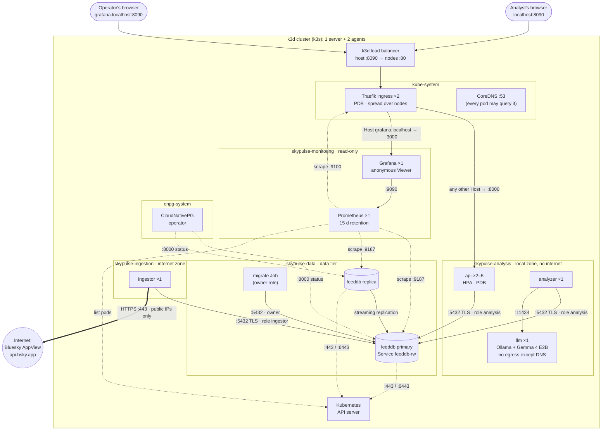

# SkyPulse: on-premises feed analysis

SkyPulse lets analysts subscribe to **Bluesky handles and hashtags** and see, for each subscription, an **LLM-generated summary of recent sentiment**, **how many posts** it covers and **when** it was last updated. Everything runs on-premises on Kubernetes, with a local **Gemma 4** model served by Ollama.

- Design decisions and trade-offs: **[DESIGN.md](DESIGN.md)**



Every arrow is a path opened by a NetworkPolicy (`k8s/base/*/networkpolicies.yaml`); each namespace starts from default-deny, so anything not drawn is blocked. Solid arrows carry application traffic, the thick one is the only route to the internet, and dotted ones are metrics and control traffic. Not drawn: every pod may also query CoreDNS on :53, and images are pulled by the nodes from the k3d registry (`localhost:5050`), not by pods. The production overlay changes the counts (3 PostgreSQL instances, 2 LLM replicas, api minimum 3) and the hostnames.

## Prerequisites

| Tool | Version tested | Install |
|---|---|---|
| Docker (Desktop or Engine) | 29.x | <https://docs.docker.com/get-docker/>. Give it **≥ 12 GB RAM** (≥ 6 GB with the small model) |
| kubectl | 1.36 | <https://kubernetes.io/docs/tasks/tools/> |
| k3d | 5.9 | <https://k3d.io> (`curl -s https://raw.githubusercontent.com/k3d-io/k3d/main/install.sh \| bash`) |
| uv | 0.12 | <https://docs.astral.sh/uv/> (installs Python 3.12 automatically) |
| make, bash | any | Linux/macOS: built in or via package manager |

Also needed: internet access during build/start (base images, the model, the CloudNativePG manifest), ~25 GB free disk, and free host ports **8090** (web) and **5050** (registry).

You don't need to install these by hand. The setup script checks each one, installs whatever is missing and starts Docker if needed:

```bash
./scripts/setup.sh            # Linux (apt/dnf/pacman/zypper), macOS (Homebrew), WSL2
./scripts/setup.sh --check    # only check; this is what `make check-tools` runs
```

kubectl, k3d and uv go into `~/.local/bin` without sudo. make and Docker come from the system package manager. The script also warns if Docker has less than 12 GB of memory.

## Build and run

```bash
make build    # uv sync --locked, unit tests, build the app image and the LLM image (first time: ~10 GB download)
make start    # create a 3-node k3s cluster + registry, install the Postgres operator, deploy, wait until ready
```

Open **<http://localhost:8090>**, subscribe to e.g. `#kubernetes` or `@bsky.app`, and within a minute or two the first summary appears.

Dashboards are at **<http://grafana.localhost:8090>** (see [Monitoring](#monitoring)).

> **Lower-memory machines:** `make build LLM_MODEL=gemma3:1b` uses a ~1 GB model instead of Gemma 4 E2B (~5 GB RAM). The analyzer auto-detects the model in the image. Pass the same `LLM_MODEL=…` to later `make build`/`make update` runs.

### API

```bash
curl -X POST localhost:8090/api/subscriptions -H 'Content-Type: application/json' -d '{"target":"#kubernetes"}'
curl -X POST localhost:8090/api/subscriptions -H 'Content-Type: application/json' -d '{"target":"@bsky.app"}'
curl -s localhost:8090/api/subscriptions          # summary, overall, positive/neutral/negative, item_count, summary_updated_at, pending, last_error
curl -X DELETE localhost:8090/api/subscriptions/1
```

## Monitoring

`make start` also deploys **Prometheus** (collects metrics every 30 s, keeps 15 days) and **Grafana** (dashboards) in the `skypulse-monitoring` namespace. Open **<http://grafana.localhost:8090>**: the **SkyPulse** dashboard is the home page, read-only, no login.

| Section | Shows | Worry when |
|---|---|---|
| Is SkyPulse healthy for analysts? | Oldest summary, API requests/s, 5xx share, p95 latency, failing subscriptions, database instances up | Any tile turns orange or red |
| Pipeline | Posts ingested vs analyzed per 5 min, posts waiting for the LLM, oldest waiting post | The backlog only ever grows |
| Subscriptions | Per target: summary age, posts covered, posts waiting, last poll, polling OK/failing | A summary older than 30 min, or polling "Failing" |
| API | Requests by status code, p50/p95 latency | 5xx responses, latency climbing |
| Database | Primary/replica, replication lag, connections, size | An instance missing, lag growing |

The application itself has **no monitoring code**. The numbers come from two places that already exist:
- **PostgreSQL:** CloudNativePG's built-in exporter runs a few SQL queries ([`k8s/base/data/monitoring-queries.yaml`](k8s/base/data/monitoring-queries.yaml)): the pipeline hands work over through the database, so it knows the backlog and how fresh every summary is.
- **The ingress controller:** Traefik counts every analyst request (rate, status codes, latency).

The dashboard is a file in Git ([`k8s/base/monitoring/config/skypulse-dashboard.json`](k8s/base/monitoring/config/skypulse-dashboard.json)): change it there and `make deploy`. Not included yet: alert notifications and central logs (`make logs` still works). The reasoning and next steps are in [DESIGN.md, D-11](DESIGN.md#d-11--observability-metrics-first-from-the-database-and-the-ingress-with-no-application-changes).

## Day-2 commands

| Command | What it does |
|---|---|
| `make update` | Continuous delivery: rebuild + test, push a new uniquely-tagged image, zero-downtime rolling update |
| `make verify` | Proves the security boundary (connection tests run inside the pods), the monitoring paths and the HA placement |
| `make status` | Nodes, pods, services, policies, HPA, PDB, database cluster, monitoring |
| `make logs` | Follow logs of all components |
| `make test` | Unit tests |
| `make stop` / `make clean` | Pause the cluster / delete cluster, registry and data |
| `make help` | Everything else (`cluster`, `operator`, `secrets`, `push`, `deploy` individually) |

## Verified behaviour

Measured on the local 3-node cluster with a request loop running against the API:

| Scenario | Result |
|---|---|
| Fresh `make clean build start` | 6.5 min, 0 pod restarts |
| `make verify` | 20/20 checks pass (analysis zone: no internet; ingestion zone: internet but not LAN; per-zone DB least privilege; owner credentials only in the data namespace; Prometheus reaches only metrics ports and scrapes every target; HA placement) |
| Rolling update of all components (`make update`) | 96/96 requests OK |
| Delete the PostgreSQL primary | automatic failover, 114/114 requests OK |
| Drain a node | 59/59 requests OK |

## Repository layout

```text
skypulse/
├── Makefile                 # build / start / update / verify …
├── pyproject.toml, uv.lock  # Python 3.12 project managed by uv
├── src/skypulse/            # one package, four roles: api | ingestor | analyzer | migrate
├── tests/                   # unit tests (pytest)
├── docker/
│   ├── app.Dockerfile       # multi-stage uv build, non-root runtime
│   └── llm.Dockerfile       # Ollama with the model baked in (no runtime downloads)
├── cluster/
│   ├── k3d.yaml             # local 3-node k3s cluster + private registry
│   └── traefik-ha.yaml      # makes the bundled ingress controller highly available
├── k8s/
│   ├── base/                # analysis/, ingestion/ and data/ zones: workloads, Postgres, migrations, policies
│   │   └── monitoring/      # Prometheus + Grafana, scrape config and the SkyPulse dashboard (config/)
│   └── overlays/            # local (k3d registry) and production (example on-prem settings)
├── deploy/argocd/           # GitOps Application for production
└── scripts/verify.sh        # security-boundary and HA checks
```

## Troubleshooting

| Problem | Fix |
|---|---|
| `make build` fails with `failed to fetch oauth token ... 401 Unauthorized` | Docker is sending a stale Docker Hub login (public images need none). `docker logout`; with Docker Desktop also sign out (or in again) in the app. `./scripts/setup.sh` detects this |
| `port is already allocated` on cluster create | Free port 8090/5050. To use other ports, change them in `cluster/k3d.yaml`; for the registry port also update `REGISTRY` in the Makefile and `k8s/overlays/local/kustomization.yaml` |
| `llm` pod `Pending` with *Insufficient memory* | Give Docker more memory, or rebuild with `LLM_MODEL=gemma3:1b` |
| Summaries stay "Waiting for the first analysis…" | `kubectl -n skypulse-analysis logs deploy/analyzer`; first model load takes ~30 s; CPU inference is ~1–2 s per post |
| A handle shows "Not found on Bluesky" | Check the spelling, e.g. `@name.bsky.social` |
| `grafana.localhost` doesn't open | Some tools don't resolve `*.localhost`. Use `kubectl -n skypulse-monitoring port-forward svc/grafana 3000:80` and open <http://localhost:3000> |
| A dashboard panel says "No data" | Wait a minute after deploying (scrapes run every 30 s; rates need two). API panels need some traffic. Database panels: `kubectl -n skypulse-data logs feeddb-1 \| grep 'Error collecting user query'` shows failing SQL queries |
| Anything else | `make status`, then `kubectl -n <namespace> describe pod <pod>` (events) and `kubectl -n <namespace> logs <pod> --previous` (why it crashed) |
